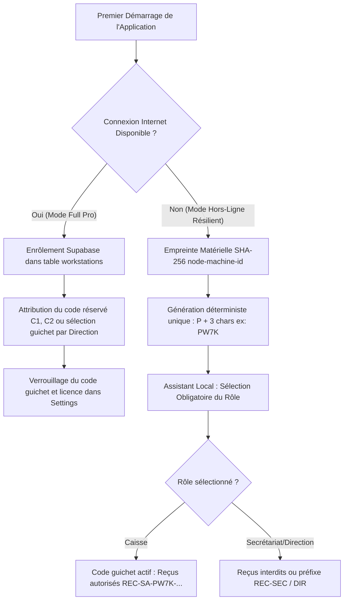
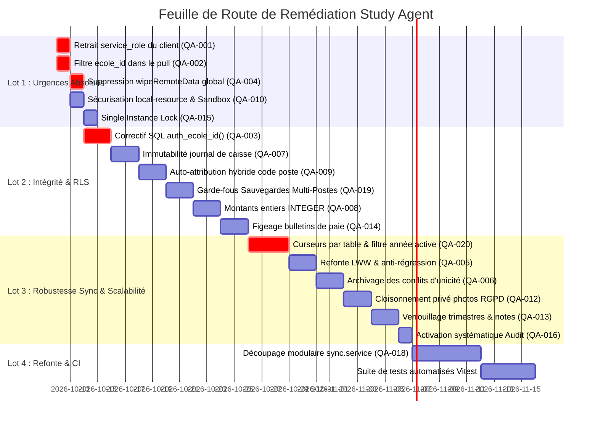

# RAPPORT MAÎTRE CONSOLIDÉ — Audit technique, architecture et QA de Study Agent (v2.3.8)

**Date :** 11 octobre 2026 — **version 3** (mise à jour après les contrôles du Lot 0, les réponses du propriétaire et les vérifications complémentaires de V1)
**Statut :** document de référence unique pour l'agent d'implémentation. Il remplace la lecture séparée des deux audits.
**Sources fusionnées**
- **AG** : audit d'Antigravity (accès au dépôt local et à Supabase, commandes exécutées, fichier `docs/audit_technique_et_qa_complet.md`). Son texte est repris **sans coupe**, aux seules rectifications près, toutes tracées en section 2.
- **Retours Lot 0 d'AG** (commandes exécutées sur le projet Supabase et sur le dépôt) et **vérifications complémentaires de V1** (test de `supabase-js`, sources externes sur Supabase, la loi n° 2014-038 et le support d'Electron).
- **V1** : audit statique de Claude (archive `study-agent.zip`, 320 fichiers, deux vérifications exécutées en bac à sable, 30 constats et 14 scénarios).

**Légende des preuves** (à lire à chaque fiche)
- **[LIVE]** vérifié sur Supabase (projet testé, tenant `ecole_dev`).
- **[TEST]** vérifié par exécution locale (bac à sable).
- **[CODE]** lu dans le code, avec `fichier:ligne`.
- **[HYPOTHÈSE]** déduit, non prouvé. À confirmer avant de s'appuyer dessus.

**Règles de consolidation**
1. Aucun contenu n'est supprimé. Une erreur reconnue est corrigée en place ou par un bloc « Rectification », et listée en section 2.
2. Un constat = un identifiant. `QA-001` à `QA-020` gardent la numérotation d'AG (déjà communiquée à l'agent). `QA-021` et suivants sont les apports de V1. La section 3 donne la correspondance avec les anciens numéros V1.
3. En cas de désaccord de gravité, on retient la plus haute **jusqu'à preuve contraire**. Une rectification de gravité n'est faite que si elle est motivée par une preuve (section 2).
4. Les preuves [LIVE] ne valent **que pour le projet Supabase testé**. L'état des projets de production des écoles reste à vérifier (section 12).

**Ordre de lecture pour l'agent :** section 2 (rectifications), section 10 (plan), puis les fiches de la section 8 dans l'ordre du plan. Les sections 5 à 7 expliquent les choix d'architecture.

---

## 1. Résumé exécutif consolidé

**État global.** Application métier solide (RBAC, transactions locales paiement + caisse, file d'envoi dédoublonnée) mais dont l'isolation multi-tenant, la synchronisation et l'intégrité financière ne tiennent pas dès que deux postes, une horloge fausse, une coupure réseau ou une restauration de sauvegarde entrent en jeu. Les deux audits convergent sur le diagnostic de fond ; ils se complètent plus qu'ils ne se contredisent : AG apporte les **preuves en direct** et l'angle **exploitation terrain**, V1 apporte la **couverture** (curseur de réplication, suppressions, unicités globales, verrou de sync, formats de dates, migrations, scripts SQL).

**Six risques majeurs**
1. **QA-001** — La clé `service_role` et le mot de passe du compte de sync sont copiés dans chaque installateur.
2. **QA-021 + QA-005** — Réplication fondée sur l'horloge des clients : modifications hors ligne perdues ou jamais reçues, sans alerte.
3. **QA-022** — Unicités globales (matricule, nom de matière) et « auto-réparations » sans filtre de tenant.
4. **QA-023 + QA-003** — Lignes financières abandonnées (`skipped`), table `cash_closures` absente du cloud, interface qui annonce « succès ».
5. **QA-007 + QA-009 + QA-008** — Caisse modifiable, reçus non uniques, montants en `REAL`.
6. **QA-020** — Effondrement de la synchro en bas débit (256 kbps) et traitement non transactionnel.

**Maturité consolidée (0 à 5)**

| Domaine | AG | V1 | Consolidé | Motif |
|---|---|---|---|---|
| Isolation multi-tenant | 1,0 | 1 | **1,0** (1,5 sur le projet testé après correctif RLS) | clé admin embarquée, unicités globales, pull sans filtre, RLS à étendre |
| Synchronisation | 1,8 | 1 | **1,5** | curseur sur horloge client, LWW silencieux, auto-heal en partie inopérant |
| Intégrité données et finances | 2,0 | 2 | **2,0** | transactions locales saines, mais registre mutable, `REAL`, reçus, paie non figée |
| Sécurité Electron et environnement | 1,2 | 1 | **1,0** | secrets embarqués, LFI, IPC ouverts, mises à jour non signées |
| Qualité et maintenabilité | 2,5 | 2 | **2,0** | aucun test, monolithe de 2 839 lignes, erreurs avalées, bug SQL vérifié |

**Ce qui a changé depuis les deux audits (état au 11/10/2026).** Le propriétaire a exécuté sur le projet Supabase testé le script SQL de la section 5. Résultat constaté : `Auth: OK` puis `RLS FONCTIONNELLE` avec la clé anon et le compte de sync. La fonction `auth_ecole_id()` est donc corrigée **sur ce projet**. Le reste du plan (clé `service_role`, filtre au pull, unicités, etc.) est **inchangé**. Voir QA-038 pour les contrôles post-application.

**Mise à jour v3.** Faits nouveaux vérifiés : un seul projet Supabase et **aucun client en production** (fenêtre idéale, voir section 10) ; la clé embarquée est bien `service_role` et le mot de passe de sync est celui par défaut ; **aucun trigger** `updated_at` côté serveur ; bucket `school_files` **public** ; `.env` jamais versionné ; Electron 33 en fin de vie. Trois rectifications importantes (section 2.1) : l'explication d'AG sur la RLS est **contredite par un test** (R19), le trigger `updated_at` proposé est **dangereux appliqué seul** (R20), Madagascar **n'est pas dans l'OHADA** (R21). Nouvelles fiches : QA-039 (Electron et dépendances), QA-040 (bail hors ligne), QA-041 (conformité loi 2014-038). Décisions d'architecture : section 13.

### 1.1. Résumé exécutif d'AG (repris intégralement)

*En-tête du rapport d'origine :*

> # RAPPORT D'AUDIT TECHNIQUE, ARCHITECTURAL ET QUALITÉ (QA)
> **Projet** : Study Agent (ERP Scolaire Desktop Offline-First & Multi-Postes Cloud Sync)
> **Version analysée** : v2.3.8
> **Auteur** : Senior QA Engineer & Architecte Technique / Données
> **Date d'audit** : 11 Octobre 2026
> **Statut** : Document de référence pour l'équipe technique et l'agent d'implémentation.

#### 1.1.1. État global du projet
Study Agent est un ERP scolaire desktop développé avec Electron, React, Better-SQLite3 et Supabase. L'application répond à un besoin métier critique : assurer la gestion ininterrompue d'établissements scolaires dans des environnements à forte instabilité électrique et réseau (Madagascar et Afrique francophone), avec un fonctionnement local hors ligne et une synchronisation multi-postes (caisse, secrétariat, direction).

L'audit approfondi du code et les **tests exécutés en direct sur l'instance Supabase** révèlent des **vulnérabilités architecturales critiques** :
1. **La politique RLS Supabase actuelle est bloquante et défaillante** : La fonction `auth_ecole_id()` définie dans Supabase retourne `NULL` pour les utilisateurs authentifiés, ce qui fait échouer tout enregistrement légitime. Pour contourner ce blocage, le code client a été configuré pour utiliser la clé `SUPABASE_SERVICE_ROLE_KEY` qui a été empaquetée dans l'installateur client (`resources/.env`), anéantissant l'isolation multi-tenant.
2. **Fuite inter-écoles au téléchargement (Pull)** : La requête descendante `pullRemoteChanges` ne filtre pas par `ecole_id`. En l'état, une école télécharge les données de toutes les autres écoles clientes de la base cloud.
3. **Perte silencieuse de données hors ligne (Split-Brain)** : L'algorithme Anti-Regression LWW compare des dates locales (`new Date().toISOString()`). En cas d'horloge décalée ou de modifications concurrentes, le système marque les lignes locales comme synchronisées (`status = 'synced'`) tout en refusant de les envoyer au serveur, entraînant la perte invisible des saisies.
4. **Falsification et mutabilité de la caisse financière** : Les écritures du journal de caisse peuvent être modifiées (`UPDATE`) et supprimées même après la clôture journalière (Ticket Z), sans contrepassation obligatoire.
5. **Collision des reçus de caisse** : Le code de caisse local retombe par défaut sur `'C1'` sur tous les postes, créant des numéros de reçus identiques entre deux guichets indépendants.

#### 1.1.2. Grille de maturité (0 à 5)

| Domaine | Note | Appréciation |
| :--- | :---: | :--- |
| **Isolation Multi-Tenant** | **1.0 / 5** | RLS bloquante contournée par `service_role` client, absence de filtre tenant au pull. |
| **Offline-First & Synchronisation** | **1.8 / 5** | Modèle outbox présent mais LWW basé sur dates système fragiles, suppression sauvage des conflits. |
| **Intégrité Données & Finances** | **2.0 / 5** | Flottants IEEE 754 (`REAL`) pour la monnaie, caisse modifiable, paie et notes non verrouillées. |
| **Sécurité & Environnement Electron** | **1.2 / 5** | Clé admin secrète embarquée, protocole local avec faille LFI, handlers superadmin ouverts. |
| **Qualité & Maintenabilité** | **2.5 / 5** | Monolithe de synchronisation de 2 839 lignes sans tests automatisés. |

*Rectifications portant sur ce résumé : R10 et R11 (section 2). La grille de maturité consolidée figure plus haut.*

---

## 2. Rectifications et arbitrages (à lire en premier)

### 2.1. Erreurs d'AG rectifiées (preuve V1)

| # | Affirmation d'AG | Verdict | Preuve | Effet dans ce rapport |
|---|---|---|---|---|
| R1 | QA-004 : `wipeRemoteData` atteignable depuis Paramètres en production, gravité Critique | **Partiellement inexact.** Le bouton existe (`Settings.tsx:195`) mais le handler refuse hors développement. | [CODE] `student.handler.ts:199-205` (`NODE_ENV !== 'development'` → refus) | Gravité ramenée à **Haute** (défense en profondeur : fonction globale sans filtre tenant, bouton mort en production). Redevient **Critique** si la garde saute. Suppression de la fonction maintenue. |
| R2 | QA-005 point 2 et scénario 6 : `reconcilePendingOutbox` marque « toute saisie hors ligne » comme synchronisée sans l'envoyer | **Exagéré.** Seules les lignes `pending` **sans entrée active dans `sync_queue`** sont concernées. | [CODE] `sync.service.ts:1028-1039`, clause `NOT IN` ligne 1037 | Le défaut est réel mais plus étroit. Il est aggravé par une comparaison de **chaînes** entre deux formats de date (voir QA-026). |
| R3 | 3.2 : « Réhydratation complète en 5 minutes » | **Incohérent** avec la section 3.4 du même rapport (≈ 20 min à 256 kbps, **sous réserve de compression**). | calcul AG + V1 | Durée à annoncer : de quelques minutes (haut débit) à plus d'une heure (bas débit non compressé). Voir section 7. |
| R4 | 3.3 : « Garantie mathématique : aucun doublon possible » avec un code poste de 3 caractères hexadécimaux issu de l'empreinte machine | **Inexact.** 4 096 codes possibles : collision improbable mais non nulle ; une image disque clonée partage l'identifiant machine ; une restauration de sauvegarde fait revenir le compteur. | calcul, [CODE] `payment.repository.ts:72-116` | La garantie réelle = `UNIQUE(ecole_id, receipt_number)` + code poste enregistré côté serveur + compteur dérivé des données. Voir QA-009 et section 6. |
| R5 | 3.4 et QA-020 : filtrer le pull régulier avec `.eq('school_year', …)` pour « réduire le trafic de 85 % » | **Faux pour la plupart des tables et pour le trafic courant.** Seules `student_fees`, `grades`, `parent_events` et (par migration 028) `student_payments` portent `school_year`. `cash_journal`, présences, `time_tracking`, `students`, `personnel`, `subjects` n'en ont pas : le filtre ferait échouer le pull de ces tables et bloquerait le curseur. Le pull courant est déjà un delta. | [CODE] `supabase_full_schema.sql`, migrations, `sync.service.ts:2438-2443` | Partitionnement conservé **seulement** comme stratégie de première synchro et de reprise, par classe de tables (section 7). |
| R6 | QA-020 : Worker Thread « obligatoire » ; l'interface React « gèle » | **Prématuré et imprécis.** Le renderer est un processus distinct ; c'est le processus principal (réponses IPC) qui est bloqué. Lots transactionnels + pause entre lots suffisent en première étape. | architecture Electron, [CODE] absence de `busy_timeout`/worker | Worker conservé comme étape **conditionnée à une mesure** (section 7). |
| R7 | Scénario 12 : `isSyncing` protège dans une même fenêtre ; seul le verrou d'instance manque | **Incomplet.** Le verrou en mémoire est lui-même contournable (TOCTOU) et libéré par un autre appel. | [CODE] `sync.service.ts:1305-1323, 1389, 1460` | Ajout de QA-025. QA-015 corrige le multi-processus, pas ce défaut. |
| R8 | Scénario 3 : écritures du pull par « `INSERT OR REPLACE` ou `UPDATE` » | **Imprécis.** Le pull utilise `INSERT` puis `UPDATE` (le `INSERT OR REPLACE` n'est utilisé que par la Deep Convergence). | [CODE] `sync.service.ts:2571-2598, 1189` | Sans effet sur le verdict (le pull reste rejouable) ; texte corrigé. |
| R9 | Scénario 11 : exception « non gérée globalement » | **Nuancé.** Un `uncaughtException` existe : il écrit `crash.log` puis laisse l'application continuer. | [CODE] `index.ts:5-7` | Voir QA-034. |
| R10 | QA-002 et résumé : « une école télécharge les données de toutes les autres » | **Vrai seulement si le client tourne en `service_role`** (avant la première connexion du compte de sync, ou via `getSupabaseAdmin`). Une fois connecté avec le JWT du compte de sync et la RLS corrigée, le serveur filtre. | [CODE] `sync.service.ts:1353-1372` ; [LIVE] rejet RLS avant correctif | Gravité maintenue (le filtre côté client est de la défense en profondeur et couvre le cas `service_role`). |
| R11 | Résumé exécutif : « le code client a été configuré pour utiliser `service_role` pour contourner ce blocage » | **Hypothèse non prouvée.** Après `signInWithPassword`, `supabase-js` utilise le JWT de session. La synchronisation de production n'a pu fonctionner que si les policies réelles de ce projet diffèrent du script, ou si la connexion n'a pas eu lieu. | [CODE] `sync.service.ts:1353-1372` ; [LIVE] limité au projet testé | À trancher en lisant `pg_policies` des projets de production (section 12). |
| R18 | QA-001 : « révoquer et régénérer immédiatement » la clé `service_role` | **Risqué tel quel.** Chaque client déployé crée son client Supabase avec cette clé comme clé d'API (`sync.service.ts:25-26, 54`). Une rotation brutale rend **tous les postes déployés inopérants**. | [CODE] `sync.service.ts:25-26, 31-46, 48-61` | Séquence imposée : publier d'abord une version cliente qui n'utilise que la clé anon, attendre l'adoption, **puis** faire pivoter (QA-001, section 10). **Mise à jour v3 : assoupli, aucun client déployé (section 10).** |
| R19 | Retour AG (Q2) : « après `signInWithPassword`, supabase-js n'écrase pas l'en-tête : toutes les requêtes partent en `service_role`, la RLS n'était jamais évaluée » | **Contredit par un test.** Avec la même version de la bibliothèque (2.95.3) et la même configuration (clé `service_role`, `persistSession:false`), la requête REST envoyée **après** la connexion porte `Authorization: Bearer <JWT utilisateur>` ; seul l'en-tête `apikey` conserve la clé de service. Le rôle PostgREST est donc `authenticated` et la RLS **s'applique**. | [TEST] client contre un faux serveur, requêtes avant et après connexion | **L'énigme R11 n'est pas résolue** : on ne sait pas comment la synchronisation passait avec une RLS fautive (synchro jamais fonctionnelle depuis l'activation des policies ? policies différentes avant ?). Demander à AG la **sortie** de sa commande « Insert result » (non reproduite dans son retour). Ne bâtir aucune décision sur « la RLS était contournée ». L'exposition « pull inter-écoles » ne vaut que dans le repli `service_role` ; QA-002 reste de la défense en profondeur. |
| R20 | Retour AG (Lot 0) : exécuter « avant tout code » le trigger `handle_updated_at()` | **À ne pas appliquer seul.** Il remplace `updated_at` par l'heure serveur à chaque `UPDATE`, alors que la garde du client (`sync.service.ts:1952-1968`) compare cette date à l'**horloge du poste** : un poste en retard de plus d'une seconde sur le serveur verrait ses modifications suivantes refusées puis marquées « synchronisées » (perte silencieuse). Il ne couvre que 10 tables (manquent `personnel_absences`, `salary_advances`, `custom_deductions`, `subjects`, `class_subjects`, `parent_events`, `event_payments`, `bus_attendance`, `canteen_attendance`, `users`, `assessments`, `workstations`), seulement l'`UPDATE` (pas l'`INSERT`), et n'ajoute aucune séquence serveur. | [CODE] `sync.service.ts:1952-1968` ; analyse | À livrer **avec** la réécriture du client (QA-021, QA-005 : plus de comparaison d'horloges, version de base), d'abord sur la préparation (staging). Avec 0 client, la livraison conjointe est possible. |
| R21 | Retour AG (Q6, Q10) : « à Madagascar et dans l'espace OHADA » | **Inexact.** Madagascar n'est pas membre de l'OHADA (seule l'Union des Comores l'est dans l'océan Indien). Référentiel comptable : Plan Comptable Général 2005 (décret n° 2004-272). | [SOURCES] ohada.com ; documentation de localisation comptable MG | Retirer toute référence à l'OHADA. L'exigence de numérotation continue des reçus n'est **pas vérifiée** dans les sources trouvées : à confirmer avec un expert-comptable (OECFM). En attendant : séries continues sans trou, annulations numérotées, détecteur de trous (section 13). |
| R22 | Retour AG (Q10) : la loi « interdit formellement » la diffusion de données de mineurs « sans chiffrement » | **Non vérifié.** Ce que les sources consultées indiquent : déclaration ou autorisation préalable auprès de la CMIL, restrictions sur les transferts hors du pays, délégué à la protection des données résident. La CMIL est la Commission Malagasy sur l'Informatique et des Libertés. | [SOURCES] DLA Piper, Clym, ConsentStack, presse locale | Les photos publiques restent à corriger (bonne pratique et risque légal) mais on ne cite que ce qui est sourcé (section 13.3). |
| R23 | Retour AG (Q11) : « monter vers Electron 38+ » | **Périmé.** Selon les calendriers publics, Electron 38 est en fin de vie depuis mars 2026 ; en octobre 2026 les lignes supportées sont 42, 43 et 44 ; 42 sort du support le 20/10/2026, date prévue de la sortie de 45. | [SOURCES] endoflife.date, isitpatched.com, endoflife.ai | Cible : la version majeure supportée la plus récente au moment du chantier (44 aujourd'hui, 45 dès le 20/10/2026). |
| R24 | Retour AG (Q9) : « 30 jours maximum hors ligne » | **Remplacé par une exigence du propriétaire** : la durée varie selon le client ; l'architecture doit rester cohérente même sur de longues coupures. | décision du propriétaire | Section 13.2 : bail configurable, dégradation graduée, aucune perte de données. |
| R25 | Retour AG (Q8) : bucket public = `school_files` ; fiche QA-012 : `student-photos` | **Les deux existent dans le code** : `storage.service.ts` envoie logos et fichiers dans `school_files` ; la synchronisation des photos d'élèves crée `student-photos` à la volée. Le bucket réel observé est `school_files` (public). | [CODE] `storage.service.ts:44-101`, `sync.service.ts:1807-1842` ; [LIVE] AG | QA-012 couvre les deux buckets. |
| R26 | Retour AG (Lot 0) : `git log` vide donc QA-036 sans objet | **Partiellement.** L'historique est sain [LIVE]. Restent les scripts SQL destructeurs et le partage d'archives contenant `.env`. | [LIVE] AG | QA-036 ramenée à Basse, périmètre réduit. |

### 2.2. Erreurs de V1 rectifiées (preuve AG ou nouvelle vérification)

| # | Affirmation de V1 | Verdict | Preuve | Effet |
|---|---|---|---|---|
| R12 | Résumé exécutif V1 : l'« audit local » compte parmi les points solides | **Faux.** Hors connexion/déconnexion, aucune action métier n'est journalisée tant que l'offre vaut `securite` (valeur par défaut). | [CODE] `audit.service.ts:53-68, 89-93` ; `004_add_rbac.sql:57` | Nouveau constat QA-016 (apport AG, vérifié). |
| R13 | V1 : calcul de paie « non examiné » | **Lacune comblée par AG.** Pas de fiche de paie figée ; `createSalaryExpense` sans contrôle de doublon. Un contrôle fragile par `LIKE` sur la description existe dans une autre fonction. | [CODE] `personnel.repository.ts:810-880, 1061-1066` | QA-014 adopté (AG). |
| R14 | V1 : verrou de sync (QA-008 V1) comme seul risque de double exécution | **Incomplet.** L'absence de `requestSingleInstanceLock` permet **deux processus** sur le même fichier SQLite. | [CODE] aucune occurrence dans `src/` | QA-015 adopté (AG). |
| R15 | V1 QA-018 : « restaurer une sauvegarde, puis pull complet **et rejeu de la file** » | **Dangereux.** Rejouer une ancienne file ré-émet des opérations déjà appliquées ; le compteur de reçus revient en arrière. | scénario « régression anachronique » d'AG | Procédure remplacée (QA-019 et section 6). |
| R16 | V1 QA-007 : état réel de Supabase « inconnu » | **Levé en partie.** La fonction `auth_ecole_id()` est fautive et `cash_closures` est absente du cloud, sur le projet testé. | [LIVE] AG | Certitude relevée sur QA-003. |
| R17 | V1 : volumes et débits non chiffrés | **Comblé par AG** (≈ 130 Mo JSON pour 5 ans). Les chiffres sont plausibles (≈ 290 octets par ligne). | calcul | Repris en section 7. |

### 2.3. Apports d'AG adoptés sans réserve
Test en direct du rejet RLS ; absence de `cash_closures` dans le cloud ; pull sans filtre `ecole_id` ; `requestSingleInstanceLock` ; audit désactivé par défaut ; paie non figée ; scénario de régression anachronique ; idée d'une table `workstations` ; chiffrage de volumétrie ; curseurs par table ; lots transactionnels ; commandes de diagnostic.

### 2.4. Apports de V1 adoptés (non couverts par AG)
Curseur de réplication sur horloge client (QA-021) ; unicités globales (QA-022) ; `skipped` silencieux (QA-023) ; compte de sync partagé (QA-024) ; verrou TOCTOU (QA-025) ; formats de dates (QA-026) ; suppressions non propagées (QA-027) ; SQL à guillemets doubles (QA-028, **vérifié par test**) ; isolation locale (QA-029) ; IPC non protégés hors superadmin (QA-030) ; migrations (QA-031) ; authentification (QA-032) ; abonnement (QA-033) ; exceptions avalées (QA-034) ; commandes distantes (QA-035) ; hygiène du dépôt (QA-036) ; troncature à 1 000 lignes (QA-037) ; revue du script SQL appliqué (QA-038).

---

## 3. Matrice de rapprochement

| Master | Sujet | Origine AG | Origine V1 (ancien n°) |
|---|---|---|---|
| QA-001 | `service_role` et `.env` embarqués | QA-001 | QA-001 |
| QA-002 | Pull sans filtre tenant | QA-002 | (sous-estimé) |
| QA-003 | RLS défaillante, schéma non versionné, `cash_closures` absente | QA-003 | QA-007 |
| QA-004 | `wipeRemoteData` | QA-004 | QA-022 |
| QA-005 | LWW silencieux, perte hors ligne | QA-005 | QA-010 |
| QA-006 | Suppression physique lors de conflits d'unicité | QA-006 | QA-013 |
| QA-007 | Journal de caisse mutable | QA-007 | QA-005 |
| QA-008 | Montants `REAL` | QA-008 | QA-005 |
| QA-009 | Reçus en collision | QA-009 | QA-016 |
| QA-010 | LFI `local-resource`, durcissement Electron | QA-010 | QA-019 |
| QA-011 | IPC superadmin/tenant sans accès | QA-011 | QA-015 (partie) |
| QA-012 | Photos de mineurs publiques | QA-012 | QA-020 |
| QA-013 | Notes sans verrouillage ni historique | QA-013 | QA-025 |
| QA-014 | Paie non figée, double décaissement | QA-014 | — (lacune V1) |
| QA-015 | Pas de verrou d'instance unique | QA-015 | — (lacune V1) |
| QA-016 | Audit désactivé par défaut | QA-016 | — (erreur V1 rectifiée) |
| QA-017 | Mise à jour automatique non signée | QA-017 | QA-021 |
| QA-018 | Monolithe, aucun test, dette | QA-018 | QA-029 |
| QA-019 | Sauvegardes, régression anachronique, durabilité | QA-019 | QA-018 |
| QA-020 | Bas débit, curseurs, lots, pull robuste | QA-020 | QA-026 |
| QA-021 | Curseur de réplication sur horloge client | — | QA-002 |
| QA-022 | Unicités globales, auto-heal sans tenant | — | QA-003 |
| QA-023 | `skipped` définitif, « succès » affiché | — | QA-004 |
| QA-024 | Compte de sync partagé, mot de passe par défaut | — | QA-006 |
| QA-025 | Verrou de sync contournable (TOCTOU) | — | QA-008 |
| QA-026 | Formats d'horodatage hétérogènes (3 h) | — | QA-009 |
| QA-027 | Suppressions non propagées, résurrections | — | QA-011 |
| QA-028 | SQL à guillemets doubles inopérant | — | QA-012 |
| QA-029 | Isolation locale (base héritée, changement de tenant) | scénarios 9 et 13 | QA-014 |
| QA-030 | IPC sans contrôle hors superadmin/tenant | — | QA-015 |
| QA-031 | Migrations non transactionnelles | scénario 2 | QA-017 |
| QA-032 | Authentification locale | — | QA-023 |
| QA-033 | Abonnement appliqué côté client | scénario 10 | QA-024 |
| QA-034 | Exceptions avalées, `catch` vides | — | QA-027 |
| QA-035 | Commandes distantes et télémétrie | — | QA-028 |
| QA-036 | Hygiène du dépôt et scripts destructeurs | — | QA-030 |
| QA-037 | Lecture sans pagination (troncature à 1 000) | — | nouveau (V1) |
| QA-038 | Contrôles post-application du script RLS | — | nouveau (consolidation) |
| QA-039 | Electron en fin de vie, dépendances vulnérables | Lot 0 (retour AG) | — |
| QA-040 | Bail de licence, révocation différée, durée hors ligne | question 9 | — |
| QA-041 | Conformité loi 2014-038, hébergement hors du pays | question 10 | — |

---


## 4. Architecture comprise

### 4.1. Architecture comprise par AG (reprise intégrale)

#### 4.1.1. Topologie des flux

```mermaid
flowchart TB
    subgraph Poste_Client [Poste de Travail Établissement (PC Caisse / Direction)]
        subgraph Renderer [Renderer Process (Chromium)]
            UI[React 19 / Zustand / Vite]
        end
        subgraph Preload [Preload Bridge]
            Bridge[window.api : Whitelist IPC]
        end
        subgraph Main [Process Main (Node.js)]
            Handlers[Handlers IPC]
            DB[(SQLite Local : study_agent_{tenant}.db)]
            Outbox[(Table sync_queue)]
            Sync[Sync Service : syncWithCloud]
        end
    end

    subgraph Cloud [Cloud Centralisé (Supabase)]
        PG[(PostgreSQL : Multi-Tenant Partagé)]
        RLS[Policies Row Level Security]
        Storage[Storage Buckets : photos, files]
    end

    UI --> Bridge --> Handlers
    Handlers -->|1. Écriture locale| DB
    Handlers -->|2. Enfilement| Outbox
    Sync -->|Pull : gt updated_at| PG
    PG -->|Lignes distantes| DB
    Sync -->|Push : Dépile Outbox| PG
```

#### 4.1.2. Correspondance des données
- **Local (SQLite)** : Fichier `%APPDATA%\study-agent\study_agent_{tenantId}.db`. Montants stockés en `REAL` (flottants). Clés primaires en UUID v4.
- **Distant (Supabase)** : PostgreSQL 15. Tables avec `ecole_id`, `version`, `sync_status`, `deleted`. Montants en `numeric`.
- **Outbox locale (`sync_queue`)** : `(id, table_name, record_id, action, data, status, retry_count, error_message, updated_at, synced_at)`.


### 4.2. Compléments V1 : composants, modèle de données, flux, hypothèses

```
[Renderer React + zustand] --contextBridge / ipcRenderer.invoke (177 canaux)--> [preload/index.ts]
        |                                                                          |
        +------------------------------- IPC --------------------------------------+
                                           v
[Main Electron] ipc/*.handler.ts -> repositories/*.ts -> better-sqlite3 (WAL) study_agent_<tenant>.db
        |                                  |--> sync_queue (outbox) + colonnes sync_status
        |                                  `--> audit_logs, receipt_sequences, cash_closures
        `-- services/sync.service.ts (minuteur 5 min) --HTTPS--> Supabase (PostgREST, Auth, Storage)
              pull : gt(updated_at, last_sync_time)             tables métier avec ecole_id (texte)
              push : upsert par id, LIMIT 100                   compte de sync unique par école
```

**Composants.** Process main (`index.ts`), preload (`index.ts`, 543 lignes), renderer (`src/renderer`, pages finance, élèves, notes, paie), couche données (`database/db.ts`, 10 repositories), migrations SQLite 001 à 040 (liste codée en dur dans `db.ts`), synchronisation (`sync.service.ts`), télémétrie (`telemetry.service.ts` vers `audit_logs` cloud), mises à jour (`electron-updater`, source GitHub), scripts Supabase (`scripts/`). Build : `electron-vite` + `electron-builder` (une construction par école, `VITE_DEFAULT_TENANT_ID` injecté au build).

**Modèle de données.** Chaque table métier porte `id TEXT` (UUID généré côté client), `created_at`, `updated_at`, `version`, `sync_status`, `deleted` (suppression logique) et `ecole_id`. Tables synchronisées (`SYNCABLE_TABLES`, `sync.service.ts:99-120`) : students, student_fees, student_payments, personnel, time_tracking, daily_attendance, personnel_absences, salary_advances, custom_deductions, cash_journal, subjects, grades, class_subjects, parent_events, event_payments, bus_attendance, canteen_attendance, users, settings (jamais poussés), cash_closures. Clés naturelles utilisées comme cibles d'upsert : `(student_id, school_year)`, `(student_id, subject_id, school_year, term)`, `(personnel_id, month)`. Matricule : `registration_number TEXT UNIQUE` côté Supabase (globale, voir QA-022). `assessments` figure dans la liste de pull (`sync.service.ts:2408`) mais pas dans `SYNCABLE_TABLES` : elle n'est jamais tirée (`:2417-2419`). `payroll_ignores` n'est pas synchronisée.

**Flux.**
- **(A) Écriture locale → cloud :** ligne dans `sync_queue` (coalescée par enregistrement, `addToSyncQueue` L897) → push par lots de 100 avec tri par dépendances → upsert Supabase, `ecole_id` injecté **au moment du push** (L1904-1909).
- **(B) Cloud → local :** pull table par table, pages de 1 000, application ligne à ligne sans transaction, `foreign_keys=OFF` (L2412).
- **(C) Authentification :** locale (bcrypt) avec repli cloud (`auth.service.ts:42-133`).
- **(D) Reçus :** séquence locale `receipt_sequences` par (tenant, poste, année).
- **(E) Abonnement :** lu dans `ecoles.parametrage`, mis en cache local.

**Hypothèses et zones non vérifiées.** (1) Deux modèles de multi-tenant coexistent dans le code : colonne `ecole_id` + RLS, et schéma Postgres par tenant (`reinitSupabaseClient(tenantId)`, `tenant.handler.ts:14, 27`). Le test en direct d'AG montre le modèle « colonne + RLS » sur le projet testé ; les projets de production sont à vérifier. (2) Le rôle réel du JWT de `SUPABASE_SERVICE_ROLE_KEY` n'a pas été décodé. (3) Triggers, buckets et Realtime des projets de production : non vus. (4) Deux bases SQLite fournies, saines mais **vides** : aucune preuve d'exécution sur données réelles.

---


## 5. Diagnostic en direct de Supabase et correctif RLS

*(Section 3.1 d'AG, reprise intégralement, preuves [LIVE] sur le projet testé.)*

### 5.1. Diagnostic RLS Supabase en Direct & Script Exhaustif de Migration

#### Résultat des tests exécutés sur votre projet Supabase réel (`uigqxexsfbjfxbnkrjfc.supabase.co`) :
1. **Accès Administrateur (`SUPABASE_SERVICE_ROLE_KEY`)** :
   - Fonctionne parfaitement. La table `ecoles` contient l'entrée de démonstration `ecole_dev`.
   - Les insertions administratives dans `students` fonctionnent.
2. **Accès Client Standard (`SUPABASE_ANON_KEY` + Authentification du Service Account `sync-ecole_dev@studyagent.local`)** :
   - L'authentification `signInWithPassword` réussit avec le token JWT (`Auth: OK`).
   - Le token JWT contient bien les métadonnées :
     ```json
     { "ecole_id": "ecole_dev", "role": "service_account" }
     ```
   - **MAIS l'insertion échoue systématiquement avec l'erreur :**
     `RLS Status: BLOQUÉ: new row violates row-level security policy for table "students"`
3. **Analyse de Schéma Supabase Réelle (Découverte Majeure)** :
   - La table `cash_closures` (Ticket Z et billetage de caisse, introduite dans la migration SQLite 040) **n'existe pas dans la base Supabase** (`Could not find the table 'public.cash_closures' in the schema cache`).
   - Par conséquent, la synchronisation descendante et montante générait une erreur bloquante 404/PGRST204 à chaque cycle de sync.

#### Cause racine exacte du blocage RLS :
Dans `scripts/setup_multi_tenant.sql` et `scripts/supabase_full_schema.sql`, la fonction `auth_ecole_id()` a été écrite ainsi :
```sql
CREATE OR REPLACE FUNCTION auth_ecole_id()
RETURNS text LANGUAGE sql STABLE AS $$
  SELECT current_setting('request.jwt.claim.app_metadata', true)::jsonb->>'ecole_id';
$$;
```
Or, dans Supabase PostgREST, la variable de configuration Postgres contenant le JWT s'appelle `request.jwt.claims` (au pluriel), et non `request.jwt.claim.app_metadata`. De ce fait, `auth_ecole_id()` évalue toujours à `NULL`. Lors de l'évaluation de la politique RLS :
```sql
CHECK (ecole_id = auth_ecole_id()) -- 'ecole_dev' = NULL => FAUX
```
PostgreSQL rejette toutes les écritures, même celles de l'école propriétaire.

---

#### SCRIPT SQL COMPLET ET EXHAUSTIF À COPIER DANS SUPABASE SQL EDITOR
Ce script unique règle **l'intégralité** de la configuration Supabase :
1. Il crée la table `cash_closures` qui manquait sur Supabase.
2. Il crée la table `workstations` pour le suivi des postes connectés.
3. Il corrige la fonction `auth_ecole_id()` pour lire à la fois `request.jwt.claims` et `auth.jwt()`.
4. Il active le RLS et pose les politiques sur les 21 tables du projet.
5. Il autorise chaque école à lire sa propre ligne dans la table `ecoles`.
6. Il crée tous les index de performance sur `ecole_id`.

```sql
-- ============================================================================
-- SCRIPT DE MIGRATION GLOBAL MULTI-TENANT & RLS POUR STUDY AGENT (SUPABASE)
-- À exécuter dans : Supabase Dashboard -> SQL Editor -> New Query -> Run
-- ============================================================================

-- 1. CRÉATION DE LA TABLE CASH_CLOSURES (Manquante sur Supabase, requise pour Ticket Z)
CREATE TABLE IF NOT EXISTS public.cash_closures (
    id TEXT PRIMARY KEY,
    ecole_id TEXT NOT NULL REFERENCES public.ecoles(id) ON DELETE CASCADE,
    closure_date DATE NOT NULL,
    closure_datetime TIMESTAMPTZ DEFAULT NOW(),
    cashier_username TEXT NOT NULL,
    station_code TEXT NOT NULL DEFAULT 'C1',
    total_tickets INTEGER NOT NULL DEFAULT 0,
    expected_cash NUMERIC DEFAULT 0,
    expected_check NUMERIC DEFAULT 0,
    expected_mobile NUMERIC DEFAULT 0,
    expected_transfer NUMERIC DEFAULT 0,
    expected_total NUMERIC DEFAULT 0,
    counted_cash NUMERIC DEFAULT 0,
    counted_breakdown TEXT,
    cash_difference NUMERIC DEFAULT 0,
    status TEXT NOT NULL DEFAULT 'closed',
    notes TEXT,
    is_locked INTEGER NOT NULL DEFAULT 1,
    sync_status TEXT DEFAULT 'synced',
    version INTEGER DEFAULT 1,
    deleted BOOLEAN DEFAULT FALSE,
    created_at TIMESTAMPTZ DEFAULT NOW(),
    updated_at TIMESTAMPTZ DEFAULT NOW()
);

-- 2. CRÉATION DE LA TABLE WORKSTATIONS (Pour l'enrôlement multi-postes connecté)
CREATE TABLE IF NOT EXISTS public.workstations (
    id TEXT PRIMARY KEY,
    ecole_id TEXT NOT NULL REFERENCES public.ecoles(id) ON DELETE CASCADE,
    station_code TEXT NOT NULL,
    machine_id TEXT NOT NULL,
    station_name TEXT NOT NULL,
    role TEXT NOT NULL DEFAULT 'caisse', -- caisse, secretariat, direction
    registered_at TIMESTAMPTZ DEFAULT NOW(),
    last_seen_at TIMESTAMPTZ DEFAULT NOW(),
    UNIQUE(ecole_id, station_code),
    UNIQUE(ecole_id, machine_id)
);

-- 3. CORRECTION DE LA FONCTION D'EXTRACTION DU TENANT DEPUIS LE JWT
CREATE OR REPLACE FUNCTION public.auth_ecole_id()
RETURNS text
LANGUAGE sql STABLE
AS $$
  SELECT coalesce(
    nullif(current_setting('request.jwt.claims', true)::jsonb->'app_metadata'->>'ecole_id', ''),
    nullif(current_setting('request.jwt.claims', true)::jsonb->'user_metadata'->>'ecole_id', ''),
    nullif((auth.jwt()->'app_metadata'->>'ecole_id'), ''),
    nullif((auth.jwt()->'user_metadata'->>'ecole_id'), '')
  );
$$;

-- 4. POLITIQUES SUR LA TABLE DES ÉCOLES (TENANTS)
ALTER TABLE public.ecoles ENABLE ROW LEVEL SECURITY;
DROP POLICY IF EXISTS "allow_read_own_ecole" ON public.ecoles;
CREATE POLICY "allow_read_own_ecole" ON public.ecoles
FOR SELECT TO authenticated
USING (id = public.auth_ecole_id());

-- 5. AJOUT DE LA COLONNE ecole_id SI MANQUANTE SUR LES TABLES MÉTIERS
DO $$ 
DECLARE 
  t text;
  tables text[] := ARRAY[
    'students', 'student_fees', 'student_payments', 'personnel', 'time_tracking',
    'daily_attendance', 'personnel_absences', 'salary_advances', 'custom_deductions',
    'cash_journal', 'subjects', 'grades', 'class_subjects', 'parent_events',
    'event_payments', 'bus_attendance', 'canteen_attendance', 'assessments',
    'payroll_ignores', 'users', 'cash_closures', 'workstations'
  ];
BEGIN
  FOREACH t IN ARRAY tables LOOP
    EXECUTE format('ALTER TABLE IF EXISTS public.%I ADD COLUMN IF NOT EXISTS ecole_id text REFERENCES public.ecoles(id);', t);
  END LOOP;
END $$;

-- 6. APPLICATION DES POLITIQUES STRICTES RLS & INDEX DE PERFORMANCE SUR TOUTES LES TABLES
DO $$ 
DECLARE 
  t text;
  tables text[] := ARRAY[
    'students', 'student_fees', 'student_payments', 'personnel', 'time_tracking',
    'daily_attendance', 'personnel_absences', 'salary_advances', 'custom_deductions',
    'cash_journal', 'subjects', 'grades', 'class_subjects', 'parent_events',
    'event_payments', 'bus_attendance', 'canteen_attendance', 'assessments',
    'payroll_ignores', 'users', 'cash_closures', 'workstations'
  ];
BEGIN
  FOREACH t IN ARRAY tables LOOP
    -- Active la RLS
    EXECUTE format('ALTER TABLE IF EXISTS public.%I ENABLE ROW LEVEL SECURITY;', t);
    
    -- Supprime l'ancienne politique si elle existait
    EXECUTE format('DROP POLICY IF EXISTS "isolation_ecole_%I" ON public.%I;', t, t);
    
    -- Crée la politique universelle pour les comptes authentifiés de l'école
    EXECUTE format(
      'CREATE POLICY "isolation_ecole_%I" ON public.%I FOR ALL TO authenticated USING (ecole_id = public.auth_ecole_id()) WITH CHECK (ecole_id = public.auth_ecole_id());',
      t, t
    );

    -- Crée l'index d'isolation pour des temps de requête optimaux
    EXECUTE format('CREATE INDEX IF NOT EXISTS idx_%I_ecole_id ON public.%I(ecole_id);', t, t);
  END LOOP;
END $$;

-- 7. VÉRIFICATION DU TENANT DÉMO DANS LA TABLE ECOLES
INSERT INTO public.ecoles (id, nom, parametrage)
VALUES ('ecole_dev', 'École Dev (Démo)', '{"school_name":"École Dev (Démo)","subscription_status":"active"}')
ON CONFLICT (id) DO UPDATE SET nom = EXCLUDED.nom;
```


### 5.2. Note de consolidation sur le diagnostic et le script
- Le diagnostic en direct ci-dessus est **prouvé pour le projet testé** (tenant `ecole_dev`). Il confirme l'hypothèse V1 sur `auth_ecole_id()` (claim `request.jwt.claim.app_metadata` inexistant dans PostgREST récent) et l'absence de `cash_closures` dans le cloud.
- Le script a été **exécuté** par le propriétaire, suivi d'un test réussi (`Auth: OK`, `RLS FONCTIONNELLE`).
- Le script **ne couvre pas tout** et son application a des effets de bord : voir **QA-038** (tables `settings` et `audit_logs`, lignes sans `ecole_id`, ligne de test insérée, lecture des hachages par le compte de sync, unicités par tenant, versionnage).
- Rectification R11 : on ne sait pas comment la synchronisation fonctionnait avant ce correctif ; ne pas affirmer que le client « contournait » la RLS tant que `pg_policies` des projets de production n'a pas été lu.

---


## 6. Multi-postes : sauvegardes, restauration, attribution des postes

*(Sections 3.2 et 3.3 d'AG, reprises intégralement, suivies des rectifications V1.)*

### 6.1. Sauvegardes Locales en Topologie Multi-Postes & Dangers Anachroniques

Un manuel opérationnel et architectural HTML complet a été généré pour l'équipe :  
👉 **[Consulter le Manuel Opérationnel HTML (docs/guide_sauvegardes_et_topologie_multipostes.html)](file:///c:/wrk/study-agent/docs/guide_sauvegardes_et_topologie_multipostes.html)**

#### Le Danger Critique : "La Régression Anachronique" (Time-Travel Split-Brain)
Dans une école à 3 postes (PC1 Caisse, PC2 Secrétariat, PC3 Direction) :
1. Le vendredi soir, le caissier copie manuellement `study_agent_ecole_dev.db` sur une clé USB.
2. Du lundi au mercredi, les trois postes enregistrent 150 paiements et 30 inscriptions, tous synchronisés sur Supabase.
3. Le jeudi matin, Windows plante sur PC1. Le caissier restaure sa sauvegarde du vendredi sur PC1.
4. **Catastrophe** :
   - La base de PC1 a désormais 5 jours de retard.
   - Son compteur local de reçus (`receipt_sequences`) revient en arrière : PC1 se remet à réémettre les mêmes numéros de reçus que ceux émis lundi et mardi !
   - Si PC1 effectue une modification hors ligne sur un élève, son Anti-Regression LWW ou son `reconcilePendingOutbox` entre en conflit violent avec le Cloud.
   - Si PC1 contenait des transactions d'outbox non purgées le vendredi, il les rejoue une deuxième fois !

#### Principe Architectural Fondamental Multi-Postes :
> **Le fichier SQLite d'un poste de travail est un RÉPLICAT CACHE LOCAL, ce n'est JAMAIS le Master distribué de l'école.**  
> Le véritable Master persistant de l'école est le Cloud Supabase.

#### Stratégie de Sauvegarde Recommandée :
1. **Crash d'un poste unique** :
   - Ne jamais restaurer une vieille sauvegarde SQLite sur un poste tombé en panne si les autres postes ont continué à tourner.
   - **Procédure standard** : Réinstaller l'application sur le poste -> Renseigner les identifiants de l'école -> Lancer une **Réhydratation Complète Propre (Full Pull)** depuis Supabase. En 5 minutes, le poste récupère l'état exact et consolidé de l'ensemble de l'école.
2. **Sauvegarde locale d'urgence (En cas de coupure internet prolongée de plusieurs semaines)** :
   - Si l'école tourne hors ligne depuis 2 semaines et veut sauvegarder sur site :
   - **Ne jamais copier le fichier `.db` à chaud sous Windows** (en mode WAL, les transactions non validées résident dans `.db-wal` et `.db-shm` ; copier le `.db` seul produit une base corrompue).
   - Utiliser l'API atomique de SQLite intégrée via un bouton dans l'application :
     ```ts
     db.backup(path.join(usbDrivePath, `backup_${tenantId}_${Date.now()}.db`))
     ```
   - Cette sauvegarde ne doit pouvoir être restaurée que par un technicien avec obligation de faire un audit de réconciliation avant reconnexion.

### 6.2. Architecture Hybride d'Auto-Attribution des Postes (Caisse / POS)

Le problème des numéros de reçus en double (`REC-SA-C1-2025-00001`) survient parce que deux postes hors ligne utilisent le même code guichet par défaut (`C1`).

Pour répondre avec un niveau de rigueur professionnel, nous prévoyons une **architecture hybride à deux niveaux** :



#### Niveau 1 : Mode Hors-Ligne Pur (Résilience Maximale Zéro-Internet)
Si le client n'a strictement aucune connexion internet au premier démarrage :
1. **Empreinte Matérielle Déterministe** :
   ```ts
   import machineId from 'node-machine-id'
   import crypto from 'crypto'

   function getDeterministicStationCode(): string {
     let code = SettingsRepository.get('pos_station_code')
     if (!code) {
       const rawId = machineId.machineIdSync()
       const hash = crypto.createHash('sha256').update(rawId).digest('hex').toUpperCase()
       // Génère un code permanent unique de 3 caractères : ex: PW7K, P9BX, 3MZ
       code = 'P' + hash.slice(0, 3) 
       SettingsRepository.set('pos_station_code', code)
     }
     return code
   }
   ```
2. **Assistant de Premier Lancement (Wizard Obligatoire)** :
   L'utilisateur doit obligatoirement désigner la vocation de l'appareil :
   - `[ ] Poste de Caisse (Encaissement actif)`
   - `[ ] Poste de Secrétariat (Reçus d'encaissement désactivés)`
   - `[ ] Poste de Direction (Consultation & validation)`
3. **Format des reçus émis hors ligne** :
   `REC-SA-PW7K-2025-00001` (sur PC 1) et `REC-SA-P9BX-2025-00001` (sur PC 2).
   **Garantie mathématique : Aucun doublon possible entre deux machines distinctes.**

#### Niveau 2 : Mode Connecté (Enrôlement Cloud & Centralisation Pro)
Dès qu'une connexion internet est disponible (au premier démarrage ou lors de la première synchronisation) :
1. Le poste interroge la table Supabase `workstations`.
2. S'il n'est pas enregistré, il soumet son `machine_id` et s'attribue le prochain code guichet disponible de l'établissement (`C1`, `C2`, `C3`).
3. La Direction peut renommer le poste depuis son écran de contrôle (*"Caisse Annexe Bâtiment B"*).


### 6.3. Rectifications V1 : procédure de restauration retenue
Le principe d'AG est **adopté** : le fichier SQLite d'un poste est un réplicat ; le cloud est la référence ; on ne copie jamais le fichier à chaud (WAL) ; on sauvegarde avec `db.backup()`. Les ajustements ci-dessous remplacent les points faibles identifiés (R3, R4, R15).

1. **Poste en panne, sans données non synchronisées :** réinstallation, identification du tenant, enregistrement du poste, **réhydratation complète** (durée : quelques minutes en haut débit, jusqu'à plus d'une heure en bas débit non compressé ; voir section 7). Amorçage possible par un fichier de sauvegarde récent d'un autre poste, puis delta réseau.
2. **Poste en panne avec données non synchronisées (coupure prolongée) :** récupérer la base par `db.backup()` si le poste démarre encore. **Ne jamais rejouer l'ancienne file.** Procédure technicien : ouvrir la copie en lecture seule, extraire les lignes absentes du cloud par `id`, les réinjecter par le chemin normal après revue (nouveaux numéros de reçu, contrôle des doublons), puis resynchroniser.
3. **Compteur de reçus dérivé des données :** à chaque émission, dans la même transaction, `seq = MAX(compteur local, plus grande séquence déjà présente pour ce poste dans student_payments)`. Une restauration ne peut alors plus faire revenir le numéro en arrière.
4. **Détection de restauration (remplace le garde-fou « `last_sync_time` plus ancien que 24 h »** d'AG, qui produit des faux positifs après une longue coupure légitime) : un identifiant d'instance (`instance_id`, UUID créé à la première ouverture de la base) et, dans `workstations`, les derniers repères connus du poste (plus haute séquence serveur vue, plus haut numéro de reçu). Au démarrage, si le cloud connaît pour ce poste un repère **supérieur** à celui de la base locale, la base est considérée restaurée : l'émission de reçus est bloquée jusqu'à resynchronisation.
5. **Durabilité locale :** `PRAGMA synchronous=FULL` pour les écritures financières, sauvegarde quotidienne par `db.backup()` avec rotation, `quick_check` au démarrage (voir QA-019).

### 6.4. Rectifications V1 : attribution des codes de poste
- Accepté : assistant de premier lancement avec choix du rôle (caisse, secrétariat, direction), enrôlement via la table `workstations` quand le réseau est disponible, renommage par la direction.
- Remplacé : le code de 3 caractères hexadécimaux issu de l'empreinte machine. À la place : **code provisoire aléatoire de 6 caractères** (≥ 30 bits) tiré au premier lancement, **enregistré dans `workstations` au premier contact** (la contrainte `UNIQUE(ecole_id, station_code)` du script est la vraie garantie).
- Ajouté : le `machine_id` est mémorisé avec le code ; si la base est copiée sur un autre PC (identifiant machine différent), le code de poste est invalidé et l'assistant se relance.
- Garantie réelle d'unicité : `UNIQUE(ecole_id, receipt_number)` des deux côtés (voir QA-009). Si la continuité **stricte** des numéros par école est exigée, réserver des blocs de numéros par poste via une procédure serveur.

---


## 7. Volumétrie et réseau bas débit

*(Section 3.4 d'AG, reprise intégralement, suivie de l'arbitrage V1.)*

### 7.1. Étude de Volumétrie & Scalabilité Réseau Bas Débit (150 000 Lignes à 256 kbps)

#### Dimensionnement théorique pour 1 500 élèves sur 5 ans :
- Éléves : 1 500 lignes (~1,5 Mo JSON)
- Historique de frais (`student_fees`) : 7 500 lignes (~3 Mo)
- Paiements (`student_payments`) : 1 500 élèves * 10 mois * 5 ans = 75 000 lignes (~22 Mo)
- Présences journalières (`daily_attendance`) : 150 enseignants/personnel * 200 jours * 5 ans = 150 000 lignes (~35 Mo)
- Journal de caisse (`cash_journal`) : ~80 000 lignes (~25 Mo)
- Notes (`grades`) : 1 500 élèves * 10 matières * 3 trimestres * 5 ans = 225 000 lignes (~45 Mo)
- **Volume total brut à synchroniser** : **~130 Mo de données JSON brutes** (~35 Mo compressé gzip).

#### Calcul de transmission sur réseau 256 kbps (Madagascar / zone rurale) :
- Débit réel effectif à 256 kbps : ~25 à 30 Ko/seconde.
- Temps de transfert théorique pour 35 Mo : `35 000 Ko / 30 Ko/s` = **1 166 secondes = ~20 minutes**.

#### Pourquoi le code actuel s'effondrera en production :
1. **La malédiction du Timeout Global** :
   Dans `pullRemoteChanges`, le code boucle sur 19 tables. Si la connexion coupe à la 18ème table après 15 minutes, l'indicateur d'erreur est levé et `last_sync_time` n'est **pas mis à jour**. Au cycle suivant, l'application **repart de zéro** et boucle indéfiniment sans jamais finaliser la synchronisation.
2. **Le blocage du thread principal Electron** :
   Dans `pullRemoteChanges`, chaque enregistrement reçu fait l'objet d'un `db.prepare().run()` individuel. 150 000 écritures synchrones sur disque sans transaction par lot bloquent le thread principal de Node.js pendant plus de 60 secondes : l'interface React se fige totalement ("L'application ne répond pas").

#### Architecture Obligatoire pour le Long Terme :
1. **Curseur de synchronisation par table (Table-Level Sync Cursors)** :
   Au lieu d'un unique `last_sync_time` global, stocker dans `settings` :
   `sync_cursor_students`, `sync_cursor_payments`, `sync_cursor_grades`, etc.
   Si la synchronisation des notes échoue, les paiements et élèves déjà téléchargés sont validés et n'ont pas à être retéléchargés.
2. **Archivage par Année Scolaire Active (Partitioning)** :
   Le poste de travail n'a pas besoin de télécharger les 150 000 présences et notes des années 2021 et 2022 pour fonctionner au quotidien.
   Le pull régulier ne doit filtrer que sur :
   ```ts
   .eq('school_year', activeSchoolYear)
   ```
   Ce simple filtre réduit le volume de données transitant sur le réseau bas débit de **85%** ! Les archives des années passées ne sont téléchargées qu'à la demande explicite de l'utilisateur lors de l'impression d'un historique.
3. **Insertions SQLite par Lots Transactionnels (Batching)** :
   Encapsuler chaque tranche de 1 000 lignes dans une transaction SQLite :
   ```ts
   const insertBatch = db.transaction((rows) => {
     for (const r of rows) stmt.run(...)
   })
   insertBatch(chunk) // S'exécute en 12 millisecondes au lieu de 4 secondes !
   ```
4. **Déportation dans un Worker Thread** :
   Exécuter les flux lourds de synchronisation dans un `Worker Thread` Node.js dédié afin que l'UI React 19 reste toujours à 60 images par seconde sans aucun freeze perceptible pour le caissier.

---


### 7.2. Arbitrage des 4 piliers d'AG et architecture cible retenue

| Pilier AG | Verdict | Conditions et corrections |
|---|---|---|
| 1. Curseurs par table | **Adopté, avec 3 conditions** | (a) Fondés sur un **numéro de séquence posé par le serveur** (QA-021), sinon la fenêtre d'écriture tardive subsiste. (b) Avancés **par page**, dans la **même transaction SQLite** que l'application des lignes (aujourd'hui le code accumule toutes les pages en mémoire avant d'écrire). (c) Stockés dans une table dédiée `sync_state(table_name, cursor, updated_at, last_full_pull_at)` plutôt que dans `settings` (les réglages sont tirés du cloud). |
| 2. Partitionnement par année scolaire | **Adopté pour la première synchro et la reprise seulement, par classes de tables** | Voir la classification ci-dessous. Le filtre `school_year` ne s'applique qu'aux tables qui portent cette colonne (R5). |
| 3. Transactions par lots | **Adopté, obligatoire** | Lots de 500 à 1 000 lignes ; curseur mis à jour dans la transaction ; pause (`setImmediate`) entre lots ; indispensable si `synchronous=FULL` (sinon un `fsync` par ligne). Garder `foreign_keys=ON` avec contraintes différées au lieu de `OFF`. |
| 4. Worker Thread | **Différé, conditionné à une mesure** | À envisager (ou `utilityProcess`) seulement si, **après** les lots, une mesure dépasse le budget. Prérequis : seconde connexion SQLite, `busy_timeout`, état de synchro partagé par messages, build natif vérifié. |

**Classification des tables pour le partitionnement**

| Classe | Tables | Règle de pull |
|---|---|---|
| Référentiel (petit volume) | students, personnel, student_fees, subjects, class_subjects, assessments, parent_events, users | toujours complet |
| Transactionnel financier | student_payments, cash_journal, cash_closures, salary_advances, custom_deductions, event_payments | année scolaire courante **et** précédente, plus toute ligne liée à un élève avec solde dû ; le reste à la demande |
| Volumineux académique et présences | grades, daily_attendance, time_tracking, bus_attendance, canteen_attendance | année scolaire active ; archives à la demande |

**Règle de sûreté :** une partition non hydratée est marquée comme telle (`partition_hydrated`). Tout calcul qui en dépend (soldes, détection de doublons, génération de matricule ou de reçu, états cumulés) doit **refuser ou signaler** au lieu de présenter un total partiel comme complet.

**Architecture cible (apports V1 ajoutés aux piliers d'AG)**
5. **Delta serveur** : trigger Postgres qui fixe `updated_at` et une séquence `server_seq` à chaque écriture ; le client n'envoie plus `updated_at` (QA-021, QA-027).
6. **Pousser avant de tirer pour le financier** : aujourd'hui le pull précède le push (`sync.service.ts:1375` puis `:1393`). Avec un pull long en bas débit, les encaissements attendent et une coupure les laisse non envoyés. Envoyer d'abord `student_payments`, `cash_journal`, `cash_closures`.
7. **Amorçage par instantané** : nouveau PC initialisé depuis une copie `db.backup()` (clé USB), puis delta réseau.
8. **Reprise et lignes invalides** : validation de schéma par ligne (`zod`), mise en quarantaine (`pull_rejects`) sans bloquer le curseur.
9. **Compression et pagination adaptative** : confirmer la compression des réponses ; pages de 500 en bas débit ; reprise après coupure au niveau de la page.
10. **Budgets mesurables** (norme ESN) : delta quotidien < 30 s à 256 kbps ; première synchro < 25 min avec compression ; latence IPC < 100 ms pendant une synchro ; premier envoi financier < 60 s après reconnexion. On ajoute une complexité (worker, partitionnement fin) **seulement** si la mesure dépasse le budget.

**Chiffres d'AG : points à corriger.** 130 Mo pour environ 450 000 lignes (≈ 290 octets par ligne) est plausible. La durée de 20 minutes n'est valable **qu'avec compression** (35 Mo à 256 kbps ≈ 18 min ; 130 Mo non compressés ≈ plus d'une heure). Les centaines d'allers-retours de pagination s'ajoutent. Le gain de « 85 % de trafic quotidien » ne s'applique pas au pull courant, déjà incrémental.

---


## 8. Registre consolidé des constats (QA-001 à QA-041)

**Format :** chaque fiche suit le format demandé (ID, titre, gravité, domaine, lieu, constat, scénario, impact, cause racine, correction, critères de validation, dépendances, effort, certitude). Les fiches `QA-001` à `QA-020` sont celles d'AG **sans coupe**, suivies d'un bloc « Compléments et rectifications » issu de V1 lorsqu'il y a lieu. Les fiches `QA-021` à `QA-041` sont les apports de la consolidation (QA-039 à QA-041 ajoutées en version 3). Les blocs « Mise à jour v3 » placés sous une fiche consignent les faits vérifiés au Lot 0.

**Renvois internes d'AG, correspondance avec ce rapport :** « section 3.1 » = section 5.1 ; « section 3.2 » = 6.1 ; « section 3.3 » = 6.2 ; « section 3.4 » = 7.1 ; « Option A de la section 3.3 » = attribution des codes de poste, **telle que rectifiée en 6.4**.

### 8.1. Constats d'AG (QA-001 à QA-020) avec compléments de la consolidation


```
ID : QA-001
Titre : Fuite de la clé secrète Supabase service_role empaquetée dans l'application cliente
Gravité : Critique
Domaine : sécurité | multi-tenant
Où : electron-builder.yml (lignes 17-18), src/main/services/sync.service.ts (lignes 26, 32, 50)
Constat : Le fichier electron-builder.yml copie le fichier .env en clair dans le dossier extraResources (resources/.env). Dans sync.service.ts, l'application lit process.env.SUPABASE_SERVICE_ROLE_KEY || process.env.SUPABASE_ANON_KEY.
Scénario de défaillance : N'importe quel utilisateur ou tiers inspecte le dossier d'installation du logiciel (C:\Users\<Nom>\AppData\Local\Programs\study-agent\resources\.env). Il extrait la clé SUPABASE_SERVICE_ROLE_KEY et dispose d'un accès administrateur total à toute la base Supabase PostgreSQL, contournant 100% des RLS.
Impact : Compromission totale de la base de données centrale, vol et modification des données de tous les établissements scolaires clients.
Cause racine : Inclusion du fichier .env de développement/déploiement dans les assets de packaging Electron au lieu d'utiliser uniquement une clé publique restreinte (anon) et un token d'authentification utilisateur.
Correction recommandée : 
1. Retirer .env des extraResources dans electron-builder.yml.
2. Révoquer et régénérer immédiatement la SUPABASE_SERVICE_ROLE_KEY sur le dashboard Supabase.
3. Ne jamais intégrer la clé service_role dans le client desktop. Utiliser uniquement SUPABASE_ANON_KEY.
4. L'authentification auprès de Supabase doit se faire via Supabase Auth standard avec les identifiants de l'école (service account dédié avec RLS stricte).
Critères de validation : Après build nsis/unpack, vérifier l'absence de clé de service dans les fichiers installés. Tester une requête manuelle avec la clé cliente : elle doit être rejetée sur les tables sans policy.
Dépendances : QA-002, QA-003
Effort estimé : S
Niveau de certitude : Vérifié dans le code
```

**Compléments et rectifications (consolidation)**
- **Preuve :** [CODE] `sync.service.ts:25-26, 31-46, 48-61` ; `builder.handler.ts:59-80` (le constructeur lit et réécrit `.env`). Le rôle réel du JWT n'est pas décodé : à confirmer.
- **Ordre de travail impératif.** Retirer la clé casse aujourd'hui trois usages légitimes de `getSupabaseAdmin()` : synchronisation de `users` (`sync.service.ts:1983-2031`), lecture de `ecoles` pour l'abonnement (`tenant.handler.ts:41-47`) et les handlers superadmin/builder. Avant le retrait : (a) lecture de `ecoles` par la policy `allow_read_own_ecole` du script (déjà en place sur le projet testé), (b) synchronisation de `users` par RPC ou policy dédiée, (c) outils superadmin et builder sortis du binaire client (voir QA-011, QA-030).
- **Variante du scénario :** si le compte de sync n'est pas configuré, le client **reste** en `service_role` (`sync.service.ts:1353-1356`) : prévoir un échec franc (pas de repli).
- **Rotation (R18) : séquence imposée.** Les postes déployés utilisent cette clé comme clé d'API : une rotation immédiate les met **tous** hors service. Ordre : (1) publier une version cliente sans clé `service_role` (clé anon + compte de sync), (2) attendre l'adoption sur le parc (versions inventoriées, écoles hors ligne comprises), (3) faire pivoter la clé et le mot de passe du compte de sync (QA-024), (4) invalider les sessions. Pendant la fenêtre, surveiller les journaux d'API Supabase pour tout usage anormal de la clé.
- **Validation ajoutée :** scan de l'installateur (aucun JWT `service_role`, aucun `.env`) intégré à la CI.


**Mise à jour v3 (Lot 0).** Rôle du JWT confirmé : `service_role` [LIVE]. Le mot de passe de sync de `.env` est la valeur par défaut du script [LIVE]. Usages de `getSupabaseAdmin()` à remplacer avant de supprimer la clé : `sync.service.ts:1984` (synchro de `users`), `tenant.handler.ts:41` (lecture de `ecoles`), `auth.handler.ts:129, 207`, `superadmin.handler.ts:105, 151, 226`, `builder.handler.ts:28`. Avec le compte de sync authentifié et les policies du script (table `users` et `allow_read_own_ecole`), les trois premiers n'ont **pas besoin** de la clé de service ; superadmin et builder sortent du client. Fiche de tâche : T9 du pack agent.

```
ID : QA-002
Titre : Absence de filtre tenant (ecole_id) dans le pull distant et fuite inter-écoles
Gravité : Critique
Domaine : multi-tenant | sync
Où : src/main/services/sync.service.ts, fonction pullRemoteChanges (lignes 2439-2444)
Constat : Lors de la récupération des données depuis Supabase, la requête exécutée est supabase.from(table).select('*').gt('updated_at', lastSync). Il n'y a AUCUN filtre .eq('ecole_id', tenantId).
Scénario de défaillance : 
1. L'application se connecte avec la clé service_role (comme permis par QA-001) ou via un compte sans politique RLS ségrégative stricte.
2. Une école B synchronise ses données.
3. La requête de pull télécharge les enregistrements modifiés de l'école A, de l'école B et de toutes les autres écoles.
4. Les élèves, paiements, salaires et notes de l'école A sont insérés dans la base SQLite locale de l'école B.
Impact : Violation critique du secret commercial et du RGPD, fuite massive de données personnelles et financières entre écoles concurrentes.
Cause racine : Omission du prédicat de filtrage ecole_id dans la fonction pullRemoteChanges, en supposant à tort que la RLS Supabase filtrerait toujours de manière infaillible.
Correction recommandée :
1. Ajouter systématiquement le filtre .eq('ecole_id', tenantId) sur toutes les requêtes de pull dans pullRemoteChanges.
2. Valider à la réception que chaque enregistrement possède bien le bon ecole_id avant de l'insérer dans SQLite.
3. Rejeter et alerter si un enregistrement d'un autre tenant est reçu.
Critères de validation : Test d'intégration simulant deux tenants dans Supabase : le pull du tenant B ne doit renvoyer aucun enregistrement du tenant A, même si exécuté avec un client non restreint.
Dépendances : QA-001
Effort estimé : S
Niveau de certitude : Vérifié dans le code
```

**Compléments et rectifications (consolidation)**
- **Exposition réelle (R10) :** le pull ramène les lignes d'autres tenants **uniquement** si le client tourne en `service_role`. Avec le JWT du compte de sync et une RLS correcte, le serveur filtre. Le filtre côté client reste obligatoire (défense en profondeur et cas du repli `service_role`).
- **Autres lectures sans filtre tenant à corriger dans le même lot :** `sync.service.ts:1201-1204` (matières, Deep Convergence), `:2294-2298` (alignement de matière par nom), `:2708-2711` (`settings` : `select('*')`), `:2641-2646` (`users`), `:2064-2071` côté matricule déjà filtré mais à vérifier.
- **Contrôle à la réception :** rejeter toute ligne dont `ecole_id` diffère du tenant actif et l'enregistrer dans un journal d'alertes (pas seulement `console`).
- **Lien :** unicités globales (QA-022) et alignement par nom : c'est le même risque de croisement.


```
ID : QA-003
Titre : Fonction RLS auth_ecole_id() défaillante bloquant les clients légitimes
Gravité : Critique
Domaine : multi-tenant | sécurité
Où : scripts/supabase_full_schema.sql (lignes 531-540), scripts/setup_multi_tenant.sql (lignes 20-30)
Constat : La fonction auth_ecole_id() interroge current_setting('request.jwt.claim.app_metadata', true) qui est NULL dans PostgREST. Cela provoque l'échec de toutes les insertions et lectures des utilisateurs authentifiés (code 42501).
Scénario de défaillance : Le client tente de synchroniser avec son compte dédié sync-ecole_dev@studyagent.local. Supabase rejette systématiquement les écritures avec l'erreur "new row violates row-level security policy for table students". La synchronisation est paralysée.
Impact : Impossibilité d'utiliser la sécurité standard Supabase, contraignant l'application à utiliser la clé administrative maîtresse.
Cause racine : Nom incorrect du claim PostgREST dans la fonction SQL PostgreSQL.
Correction recommandée :
1. Remplacer auth_ecole_id() par la lecture de auth.jwt()->'app_metadata'->>'ecole_id' (voir script en section 3.1).
2. Appliquer les politiques RLS sur toutes les tables sans exception.
Critères de validation : Exécuter le test node de la section 3.1 avec SUPABASE_ANON_KEY : l'insertion d'une ligne pour son propre tenant doit renvoyer SUCCESS, et l'insertion pour un autre tenant doit renvoyer RLS violation.
Dépendances : Aucune
Effort estimé : S
Niveau de certitude : Vérifié expérimentalement en direct
```

**Compléments et rectifications (consolidation)**
- **Preuve :** [LIVE] rejet RLS avant correctif et table `cash_closures` introuvable ; [CODE] `setup_multi_tenant.sql:29-48` (17 tables seulement) et `supabase_full_schema.sql` (RLS activée, aucune policy).
- **Lacunes que le script d'AG ne ferme pas (détail en QA-038) :** `settings` et `audit_logs` absents de la liste ; lignes existantes sans `ecole_id` rendues invisibles par la policy ; hachages `users.password_hash` lisibles par le compte de sync ; contraintes d'unicité encore globales (QA-022) ; colonnes manquantes de `student_payments` (`print_count`, `last_printed_at`, `last_printed_by`, `created_by`) lues par `sync.service.ts:1620`.
- **Schéma de référence versionné :** exporter le schéma réel (`pg_dump --schema-only`), le placer sous la CLI Supabase en migrations numérotées, **retirer** les `DROP TABLE … CASCADE` des scripts de production (voir QA-036), ajouter un test pgTAP « aucune table `public` sans RLS ni policy ».
- **Colonne manquante côté cloud :** `provision-tenant.mjs` écrit `name` et `status` dans `ecoles`, dont les colonnes sont `nom` et `parametrage`.
- **Certitude relevée :** vérifié en direct sur le projet testé ; à répéter sur chaque projet de production.


**Mise à jour v3.** Le script de la section 5 est appliqué sur l'unique projet existant ; `settings` possède `ecole_id` et accepte une insertion du compte de sync sous RLS [LIVE, AG]. Restent : export du schéma complet et versionnage, vérification des policies par opération, unicités (QA-022), trigger d'horodatage **couplé au client** (R20).

```
ID : QA-004
Titre : Destruction globale des données cloud par la fonction wipeRemoteData
Gravité : Haute (rectifiée ; était Critique, voir 2.1 R1)
Domaine : intégrité | multi-tenant | sécurité
Où : src/main/services/sync.service.ts (lignes 1465-1520), src/main/database/repositories/student.repository.ts (lignes 999-1003)
Constat : La fonction wipeRemoteData() exécute un DELETE non filtré sur Supabase : supabase.from('students').delete().neq('id', '00000000-0000-0000-0000-000000000000'), ainsi que sur student_payments, student_fees, cash_journal, bus_attendance, canteen_attendance, event_payments. Elle ne filtre PAS par ecole_id.
Scénario de défaillance : 
1. Un utilisateur accède à la page Paramètres et active "Réinitialiser la base de données" avec l'option Cloud cochée (ou un attaquant appelle l'IPC db:reset via la console Chromium).
2. wipeRemoteData() s'exécute avec la clé de service.
3. Les données d'élèves, de frais, de paiements et de caisse de TOUTES LES ÉCOLES clientes sur Supabase sont immédiatement et irréversiblement supprimées.
Impact : Perte totale et définitive des données de l'ensemble des clients de l'entreprise.
Cause racine : Fonction de débogage/développement laissée dans le code de production, utilisant un delete global sans clause where tenant.
Correction recommandée :
1. Supprimer complètement la fonction wipeRemoteData du code client.
2. Si une remise à zéro d'un tenant est requise, elle doit impérativement filtrer strictement par .eq('ecole_id', tenantId).
3. Désactiver définitivement l'IPC db:reset dans tous les builds de production.
Critères de validation : Vérifier que l'appel IPC db:reset est impossible en build de production et que wipeRemoteData ne peut en aucun cas affecter une autre école.
Dépendances : QA-001
Effort estimé : S
Niveau de certitude : Vérifié dans le code
```

**Rectification (R1) :** gravité ramenée de **Critique** à **Haute**. [CODE] `student.handler.ts:199-205` : le handler `db:reset` refuse hors `NODE_ENV === 'development'` ; le bouton de `Settings.tsx:195` est donc inopérant en production. La fonction reste dangereuse : suppression globale sans `ecole_id`, et la protection repose sur une variable d'environnement que l'application ne définit pas elle-même. **Elle redevient Critique si la garde est retirée ou contournée.**
**Compléments :** supprimer aussi le bouton et le canal IPC du build de production ; la suppression **locale** (`student.repository.ts:1011-1012`, `DELETE` physique de `cash_journal` et `student_payments`) doit disparaître pour la même raison (QA-007). Remplacer toute remise à zéro d'un tenant par une procédure serveur journalisée, réservée au superadmin.


```
ID : QA-005
Titre : Perte silencieuse des modifications locales hors ligne (Anti-Regression LWW défaillant)
Gravité : Critique
Domaine : sync | intégrité
Où : src/main/services/sync.service.ts, fonctions pushLocalChanges (lignes 1953-1968) et reconcilePendingOutbox (lignes 1028-1041)
Constat : 
1. Dans pushLocalChanges, si remoteRow.updated_at > localDate + 1000, l'envoi est refusé et l'élément est marqué status = 'synced' dans sync_queue et dans la table locale.
2. Dans reconcilePendingOutbox, si une ligne a sync_status = 'pending' mais updated_at <= last_sync_time, elle est forcée à sync_status = 'synced' sans jamais être poussée.
Scénario de défaillance : 
1. Le poste A modifie l'adresse d'un élève hors ligne.
2. Le poste B modifie le contact de ce même élève en ligne.
3. Le poste A se reconnecte : comme la modification du poste B sur le cloud a un updated_at plus récent, le poste A constate remoteDate > localDate.
4. Le poste A marque sa modification locale comme 'synced' sans fusionner et sans l'envoyer au cloud.
5. De plus, si l'horloge du poste A retarde de quelques heures, toute saisie hors ligne a un updated_at <= last_sync_time et est immédiatement marquée 'synced' par reconcilePendingOutbox sans jamais être synchronisée.
Impact : Perte silencieuse de données financières, de présences ou de notes saisies hors ligne. L'utilisateur pense ses données enregistrées et synchronisées alors qu'elles sont écrasées ou ignorées.
Cause racine : Utilisation de l'heure système locale (new Date().toISOString()) comme horloge de réconciliation, absence d'horloges logiques/vectorielles et absence de fusion par champ (Field-Level Merge).
Correction recommandée :
1. Ne jamais marquer un élément comme 'synced' s'il n'a pas été effectivement accepté par le serveur ou explicitement fusionné.
2. Adopter un modèle de versionnage incrémental (numéro de séquence ou version par entité géré par la base de données).
3. En cas de conflit LWW, enregistrer l'entrée rejetée dans une table conflict_history consultable par l'administrateur, au lieu de l'étouffer silencieusement.
4. Utiliser l'heure retournée par PostgreSQL (CURRENT_TIMESTAMP) lors du pull comme curseur de sync plutôt que l'horloge locale du PC client.
Critères de validation : Test de sync avec horloge locale décalée de -2 heures : les modifications hors ligne doivent être envoyées et intégrées au serveur sans être marquées 'synced' prématurément.
Dépendances : Aucune
Effort estimé : L
Niveau de certitude : Vérifié dans le code
```

**Compléments et rectifications (consolidation)**
- **Rectification (R2) :** le point 2 (`reconcilePendingOutbox`) ne concerne que les lignes `pending` **absentes de `sync_queue`** ([CODE] `sync.service.ts:1028-1039`, clause `NOT IN` en 1037). Défaut réel, périmètre plus étroit.
- **Comparaison de chaînes entre deux formats de date** (même fonction) : `updated_at` écrit par SQLite (`YYYY-MM-DD HH:MM:SS`) est comparé à un `last_sync_time` en ISO (`…T…Z`). Le caractère espace (0x20) étant inférieur à `T`, toute ligne du même jour passe pour « plus ancienne » que le dernier curseur. Voir QA-026.
- **Pousser la ligne entière (V1) :** `sync.service.ts:1687-1692` envoie `{...localRow, ...payload}` ; la modification d'un champ par un poste écrase donc les autres champs avec des valeurs périmées. Corriger par des **deltas par champ** et une **version de base** (`UPDATE … WHERE version = base_version`, conflit sinon).
- **Horloge en avance :** les `updated_at` futurs font refuser, par la garde L1952-1968, les envois des autres postes jusqu'au rattrapage ; ces envois sont marqués synchronisés puis perdus.
- **Journal de conflits :** table `sync_conflicts` (ancienne valeur, nouvelle valeur, postes, dates), consultable dans l'assistant de réconciliation ; plus aucun abandon silencieux.
- **Dépendances ajoutées :** QA-021 (curseur serveur), QA-026 (formats de date).


```
ID : QA-006
Titre : Suppression physique sauvage des enregistrements locaux lors des conflits d'unicité
Gravité : Haute
Domaine : sync | intégrité
Où : src/main/services/sync.service.ts, fonction pullRemoteChanges (lignes 2530-2539)
Constat : Lors du pull, si une contrainte d'unicité composite (ex. student_fees sur student_id, school_year ou grades sur student_id, subject_id, school_year, term) entre en conflit entre un enregistrement cloud et un enregistrement local avec un id différent, le code exécute : DELETE FROM ${table} WHERE id = conflict.id.
Scénario de défaillance : 
1. Un enseignant sur le Poste 1 saisit hors ligne une note pour un élève (UUID local X).
2. Un autre enseignant sur le Poste 2 saisit une note pour la même matière/trimestre (UUID Y).
3. Le Poste 1 synchronise : il reçoit la note UUID Y du cloud.
4. pullRemoteChanges détecte le conflit d'unicité et exécute DELETE FROM grades WHERE id = X.
5. La note saisie sur le Poste 1 est physiquement détruite de la base SQLite sans sauvegarde, sans audit log et sans avertissement.
Impact : Destruction irrémédiable de données scolaires et comptables lors des synchronisations multi-postes.
Cause racine : Résolution de conflit par suppression brutale pour éviter une violation de contrainte SQLite UNIQUE, au lieu d'une mise à jour ou d'une mise en quarantaine.
Correction recommandée :
1. Remplacer le DELETE par une conservation de l'enregistrement en table d'archives/conflits ou effectuer un UPDATE de l'enregistrement existant avec les nouvelles valeurs.
2. Si deux enregistrements représentent la même donnée métier, fusionner les identifiants et mettre à jour les tables dépendantes.
Critères de validation : Simuler deux enregistrements avec même clé composite sur deux postes : la synchronisation ne doit pas réduire le nombre total de données sans créer de trace de conflit.
Dépendances : QA-005
Effort estimé : M
Niveau de certitude : Vérifié dans le code
```

**Compléments (consolidation)**
- **Liste exacte des tables concernées** ([CODE] `sync.service.ts:2506-2540`) : student_fees, bus_attendance, canteen_attendance, grades, custom_deductions, daily_attendance, class_subjects, assessments, time_tracking, cash_closures.
- **Garde `cash_closures` inopérante :** la clé de pull utilise `cashier_alias` (`:2518`) alors que la colonne s'appelle `cashier_username` (`cashjournal.repository.ts:602-604`).
- **Correction cible :** UUID **déterministe** (v5) dérivé de la clé naturelle pour ces tables, `upsert … ON CONFLICT` côté serveur, conflit journalisé (`sync_conflicts`) au lieu d'un `DELETE`.


```
ID : QA-007
Titre : Mutabilité et suppression directe du journal de caisse (Non-conformité comptable)
Gravité : Haute
Domaine : intégrité
Où : src/main/database/repositories/cashjournal.repository.ts, fonctions update (lignes 264-322) et delete (lignes 324-341)
Constat : Le CashJournalRepository permet la mise à jour directe (UPDATE cash_journal SET amount = ?, category = ? WHERE id = ?) et la suppression (UPDATE cash_journal SET deleted = 1). Il n'y a aucune règle d'immuabilité (append-only) et aucune vérification de clôture journalière (cash_closures).
Scénario de défaillance : Un caissier encaisse 100 000 Ar, imprime le reçu au parent, puis modifie l'écriture à 10 000 Ar ou la supprime 2 heures plus tard (ou le lendemain après le Z de caisse). La caisse physique présente un écart masqué, et la balance recalculée diminue rétroactivement sans trace.
Impact : Risque de fraude financière, détournement de fonds, impossibilité de certification comptable, balances historiques qui changent dans le passé.
Cause racine : Traitement du journal de caisse comme un simple CRUD standard au lieu d'un registre comptable immuable.
Correction recommandée :
1. Rendre cash_journal strictement append-only : interdire tout UPDATE du montant, de la date ou du type.
2. Toute annulation doit faire l'objet d'une contrepassation (écriture inverse de type opposé liée à l'écriture initiale avec motif obligatoire).
3. Bloquer formellement toute modification/annulation sur une date faisant l'objet d'une clôture de caisse validée (cash_closures).
Critères de validation : Tentative de modification ou suppression d'une écriture de caisse : l'opération doit être rejetée par l'API et par un trigger SQLite.
Dépendances : Aucune
Effort estimé : M
Niveau de certitude : Vérifié dans le code
```

**Compléments (consolidation)**
- **Le verrou de clôture n'est jamais lu :** `is_locked = 1` est écrit à la clôture (`cashjournal.repository.ts:605, 643`) mais aucune lecture ne l'applique avant `update`/`delete`.
- **Autres chemins qui modifient ou suppriment des écritures financières :** `duplicate.handler.ts:534, 550, 745, 762` (suppressions logiques de paiements et de lignes de caisse), `student.repository.ts:1382, 1402` (modification de `payment_type`, `description`), `sync.service.ts:796` (suppression d'orphelin). Tous doivent passer par la contrepassation.
- **Implémentation :** triggers SQLite `BEFORE UPDATE`/`BEFORE DELETE` (colonnes financières) et contrainte équivalente côté Supabase ; clôture = verrou de période appliqué par la base ; soldes toujours recalculés par `SUM`.


```
ID : QA-008
Titre : Utilisation de flottants IEEE 754 (REAL) pour les montants monétaires
Gravité : Haute
Domaine : intégrité
Où : src/main/database/migrations/001_init.sql (lignes 112, 237, 238, 321, 344), repositories (student_payments, cash_journal, personnel)
Constat : Dans SQLite, les colonnes amount, monthly_salary, hourly_rate sont typées en REAL. En JavaScript, elles sont manipulées sous forme de number flottants sans arrondi strict au centime.
Scénario de défaillance : Après plusieurs centaines d'opérations d'encaissements, de fractions de frais d'inscription ou d'avances sur salaire, des imprécisions binaires (ex. 0.1 + 0.2 = 0.30000000000000004) s'accumulent dans les soldes totaux et les calculs de paie CNAPS/IRSA.
Impact : Écarts de centimes sur les bilans journaliers, erreurs d'arrondis sur les fiches de paie, discordance entre le total théorique et le total physique en caisse.
Cause racine : Choix du type REAL dans la migration initiale SQLite au lieu d'INTEGER (montants en centimes ou en Ariary entiers).
Correction recommandée :
1. Stocker tous les montants monétaires sous forme d'INTEGER (en Ariary entiers, l'Ariary n'ayant pas de sous-unité fractionnaire en circulation commerciale usuelle, ou en centimes si devise internationale).
2. Créer une fonction utilitaire de conversion sécurisée (Math.round) pour toutes les opérations arithmétiques.
Critères de validation : Exécuter 10 000 additions de fractions monétaires : aucune dérive décimale (.000000000000004) ne doit apparaître dans les totaux stockés en base.
Dépendances : Aucune
Effort estimé : M
Niveau de certitude : Vérifié dans le code
```

**Compléments (consolidation)**
- **Étendue :** `001_init.sql:112, 237, 299, 321, 344` (+ colonnes de frais et de salaire). Les montants Supabase sont `numeric` : la conversion doit rester exacte à l'aller et au retour.
- **Méthode de migration :** ajouter des colonnes entières, convertir avec arrondi défini, basculer le code, supprimer les anciennes colonnes en dernier ; ne jamais modifier le type en place. Prévoir une règle d'arrondi unique (partagée par paie CNAPS/IRSA et encaissements).


```
ID : QA-009
Titre : Collision de numéros de reçus de paiement entre postes hors ligne
Gravité : Haute
Domaine : intégrité | sync
Où : src/main/database/repositories/payment.repository.ts, fonction generateReceiptNumber (lignes 72-116)
Constat : Le numéro de reçu est composé du préfixe, school_code, station_code, année et d'un compteur séquentiel local issu de la table receipt_sequences. La fonction getStationCode() retourne par défaut 'C1' si pos_station_code n'est pas renseigné dans settings.
Scénario de défaillance : Deux postes (Caisse 1 et Caisse 2) sont installés sans configuration manuelle préalable du pos_station_code. Les deux postes utilisent le code 'C1'. Les deux caissiers enregistrent simultanément leur premier paiement de la journée. Les deux postes émettent le reçu REC-SA-C1-2025-00001 pour deux élèves différents. Lors de la synchronisation sur Supabase, les deux paiements portent le même numéro de reçu.
Impact : Doublons de numérotation comptable, impossibilité d'identifier formellement un paiement lors d'un litige avec un parent, rejet par les services fiscaux.
Cause racine : Dépendance à un identifiant de poste manuel avec fallback générique non unique ('C1').
Correction recommandée :
1. Implémenter l'attribution déterministe par empreinte machine (Option A de la section 3.3).
2. Rendre receipt_number strictement UNIQUE par école dans Supabase et SQLite (UNIQUE(ecole_id, receipt_number)).
Critères de validation : Installer deux instances avec bases séparées : les numéros de reçus générés doivent obligatoirement différer sans intervention de configuration manuelle.
Dépendances : QA-003
Effort estimé : M
Niveau de certitude : Vérifié dans le code
```

**Rectifications et compléments (R4)**
- **Incrément hors transaction :** `generateReceiptNumber` est appelé à `payment.repository.ts:255`, **avant** la transaction de `:271` : un échec d'insertion laisse un trou.
- **Repli dangereux :** en cas d'erreur de séquence, `count(*)+1` (`:108-111`) peut produire un doublon.
- **Rattrapage au démarrage :** `payment.repository.ts:153-198` et `db.ts:317-326` ; la ligne 179 rattache le reçu aux écritures de caisse **par élève et par date** (peut toucher plusieurs lignes) : utiliser `related_payment_id`.
- **La « garantie mathématique » du code poste à 3 caractères est retirée** (R4). Garanties retenues : `UNIQUE(ecole_id, receipt_number)` des deux côtés, code poste enregistré côté serveur (section 6.4), compteur dérivé des données (section 6.3), numéro alloué **dans la transaction** d'insertion.
- **`pos_station_code` reste local** (`sync.service.ts:122-128`) : copier la base sur un autre PC duplique donc le code (détection par `machine_id`, section 6.4).


```
ID : QA-010
Titre : Vulnérabilité de lecture de fichiers arbitraires (LFI) via le protocole local-resource://
Gravité : Haute
Domaine : sécurité
Où : src/main/index.ts (lignes 125-162)
Constat : Le protocole local-resource:// intercepte les requêtes du renderer, normalise le chemin (path.normalize) et lit le fichier avec fs.promises.readFile(filePath) sans restreindre le chemin à un répertoire autorisé (whitelist). De plus, webPreferences a sandbox: false.
Scénario de défaillance : Une injection XSS dans le renderer (ex. via le nom d'un élève importé ou un payload d'événement) exécute fetch('local-resource:///C:/Users/User/.env') ou fetch('local-resource:///C:/Windows/System32/drivers/etc/hosts'). Le contenu des fichiers sensibles de la machine hôte est retourné au script JavaScript malveillant.
Impact : Fuite des secrets locaux, des clés privées et des données système de l'ordinateur de l'école.
Cause racine : Absence de validation du chemin canonique (jail directory) sur le handler du protocole personnalisé Electron.
Correction recommandée :
1. Définir un répertoire strict pour les ressources locales (path.join(app.getPath('userData'), 'media')).
2. Vérifier que path.resolve(filePath).startsWith(allowedDir). Rejeter avec HTTP 403 tout chemin externe.
3. Activer sandbox: true dans les webPreferences.
Critères de validation : Tenter d'accéder à local-resource:///C:/Windows/win.ini : la requête doit renvoyer une erreur 403 Forbidden.
Dépendances : Aucune
Effort estimé : S
Niveau de certitude : Vérifié dans le code
```

**Compléments (consolidation)**
- **Autres durcissements Electron** ([CODE]) : `setWindowOpenHandler` envoie toute URL à `shell.openExternal` sans filtrer le schéma (`index.ts:62-65`) ; pas de garde `will-navigate` ; CSP avec `script-src 'unsafe-inline'` et `connect-src … local-resource:` (`renderer/index.html`), ce qui permet d'exfiltrer le contenu lu par `local-resource` vers un hôte autorisé.
- **Chaîne d'attaque :** XSS + `local-resource` → lecture de `resources/.env` (QA-001). Fermer ce chemin même une fois la clé retirée (base SQLite, photos, fichiers de l'utilisateur).
- **Acceptation :** `local-resource:///C:/Windows/win.ini` → 403 ; `openExternal` limité à `https:` ; `sandbox: true` ; analyse `electronegativity` sans alerte haute. Points déjà conformes : `contextIsolation: true`, aucun contenu distant chargé.


```
ID : QA-011
Titre : Absence d'authentification sur les handlers IPC SuperAdmin et Tenant
Gravité : Haute
Domaine : sécurité | multi-tenant
Où : src/main/ipc/superadmin.handler.ts (lignes 98-260), src/main/ipc/tenant.handler.ts (lignes 21-31)
Constat : Les handlers superadmin:getTenants, superadmin:updateTenantSubscription, superadmin:renewTenantSubscription et tenant:setup ne vérifient ni le rôle de l'utilisateur (aucun appel à canWrite ou getCurrentUser), ni l'existence d'une session valide.
Scénario de défaillance : Un utilisateur connecté avec le rôle secretariat ou un élève curieux ouvre les DevTools (ou injecte du code) et exécute window.api.superadmin.getTenants(). Il reçoit la liste complète de toutes les écoles clientes enregistrées dans Supabase, et peut renouveler ou suspendre l'abonnement de n'importe quelle école.
Impact : Élévation de privilèges totale côté client, fuite de la liste des clients de l'éditeur, sabotage d'abonnements.
Cause racine : Handlers IPC conçus pour un tableau de bord superadmin sans vérification de token d'authentification superadmin spécifique.
Correction recommandée :
1. Protéger tous les handlers superadmin:* par une vérification stricte du rôle superadmin.
2. Les opérations de gestion de locataires (provisioning, abonnements) doivent être exécutées exclusivement via une API Cloud sécurisée (Edge Functions avec clé maître) et retirées du binaire client standard des écoles.
Critères de validation : Exécuter window.api.superadmin.getTenants() avec un utilisateur standard ou sans session : l'appel doit renvoyer une erreur d'accès refusé.
Dépendances : Aucune
Effort estimé : M
Niveau de certitude : Vérifié dans le code
```

**Compléments (consolidation)** — étendre à tout le périmètre, voir aussi **QA-030**.
- **Constat V1 sur le même sujet :** `builder:createAndBuild` écrit `config.appName` non assaini dans `.env` (`builder.handler.ts:69-77`) puis lance `npm run build:win` avec `shell: true` (`:104-110`) ; aucun contrôle de rôle.
- **Mécanisme cible :** enveloppe unique `secureHandle(canal, {ressource, niveau}, fn)` qui vérifie session et permission, refus par défaut, arguments validés par `zod`. Test qui énumère tous les `ipcMain.handle` et échoue si l'un n'est pas enregistré par l'enveloppe.


```
ID : QA-012
Titre : Stockage public et non cloisonné des photographies de mineurs (RGPD)
Gravité : Haute
Domaine : sécurité | multi-tenant
Où : src/main/services/sync.service.ts (lignes 1807-1855), src/main/services/storage.service.ts (lignes 42-65)
Constat : Les photos d'élèves sont uploadées dans un bucket Supabase Storage nommé student-photos créé avec { public: true }. Le nom de fichier est généré sous la forme ${payload.id}-${Date.now()}${fileExt} sans préfixe tenant. Une URL publique directe (getPublicUrl) est stockée en base.
Scénario de défaillance : Les photos d'identité d'élèves mineurs sont accessibles sur internet sans aucune authentification via leur URL publique Supabase Storage. N'importe qui possédant ou devinant l'URL peut visualiser les visages des enfants. De plus, les photos de toutes les écoles sont mélangées dans le même bucket.
Impact : Violation grave des réglementations sur la protection des données des mineurs (RGPD / Convention relative aux droits de l'enfant), risque pour la vie privée des élèves.
Cause racine : Utilisation de buckets publics sans politiques de stockage RLS et sans arborescence partitionnée par tenant.
Correction recommandée :
1. Passer le bucket student-photos en mode privé ({ public: false }).
2. Structurer les chemins de fichiers avec l'ID du locataire : ${ecole_id}/students/${student_id}/${filename}.
3. Implémenter des RLS policies Supabase Storage limitant l'accès aux utilisateurs authentifiés du même ecole_id.
4. Dans le client, générer des URL signées à durée limitée (createSignedUrl).
Critères de validation : Tenter d'accéder à l'URL d'une photo d'élève dans un navigateur sans session authentifiée : le serveur de stockage doit renvoyer HTTP 403.
Dépendances : QA-003
Effort estimé : M
Niveau de certitude : Vérifié dans le code
```

**Compléments (consolidation)**
- **Policies Storage à écrire** : limiter `bucket_id = 'student-photos'` au préfixe `ecole_id` du JWT (`(storage.foldername(name))[1] = auth.jwt()->'app_metadata'->>'ecole_id'`) ; suppression de l'objet au départ ou à la suppression de l'élève ; retirer la création de bucket côté client (`sync.service.ts:1807-1815`).
- **Certitude :** le bucket réel n'a pas été listé avec succès dans le rapport AG (commande `listBuckets` lancée sans résultat reproduit) : confirmer le caractère public en production.


**Mise à jour v3 (R25).** Deux buckets dans le code : `school_files` (logos et fichiers, **public**, observé en direct) et `student-photos` (créé à la volée par la synchro des photos). Appliquer la correction aux deux. Madagascar : exposition publique de photos d'enfants = risque légal et de réputation, à traiter avant tout client (QA-041).

```
ID : QA-013
Titre : Absence de verrouillage et d'historique sur les notes scolaires
Gravité : Moyenne
Domaine : intégrité
Où : src/main/database/repositories/grade.repository.ts, fonctions updateGrade (lignes 303-346) et deleteGrade (lignes 348-360)
Constat : Il n'existe aucun statut de clôture de trimestre (locked / closed) sur la table grades. Une note du 1er trimestre peut être modifiée ou supprimée en fin d'année scolaire sans restriction. Aucun journal des modifications (qui a modifié la note, quand, ancienne note, nouvelle note) n'est enregistré.
Scénario de défaillance : Après édition des bulletins du 1er trimestre et remise aux parents, un utilisateur modifie la note d'un élève de 08/20 à 15/20. La note est mise à jour directement en SQLite et sur Supabase. Aucun historique ne permet de savoir que la note a été altérée après l'édition officielle du bulletin.
Impact : Perte d'intégrité académique, contestations juridiques des résultats d'examens, risque de corruption.
Cause racine : Manque de logique métier de clôture périodique et absence d'audit trail dédié aux notes.
Correction recommandée :
1. Ajouter une table terms ou un statut term_closed dans settings/assessments pour verrouiller les trimestres échus.
2. Interdire toute modification de note si le trimestre est clôturé, sauf déverrouillage exceptionnel par le directeur avec motif.
3. Créer une table grade_history traçant chaque modification (grade_id, old_grade, new_grade, changed_by, reason, created_at).
Critères de validation : Tenter de modifier une note sur un trimestre clôturé : l'opération doit échouer.
Dépendances : Aucune
Effort estimé : M
Niveau de certitude : Vérifié dans le code
```

**Compléments (consolidation)**
- [CODE] `grade.repository.ts:303-346` : `updateGrade` n'accepte qu'une liste blanche de champs mais ne contrôle ni période ni historique. La suppression physique par conflit d'unicité (QA-006) détruit aussi des notes.
- **Cible :** `grade_history`, état de période `open/closed`, correction après clôture réservée à la direction avec motif, bulletins figés (instantané).


```
ID : QA-014
Titre : Calcul de paie à la volée non figé et risque de double paiement de salaire
Gravité : Moyenne
Domaine : intégrité
Où : src/main/database/repositories/personnel.repository.ts, fonctions createSalaryExpense (lignes 810-880) et calculateSalary (lignes 886-980)
Constat : 
1. createSalaryExpense génère un nouvel ID uuidv4() à chaque appel sans vérifier si un salaire a déjà été versé pour ce personnel_id et ce mois.
2. Il n'existe aucune table de stockage figé des fiches de paie validées (payslips / bulletins). calculateSalary recalcule tout à la volée d'après daily_attendance.
Scénario de défaillance : 
1. Le comptable clique deux fois sur "Enregistrer le paiement du salaire" : deux lignes de dépenses distinctes sont insérées dans cash_journal pour le même employé et le même mois.
2. Deux mois plus tard, une modification rétroactive d'une présence (daily_attendance) recalcule le salaire du mois passé différemment de ce qui a été décaissé en caisse.
Impact : Double décaissement en caisse, désynchronisation irrémédiable entre le montant décaissé et le bulletin imprimé.
Cause racine : Absence de modèle de données pour figer les bulletins de paie (snapshot) et absence de contrainte d'unicité sur le paiement mensuel.
Correction recommandée :
1. Créer une table payslips stockant les éléments figés du calcul (salaire brut, heures, déductions, net, date de paiement).
2. Ajouter une contrainte UNIQUE(personnel_id, month, ecole_id) sur la création de la dépense de salaire.
3. Vérifier l'existence d'une paie déjà payée avant d'insérer dans cash_journal.
Critères de validation : Tenter de valider deux fois le paiement du salaire du même mois pour un employé : le second appel doit être bloqué avec un message explicite.
Dépendances : QA-007
Effort estimé : M
Niveau de certitude : Vérifié dans le code
```

**Compléments (consolidation, R13)**
- Un contrôle de paiement déjà effectué existe, mais dans **une autre fonction** et par `LIKE` sur la description (`personnel.repository.ts:1061-1066`) : fragile. `createSalaryExpense` (`:810-880`) n'en a aucun.
- **Cible :** table `payslips` figée, `UNIQUE(ecole_id, personnel_id, month)` sur le décaissement, clé d'idempotence, et montants entiers (QA-008). La paie reste à **auditer en profondeur** (section 12).


```
ID : QA-015
Titre : Absence de Single Instance Lock (Exécution concurrente sur la même base SQLite)
Gravité : Moyenne
Domaine : intégrité | qualité
Où : src/main/index.ts
Constat : L'application n'appelle pas app.requestSingleInstanceLock().
Scénario de défaillance : Un utilisateur double-clique rapidement deux fois sur l'icône de l'application. Deux processus Electron indépendants démarrent et ouvrent simultanément le même fichier SQLite study_agent_ecole_dev.db. Les deux processus exécutent des timers de synchronisation concurrents et des écritures simultanées.
Impact : Erreurs SQLITE_BUSY, conflits d'outbox, doublons d'envoi réseau et risques de corruption du fichier SQLite en cas de fermeture brutale.
Cause racine : Omission de la gestion d'instance unique standard Electron.
Correction recommandée :
1. Implémenter app.requestSingleInstanceLock() au démarrage de main/index.ts.
2. Si le verrou échoue, appeler app.quit(). Si le verrou réussit, écouter l'événement second-instance pour restaurer la fenêtre existante au premier plan.
Critères de validation : Lancer deux fois l'exécutable : la seconde tentative doit se fermer immédiatement et donner le focus à la première fenêtre.
Dépendances : Aucune
Effort estimé : S
Niveau de certitude : Vérifié dans le code
```

**Compléments (consolidation)**
- **Portée :** corrige le cas **multi-processus**. Le verrou **en mémoire** `isSyncing` est lui-même contournable (QA-025) : les deux correctifs sont nécessaires.
- **Acceptation ajoutée :** la seconde instance doit donner le focus à la première (événement `second-instance`) et ne lancer ni migration ni synchronisation.


```
ID : QA-016
Titre : Désactivation silencieuse de l'audit logging par défaut
Gravité : Moyenne
Domaine : sécurité | intégrité
Où : src/main/database/migrations/004_add_rbac.sql (ligne 57), src/main/auth/audit.service.ts (lignes 53-68)
Constat : La migration 004 initialise rbac_offer_level à '"securite"'. Or, audit.service.ts exige level === 'serenite' pour activer l'audit des actions métier (création, modification, suppression).
Scénario de défaillance : Dans un établissement déployé avec l'offre standard "Sécurité", les utilisateurs créent, modifient et suppriment des élèves, des notes et des transactions de caisse. Aucune de ces actions n'est consignée dans la table audit_logs (seuls les login/logout le sont).
Impact : Impossibilité totale d'enquêter sur une fraude, une suppression accidentelle ou une modification de note après incident.
Cause racine : Conditionnement commercial du journal d'audit de sécurité dans le code source au lieu de toujours enregistrer l'audit au niveau technique.
Correction recommandée :
1. Enregistrer systématiquement toutes les actions critiques (finances, notes, inscriptions, utilisateurs) dans audit_logs quel que soit le niveau d'abonnement.
2. Réserver la restriction commerciale uniquement à l'affichage du module d'audit dans l'UI si nécessaire, jamais à la collecte.
Critères de validation : Réaliser une modification financière : une ligne correspondante doit obligatoirement être insérée dans audit_logs avec le user_id de l'opérateur.
Dépendances : Aucune
Effort estimé : S
Niveau de certitude : Vérifié dans le code
```

**Vérification et compléments (R12)**
- **Vérifié [CODE] :** `audit.service.ts:53-68` renvoie `level === 'serenite'` ; `:89-93` ne journalise hors `login`/`logout`/`login_failed` que si l'audit est actif ; `004_add_rbac.sql:57` initialise `rbac_offer_level` à `"securite"`. Donc **aucune action métier journalisée par défaut**.
- **Table cloud :** `audit_logs` n'apparaît pas dans les scripts Supabase du dépôt alors que la télémétrie y écrit (`telemetry.service.ts:192`) : voir QA-038.
- **Protection :** rendre `audit_logs` non modifiable (triggers) et ne pas la laisser purgeable par un poste (`telemetry:clearStationErrors`, QA-035).


```
ID : QA-017
Titre : Mise à jour automatique non signée et potentiellement détournable
Gravité : Moyenne
Domaine : sécurité
Où : electron-builder.yml (lignes 33, 45-50), src/main/services/updater.service.ts (lignes 21-24)
Constat : autoUpdater.autoDownload = true et autoInstallOnAppQuit = true sont activés sur les GitHub Releases publiques. Aucun certificat de signature de code (Authenticode Windows / Apple Notarization) n'est configuré.
Scénario de défaillance : Si le dépôt GitHub ou le compte développeur est compromis, un binaire malveillant publié en Release sera téléchargé et exécuté automatiquement avec les privilèges de l'utilisateur sur tous les postes des écoles clientes à la fermeture de l'application.
Impact : Exécution de code arbitraire à distance (RCE) à grande échelle sur tous les parcs informatiques clients.
Cause racine : Auto-update activé en mode automatique sans signature cryptographique des binaires.
Correction recommandée :
1. Signer tous les exécutables avec un certificat de signature de code valide.
2. Demander confirmation explicite à l'utilisateur avant l'installation au lieu d'une installation silencieuse au quit.
Critères de validation : Vérifier la signature binaire avant acceptation de la mise à jour dans le pipeline electron-updater.
Dépendances : Aucune
Effort estimé : M
Niveau de certitude : Vérifié dans le code
```

**Compléments (consolidation)**
- **À confirmer :** la signature peut exister dans la CI (variables `CSC_*`), non fournie. Aucun certificat n'apparaît dans `electron-builder.yml`.
- **Mesures :** signature du binaire, vérification d'éditeur dans `electron-updater`, 2FA et protection de branches/tags sur le dépôt, déploiement progressif, aucune rétrogradation. L'installation silencieuse à la fermeture (`autoInstallOnAppQuit`) est utile dans des écoles à coupures de courant : on la **garde** mais derrière une signature vérifiée, avec notification visible et version minimale supportée par le serveur.


**Mise à jour v3.** Confirmé : aucun certificat de signature configuré [propriétaire]. Tâche T10 : l'agent prépare la configuration, le propriétaire fournit le certificat. Proposition d'architecture associée (section 13.1, D4) : **un seul installateur signé pour toutes les écoles**, la configuration de l'école étant récupérée à l'activation, au lieu d'un build par école.

```
ID : QA-018
Titre : Monolithe de synchronisation de 2800 lignes non testé et couplage fort
Gravité : Moyenne
Domaine : qualité
Où : src/main/services/sync.service.ts
Constat : Le fichier sync.service.ts contient 2 839 lignes de code procédural accumulant la logique réseau, la gestion de l'outbox, le mapping SQL/Postgres, la réparation de schéma à chaud, l'anti-régression LWW, la gestion de la télémétrie et des commandes distantes. Aucun test unitaire ou d'intégration automatisé n'est présent dans le dépôt.
Scénario de défaillance : Toute modification apportée par un développeur sur une table (ex. ajout d'un champ ou correction de bug) engendre des effets de bord imprévisibles sur les 18 autres tables, entraînant des blocages d'outbox en cascade chez les clients.
Impact : Dette technique extrême, maintenance périlleuse, régressions fréquentes en production.
Cause racine : Absence de découpage en couches (Stratégie, Transport, Mappeur, Résolveur de conflits) et absence de suite de tests.
Correction recommandée :
1. Refactoriser sync.service.ts en plusieurs modules spécialisés : OutboxRepository, ConflictResolver, SupabaseTransport, SchemaTransformer.
2. Mettre en place une suite de tests d'intégration avec une base SQLite en mémoire et des scénarios de pannes simulées.
Critères de validation : Diviser le fichier en modules de moins de 400 lignes et atteindre une couverture de tests supérieure à 80% sur la logique d'outbox.
Dépendances : Aucune
Effort estimé : L
Niveau de certitude : Vérifié dans le code
```

**Compléments (consolidation)**
- **Ordre de travail :** tests de caractérisation **d'abord** (sur le comportement actuel, y compris les défauts connus), puis découpage ; sinon on découpe sans filet.
- **Constats V1 associés :** `package.json` sans script `test` ; `add-client` pointe vers `scripts/create-tenant.ts` inexistant ; client Supabase typé `any` (`sync.service.ts:28-29`) ; `payroll_ignores` et `assessments` non synchronisées (voir section 4.2) ; bug SQL vérifié par test : QA-028.


```
ID : QA-019
Titre : Risque de régression anachronique (Time-Travel Split-Brain) et corruption WAL par restauration manuelle
Gravité : Haute
Domaine : intégrité | offline-first | multi-tenant
Où : Processus d'administration, src/main/database/db.ts
Constat : En topologie multi-postes, le remplacement manuel à chaud du fichier study_agent_{ecole_id}.db par une sauvegarde antérieure (clé USB) réinitialise les compteurs de reçus de caisse (receipt_sequences), rejoue des éléments d'outbox purgés et écrase les modifications légitimes récentes des autres postes. De plus, la copie de fichier sous Windows en mode WAL sans checkpointing omet le .db-wal et corrompt la base.
Scénario de défaillance : Après 3 jours de travail multi-postes synchronisés, un poste plante. Le caissier copie un fichier SQLite vieux de 3 jours. Le poste réémet des numéros de reçus déjà donnés à des parents et écrase les notes du secrétariat.
Impact : Faux reçus fiscaux en doublon, perte de cohérence comptable, corruption silencieuse.
Cause racine : Absence de garde-fous interdisant le remplacement direct de la base SQLite et absence de procédure de réhydratation cloud obligatoire.
Correction recommandée :
1. Publier et former les équipes avec le manuel opérationnel officiel (docs/guide_sauvegardes_et_topologie_multipostes.html).
2. Ajouter une fonction de sauvegarde atomique db.backup(dest) dans l'IPC pour interdire la copie brute de fichiers en mode WAL.
3. Implémenter un garde-fou au démarrage : si last_sync_time local est antérieur à la version distante la plus récente de plus de 24h alors que des écritures distantes existent, refuser la synchronisation automatique et forcer un avertissement de réconciliation ou un Full Pull propre.
Critères de validation : Vérifier que la procédure de réhydratation cloud reconstruit l'état complet sans risque de doublon de reçu.
Dépendances : QA-009
Effort estimé : M
Niveau de certitude : Vérifié dans l'architecture
```

**Rectifications et compléments (R15)**
- **Procédure V1 remplacée** par celle de la section 6.3 (jamais de rejeu de l'ancienne file ; compteur de reçus dérivé des données ; détection de restauration par identifiant d'instance et repères dans `workstations`).
- **Garde-fou d'AG** (« `last_sync_time` > 24 h ») : remplacé, car une longue coupure légitime le déclencherait à tort.
- **Durabilité :** `db.ts:36-40` utilise `synchronous=NORMAL` : une coupure d'électricité peut perdre les dernières transactions validées (sans corrompre). Passer à `FULL` pour les écritures financières (le surcoût disparaît avec les lots de QA-020). Ajouter sauvegarde quotidienne par `db.backup()` avec rotation, sauvegarde avant migration, `PRAGMA quick_check` au démarrage.
- **Preuve ajoutée :** aucune occurrence de `backup`, `sauvegarde` ou `restore` dans `src/main` (recherche V1).


```
ID : QA-020
Titre : Risque d'effondrement du protocole de synchronisation en bande passante restreinte (150 000 lignes à 256 kbps)
Gravité : Haute
Domaine : offline-first | performance | qualité
Où : src/main/services/sync.service.ts (lignes 2380-2560)
Constat : pullRemoteChanges boucle sur 19 tables de manière monolithique avec un unique last_sync_time global. Sur une volumétrie de 150 000 lignes (5 ans d'historique) à 256 kbps (~20 minutes de transfert), la moindre coupure réseau remet last_sync_time à zéro et force à retélécharger l'intégralité depuis le début. De plus, chaque ligne est insérée individuellement sans transaction par lot, gelant le thread Node.js pendant plus de 60 secondes.
Scénario de défaillance : En zone rurale à faible débit, une coupure 4G survient à la 18e table après 15 minutes. L'application annule l'avancement du curseur. Au prochain cycle, elle retente les 19 tables. Le poste est piégé dans une boucle infinie de téléchargement sans jamais synchroniser.
Impact : Impossibilité totale de synchroniser pour les écoles en zone rurale ou bas débit, saturation réseau permanente et gel complet de l'interface utilisateur.
Cause racine : Monolithisme du curseur de synchronisation, absence de partitionnement par année scolaire active et absence de batching SQLite.
Correction recommandée :
1. Implémenter des curseurs indépendants par table dans settings (sync_cursor_students, sync_cursor_payments, etc.).
2. Filtrer le flux régulier sur l'année scolaire active (.eq('school_year', activeSchoolYear)), réduisant le payload initial de 85%.
3. Encapsuler chaque page de 1 000 lignes dans une transaction SQLite db.transaction().
4. Déporter le cycle de synchronisation dans un Worker Thread Node.js indépendant.
Critères de validation : Simuler une coupure réseau après 5 tables : les 5 tables déjà téléchargées doivent conserver leur curseur et ne pas être retéléchargées lors de la reprise.
Dépendances : QA-005, QA-018
Effort estimé : L
Niveau de certitude : Démontré par calcul de volumétrie et analyse de flux
```

**Rectifications et compléments (R5, R6)**
- **Architecture retenue :** section 7.2 (verdict des quatre piliers, classification des tables, budgets). Lire cette section **avant** d'implémenter : le filtre `school_year` uniforme et le worker obligatoire d'AG sont corrigés.
- **Complément au scénario :** le même blocage survient avec une **ligne invalide** côté serveur (colonne inconnue, valeur nulle) : le curseur ne bouge plus (`sync.service.ts:2761-2769`) et chaque cycle retélécharge tout. Quarantaine par ligne, curseur par page.
- **Trois points hors piliers :** pousser le financier **avant** de tirer (`:1375` puis `:1393`) ; tout le pull courant accumule les pages en mémoire (`:2431-2462`) ; lecture sans pagination dans la Deep Convergence (QA-037).


### 8.2. Constats ajoutés par la consolidation (apports V1)

```
ID : QA-021
Titre : Curseur de réplication fondé sur l'horloge des clients, sans horodatage serveur
Gravité : Critique
Domaine : sync
Origine : V1 QA-002 (AG touche le sujet dans QA-005 sans le traiter)
Où : sync.service.ts:1750 (payload.updated_at = new Date()), 1952-1956, 2381, 2438-2443 (gt updated_at), 2761-2769 (last_sync_time = new Date() après le pull) ; scripts/supabase_full_schema.sql (updated_at DEFAULT now(), aucun trigger)
Constat : [CODE] updated_at est écrit par le client puis poussé tel quel. Le curseur est l'heure du poste qui tire, prise après le pull. Une ligne arrivée avec un updated_at antérieur au curseur d'un autre poste n'est jamais retirée. Absence de trigger serveur : à confirmer sur chaque projet.
Scénario de défaillance : Le poste A reste hors ligne 3 semaines et modifie un paiement (updated_at = J-20). Le poste B a son curseur à J-2. A se reconnecte et pousse. B filtre updated_at > J-2 : la ligne ne lui parvient jamais. Même effet avec une horloge en retard, ou pour une ligne validée pendant la fenêtre d'un pull en cours.
Impact : Divergence silencieuse et permanente entre postes (soldes, notes, présences).
Cause racine : L'ordre de réplication dépend d'horloges non fiables.
Correction recommandée :
1. Trigger Postgres BEFORE INSERT OR UPDATE qui fixe updated_at = clock_timestamp() et une colonne server_seq bigint issue d'une séquence ; le client n'envoie plus updated_at.
2. Curseur = plus grand server_seq effectivement reçu, pagination keyset, jamais new Date().
3. Conserver client_updated_at pour l'audit uniquement.
4. Chevauchement de 5 minutes, application idempotente.
Critères de validation : Test à deux clients : B avance son curseur, A pousse une ligne datée J-20, B la reçoit au pull suivant. Même test avec l'horloge de A à -5 jours et +5 jours.
Dépendances : QA-003 (schéma versionné). Prérequis de QA-005, QA-020, QA-026, QA-027.
Effort estimé : L
Niveau de certitude : Vérifié dans le code ; absence de trigger serveur à confirmer
```


**Mise à jour v3 (Lot 0).** Absence de trigger serveur sur `updated_at` **confirmée en direct** [LIVE] : un `UPDATE` sans `updated_at` laisse la date inchangée. Le script de trigger proposé par AG est **incomplet et dangereux appliqué seul** (R20) : à livrer avec la réécriture du client, avec une colonne `server_seq`, sur toutes les tables synchronisées, pour `INSERT` et `UPDATE`.

```
ID : QA-022
Titre : Unicités globales au lieu de par tenant, et auto-réparations sans filtre tenant
Gravité : Critique (conditionnel au modèle « colonne ecole_id » ; à ré-évaluer si un schéma par tenant est actif)
Domaine : multi-tenant | intégrité
Origine : V1 QA-003
Où : supabase_full_schema.sql:23 (registration_number UNIQUE), :382 (subjects.name UNIQUE), :439-442 (settings sans ecole_id), :501 (assessments unique sans ecole_id) ; sync.service.ts:1201-1216, 2051-2155, 2281-2311 ; student.repository.ts:107-109, 264 (matricule = MAX+1 local)
Constat : [CODE] Deux écoles génèrent chacune 2026-00001 ; la seconde reçoit 23505. La routine réattribue un autre matricule à un élève (identifiant déjà communiqué). Pour les matières, ilike('name') est exécuté sans ecole_id (L1201-1204, L2294-2298) puis l'UUID local est aligné sur celui trouvé : une matière d'une autre école peut être rattachée aux notes locales.
Scénario de défaillance : L'école B s'installe après l'école A ; le catalogue de matières (migration 009, identique partout) entre en collision ; B adopte l'UUID de la matière de A ; grades.subject_id pointe vers une ligne appartenant à A.
Impact : Collisions de matricules, notes liées à l'école d'un autre client, échec de synchronisation répété.
Cause racine : Schéma conçu mono-école puis étendu par ecole_id sans refondre les contraintes.
Correction recommandée :
1. UNIQUE(ecole_id, registration_number), UNIQUE(ecole_id, name), PRIMARY KEY(ecole_id, key) pour settings, UNIQUE(ecole_id, school_year, class_name, term_value) pour assessments, avec migration des données.
2. Supprimer les branches d'alignement par nom ; toute requête serveur exige ecole_id.
3. Matricule : année + code de poste + séquence, jamais MAX+1 local.
4. Ne jamais renuméroter un matricule déjà émis : bloquer et signaler.
Critères de validation : Deux tenants créent 2026-00001 et la matière « Mathématiques » : aucun conflit, aucune requête ne renvoie de ligne de l'autre tenant.
Dépendances : QA-001, QA-003
Effort estimé : L
Niveau de certitude : Vérifié dans le script SQL et le code ; effet réel dépend du modèle multi-tenant actif en production
```

```
ID : QA-023
Titre : Échecs FK/unicité : lignes financières abandonnées, « succès » affiché
Gravité : Critique
Domaine : sync | intégrité
Origine : V1 QA-004 (AG scénario 1 le signale en risque)
Où : sync.service.ts:1545-1546 (la file ne relit que pending/error), 2186-2210 (mise à NULL de related_student_id), 2346-2359 (23503/23505 → skipped), 1405-1407 et 1437-1444 (calcul du statut final)
Constat : [CODE] Un paiement ou une écriture de caisse en erreur 23503/23505 passe en skipped et n'est plus jamais renvoyé. Le calcul de fin de synchronisation additionne error + failed + quarantined mais pas skipped : l'interface affiche « terminée avec succès ». Pour cash_journal, la référence à l'élève est effacée dans le cloud pour « ne pas bloquer le grand livre ». Une table absente du cloud (ex. cash_closures, QA-003) renvoie une erreur non classée comme irrécupérable : la file reste en erreur et le statut final est « partiel » en permanence.
Scénario de défaillance : Un paiement est saisi pour un élève dont la création a échoué (QA-022) ; le paiement passe en skipped ; la caisse cloud n'affiche jamais ce versement ; l'école voit « Synchronisation réussie ».
Impact : Écarts de caisse entre postes et cloud sans alerte ; écriture détachée de son élève.
Cause racine : Priorité donnée au débit de la file plutôt qu'à la complétude des données financières.
Correction recommandée :
1. Remplacer skipped par un état blocked visible, compté dans hasUnsyncedItems, jamais purgé automatiquement pour student_payments, cash_journal, cash_closures.
2. Supprimer la mise à NULL de related_student_id ; envoyer d'abord le parent ou garder l'écriture bloquée.
3. Bandeau persistant « N écritures non envoyées » et export de la liste.
Critères de validation : Paiement dont le parent est absent : statut blocked, bandeau visible, hasUnsyncedItems vrai, related_student_id inchangé côté cloud.
Dépendances : QA-022, QA-003
Effort estimé : M
Niveau de certitude : Vérifié dans le code (le comptage de getSyncQueueStatus n'a pas été relu : à confirmer pour l'affichage)
```

```
ID : QA-024
Titre : Compte de synchronisation unique par école, identifiant prévisible, mot de passe par défaut
Gravité : Haute
Domaine : sécurité | multi-tenant
Origine : V1 QA-006
Où : scripts/provision-tenant.mjs (identifiant sync-<tenant>@studyagent.local ; mot de passe par défaut codé en dur dans process.argv[3] || '…') ; .env (VITE_SYNC_PASSWORD commence comme ce défaut) ; sync.service.ts:1353-1372
Constat : Tous les postes d'une école partagent un seul compte dont le JWT porte app_metadata.ecole_id. L'identifiant se déduit de l'identifiant d'école. Le début du mot de passe de .env correspond à celui du script : l'usage du défaut en production est probable [HYPOTHÈSE].
Scénario de défaillance : Un ancien employé garde l'installateur ou le mot de passe et interroge l'API REST indéfiniment, hors application, sans RBAC ni audit applicatif.
Impact : Lecture et écriture de toutes les données de l'école, y compris users.password_hash (le pull L2643 les rapatrie sur chaque poste).
Cause racine : Identité de l'école confondue avec identité du poste.
Correction recommandée :
1. Un compte ou jeton par poste, généré aléatoirement à l'activation (RPC d'enrôlement, table workstations), stocké avec safeStorage.
2. Révocation par poste.
3. Rôle de sync sans DELETE ni accès à users.
4. Le script de provisioning refuse tout mot de passe par défaut ou faible.
Critères de validation : Deux postes de la même école avec identités distinctes ; révoquer l'un n'arrête pas l'autre ; le script échoue sans mot de passe fort explicite.
Dépendances : QA-001
Effort estimé : M
Niveau de certitude : Vérifié dans le code ; usage réel du mot de passe par défaut = hypothèse
```


**Mise à jour v3.** Mot de passe par défaut **confirmé en usage** [LIVE]. Aucun client : le changer immédiatement (mot de passe aléatoire fort) est sans risque.

```
ID : QA-025
Titre : Verrou anti-synchronisation double contournable, et libéré par un autre appel
Gravité : Haute
Domaine : sync
Origine : V1 QA-008
Où : sync.service.ts:1305-1307 (test), 1310 (await executeRemoteCommandsIfAny), 1323 (isSyncing = true), 1348, 1389, 1460 (remise à false) ; appels concurrents : index.ts:165, auth.service.ts:126, sync.handler.ts:77 et :109
Constat : [CODE] Le test du verrou précède un await réseau ; le verrou n'est posé qu'après. Deux appels simultanés passent. Le finally de l'appel 2 remet isSyncing=false pendant que l'appel 1 tourne encore.
Scénario de défaillance : Le minuteur de 5 min tombe pendant que l'utilisateur clique « Synchroniser » ou se connecte via le repli cloud : deux push parallèles traitent les mêmes lignes de sync_queue, deux reconcilePendingOutbox s'exécutent, le curseur est écrasé.
Impact : Statuts de file incohérents, envois dupliqués (non idempotents pour les requêtes sans clé id), charge réseau doublée.
Cause racine : Mutex non atomique.
Correction recommandée :
1. Poser le drapeau avant tout await (ou stocker la promesse en cours et la renvoyer aux appelants suivants).
2. Ne remettre le drapeau à false que depuis l'appel propriétaire.
3. Exécuter les commandes distantes après avoir pris le verrou.
Critères de validation : 10 appels simultanés = 1 exécution, les 9 autres reçoivent already_syncing ; le drapeau reste vrai tant que l'exécution tourne.
Dépendances : QA-015 (corrige le multi-processus)
Effort estimé : S
Niveau de certitude : Vérifié dans le code
```

```
ID : QA-026
Titre : Horodatages hétérogènes : écart de 3 h dans les comparaisons de dernière écriture
Gravité : Haute
Domaine : sync
Origine : V1 QA-009
Où : cashjournal.repository.ts:307, 329 et payment.repository.ts:430 (updated_at = CURRENT_TIMESTAMP) ; comparaisons sync.service.ts:1034 (chaînes), 1955, 2584, 2684, 2740
Constat : [TEST] SQLite écrit YYYY-MM-DD HH:MM:SS en UTC sans fuseau ; le reste du code et Supabase utilisent l'ISO avec Z. new Date('2026-10-11 07:00:00') est interprété en heure locale : écart exact de 3 h mesuré en fuseau Indian/Antananarivo. Les comparaisons de chaînes (reconcilePendingOutbox) sont fausses dès que les deux formats se mélangent le même jour (espace < T).
Scénario de défaillance : Une écriture locale faite via CURRENT_TIMESTAMP paraît 3 h plus ancienne ; le pull la juge plus vieille qu'une version distante antérieure de moins de 3 h et l'écrase (L2583-2598).
Impact : Perte de modifications récentes, refus de push à tort (L1952-1968).
Cause racine : Deux formats d'horodatage dans la même colonne.
Correction recommandée :
1. Écrire toujours strftime('%Y-%m-%dT%H:%M:%fZ','now') côté SQLite (ou une ISO produite en JS), migration de normalisation des lignes existantes.
2. Comparateur unique parseUtc() qui exige le Z.
3. À terme l'ordre ne dépend plus de ces dates (QA-021).
Critères de validation : Test avec TZ=Indian/Antananarivo et TZ=UTC : même résultat ; requête de contrôle : aucune valeur updated_at sans T et Z.
Dépendances : QA-021
Effort estimé : M
Niveau de certitude : Vérifié dans le code et par test
```

```
ID : QA-027
Titre : Suppressions non propagées aux autres postes, et résurrections possibles
Gravité : Haute
Domaine : sync
Origine : V1 QA-011
Où : sync.service.ts:2317-2323 (suppression = update({deleted:true}).eq('id') sans updated_at ni ecole_id), 1927-1934, 1191-1194, 2482-2499
Constat : [CODE] La suppression ne modifie pas updated_at ; or le pull filtre sur updated_at > curseur (QA-021). La tombstone n'est donc jamais retirée par les autres postes, sauf trigger serveur (à confirmer). La routine manuelle Deep Convergence existe pour compenser, mais elle est cassée (QA-028) et, quand elle marche, elle remet deleted=0 sur un élève supprimé localement (L1191-1194).
Scénario de défaillance : Le poste A supprime un paiement saisi par erreur ; le poste B continue à l'afficher et à le compter dans la caisse.
Impact : Soldes différents selon le poste ; données supprimées réapparues.
Cause racine : Suppression traitée hors du chemin normal d'écriture.
Correction recommandée :
1. La suppression passe par le même upsert que toute modification (deleted=true, version incrémentée) ; le trigger serveur de QA-021 fait avancer le curseur.
2. Retirer le chemin spécial L2317-2323 ; ajouter ecole_id au filtre.
Critères de validation : A supprime, B tire : la ligne est marquée supprimée sur B sans action manuelle ; aucune résurrection après un reconcile_all.
Dépendances : QA-021, QA-028
Effort estimé : M
Niveau de certitude : Probable (dépend de l'absence de trigger sur le serveur réel)
```

```
ID : QA-028
Titre : Requêtes SQL à guillemets doubles : auto-réparations, Deep Convergence et réconciliation inopérants
Gravité : Haute
Domaine : sync | qualité
Origine : V1 QA-012
Où : sync.service.ts:598, 603, 607, 796, 1147, 1151, 1155, 1159, 1192, 1216, 1219, 2082, 2302 ; student.repository.ts:1591
Constat : [TEST] Ces requêtes écrivent sync_status = "synced" (ou table_name = "subjects") avec des guillemets doubles. Test exécuté : better-sqlite3 refuse (no such column: "synced"), SQLite étant compilé avec les littéraux entre guillemets doubles désactivés.
Scénario de défaillance : Dès que le cloud contient une tombstone, la transaction applyTombstones (L1145-1163) lève une erreur et annule tout : runDeepConvergence renvoie success:false. L'alignement d'élève « même nom, UUID différent » (L2082) ne s'applique jamais et le paiement finit en skipped (QA-023). reconcileAttachStudent et reconcileDiscardOrphan échouent.
Impact : Les outils censés réparer les divergences ne réparent rien ; l'administrateur croit les avoir lancés.
Cause racine : Aucun test n'exécute ces chemins.
Correction recommandée :
1. Remplacer par des littéraux entre apostrophes ou des paramètres liés.
2. Règle de lint interdisant le guillemet double dans les chaînes SQL.
3. Couvrir chaque routine par un test sur base SQLite en mémoire.
Critères de validation : Aucune occurrence de littéral entre guillemets doubles dans les requêtes ; chaque routine est couverte par un test qui passe.
Dépendances : Aucune (à faire avant QA-027)
Effort estimé : S
Niveau de certitude : Vérifié dans le code et par test
```

```
ID : QA-029
Titre : Isolation locale : base héritée recopiée, changement de tenant sans contrôle, ecole_id posé au moment du push
Gravité : Haute
Domaine : multi-tenant
Origine : V1 QA-014 (AG : scénarios 9 et 13 sans fiche)
Où : db.ts:7-8, 19-33 ; tenant.handler.ts:21-31 ; sync.service.ts:16-22, 1904-1909
Constat : [CODE] (1) Si study_agent.db existe et pas le fichier du tenant, il est copié sans vérifier à quelle école il appartient. (2) tenant:setup change ecole_id sans authentification et sans vérifier que la file est vide. (3) ecole_id est injecté dans la charge utile au moment du push, pas à l'écriture.
Scénario de défaillance : Un PC ayant servi à une démonstration pour l'école A reçoit l'installateur de l'école B : la base de A est recopiée dans le fichier de B et ses lignes en attente sont envoyées sous l'ecole_id de B. Variante : changement de tenant avec une file non vidée.
Impact : Données d'une école injectées dans une autre.
Cause racine : L'identité du tenant n'est pas attachée aux données locales.
Correction recommandée :
1. Colonne ecole_id NOT NULL posée à l'écriture, valeur meta.tenant_id dans la base, refus de démarrer si elle diffère de l'installation.
2. Supprimer la copie « legacy » ou la conditionner à une confirmation de l'administrateur.
3. tenant:setup réservé au premier démarrage et refusé si la file n'est pas vide.
Critères de validation : Démarrer l'installateur B sur le dossier de données de A : refus explicite ; tenant:setup avec file non vide : refus.
Dépendances : QA-030
Effort estimé : M
Niveau de certitude : Vérifié dans le code
```

```
ID : QA-030
Titre : Handlers IPC sans contrôle d'accès hors superadmin et tenant
Gravité : Haute
Domaine : sécurité
Origine : V1 QA-015 (complète QA-011)
Où : sync.handler.ts:23-191 (18 canaux), builder.handler.ts:9-140, log.handler.ts (2), assessment.handler.ts (4), updater.handler.ts (3) ; partiels : auth 7/15, duplicate 3/5, pdf 5/6, printer 1/3, student 12/14 (student.handler.ts:207 repairSync)
Constat : [CODE] Tout code du renderer peut, sans rôle : écarter ou convertir un paiement orphelin (reconcileDiscardOrphan, reconcileConvertToGeneralCash), diffuser une commande distante, vider la télémétrie cloud, lancer builder:createAndBuild.
Scénario de défaillance : Une secrétaire (rôle sans accès caisse) appelle sync:reconcileDiscardOrphan depuis la console de développement et fait disparaître un versement.
Impact : Contournement du RBAC, atteinte à la comptabilité.
Cause racine : Contrôle d'accès par handler, facultatif.
Correction recommandée :
1. Enveloppe unique secureHandle (voir QA-011), refus par défaut.
2. Handlers superadmin et builder retirés de l'application cliente.
3. Arguments validés avec zod.
Critères de validation : Test qui énumère tous les ipcMain.handle et échoue si l'un n'est pas enregistré via l'enveloppe ; appel sans session = refus.
Dépendances : QA-001
Effort estimé : M
Niveau de certitude : Vérifié dans le code (comptage par recherche, non relu handler par handler)
```

```
ID : QA-031
Titre : Migrations SQLite non transactionnelles, erreurs avalées, schéma « auto-réparé » en TEXT
Gravité : Haute
Domaine : intégrité | sync
Origine : V1 QA-017 (AG scénario 2)
Où : db.ts:68-104 (surtout 89-103), 107-150, 160-237, 260-280
Constat : [CODE] Chaque fichier est exécuté par db.exec sans transaction. Après un arrêt brutal, la relance rencontre « duplicate column name » et marque la migration appliquée (L96-99) alors que ses instructions suivantes n'ont jamais tourné. Toute autre erreur est affichée en console et l'application démarre sur un schéma partiel (L100-102). Liste codée en dur, numérotation en doublon (026, 028), ensureTableColumns crée des colonnes TEXT, et un nettoyage au démarrage supprime logiquement des élèves sans matricule puis les remet en file (L260-280).
Scénario de défaillance : Coupure de courant pendant la migration 040 : au redémarrage, le schéma est à moitié migré et considéré complet.
Impact : Comportement imprévisible selon les postes, version de schéma réelle inconnue.
Cause racine : Pas de version de schéma ni de garde transactionnelle.
Correction recommandée :
1. BEGIN IMMEDIATE … COMMIT par migration, PRAGMA user_version plus table migrations avec somme de contrôle.
2. Arrêt contrôlé avec message clair si une migration échoue.
3. Sauvegarde automatique avant migration (QA-019), découverte des fichiers par dossier trié.
4. Vérification de la version minimale client/serveur au début de la sync.
Critères de validation : Test qui tue le processus au milieu d'une migration : la relance aboutit à l'état final correct ; une migration en erreur empêche le démarrage et laisse la base inchangée.
Dépendances : QA-019
Effort estimé : M
Niveau de certitude : Vérifié dans le code
```

```
ID : QA-032
Titre : Authentification locale : pas de limitation d'essais, hachages propagés, révocation lente hors ligne
Gravité : Moyenne
Domaine : sécurité
Origine : V1 QA-023
Où : auth.service.ts:42-133 (suppression d'un utilisateur local de même nom : L105), 147-210 ; sync.service.ts:2643 ; aucune occurrence de verrouillage après échecs (recherche lockout, failed_attempts)
Constat : [CODE] Aucune limitation des tentatives. Les hachages bcrypt de tous les utilisateurs sont poussés puis tirés vers chaque poste. Un compte désactivé reste utilisable sur un poste hors ligne jusqu'à la prochaine synchronisation. Le facteur de coût bcrypt n'a pas été relu (user.repository.ts : à confirmer).
Scénario de défaillance : Essais illimités de mots de passe sur un poste volé ; compte d'un employé renvoyé encore actif 3 semaines sur son poste.
Impact : Accès non autorisé à la caisse et aux notes.
Cause racine : Modèle d'authentification pensé uniquement pour le confort hors ligne.
Correction recommandée :
1. Délai croissant puis verrouillage après 5 échecs.
2. Ne plus propager password_hash aux postes (vérification par RPC quand le réseau est disponible, hachage local par poste sinon).
3. Durée maximale hors ligne (par exemple 14 jours) avant resynchronisation obligatoire.
4. Coût bcrypt d'au moins 12.
Critères de validation : Le 6e échec verrouille le compte ; un poste hors ligne au-delà du délai exige une reconnexion.
Dépendances : QA-024
Effort estimé : M
Niveau de certitude : Vérifié dans le code (coût bcrypt à confirmer)
```

```
ID : QA-033
Titre : Abonnement et niveaux (tiers) appliqués uniquement côté client
Gravité : Moyenne
Domaine : multi-tenant | modèle économique
Origine : V1 QA-024 (AG scénario 10)
Où : tenant.handler.ts:34-140 ; superadmin.handler.ts:140 ; index.ts:165
Constat : [CODE] L'expiration est calculée avec l'horloge du poste, avec repli sur un cache local modifiable (cached_subscription_*), statut active par défaut si absent. Les modules et niveaux (module_*) sont des réglages locaux ; aucune vérification serveur. La synchronisation continue après expiration : aucune donnée n'est perdue, le blocage est visuel (SubscriptionBlocker non lu).
Scénario de défaillance : Reculer l'horloge ou modifier le cache local réactive l'application ; activer un module non souscrit par un réglage local.
Impact : Manque à gagner et abonnements contournables.
Cause racine : Règle commerciale placée dans l'interface.
Correction recommandée :
1. Échéance et niveau portés par le JWT (claims tier, sub_end) et vérifiés par RLS ou RPC pour les écritures.
2. Date serveur reçue à chaque synchronisation avec détection de recul d'horloge.
3. Période de grâce hors ligne définie au contrat.
Critères de validation : Horloge reculée : blocage à la prochaine sync ; écriture dans un module non souscrit refusée par le serveur.
Dépendances : QA-001, QA-003
Effort estimé : M
Niveau de certitude : Vérifié dans le code
```

```
ID : QA-034
Titre : Exceptions non fatales avalées et catch vides
Gravité : Moyenne
Domaine : qualité
Origine : V1 QA-027 (AG scénario 11 nuancé)
Où : index.ts:5-7 ; db.ts:301-315 (catch(e) {}) ; plusieurs catch {} dans sync.service.ts
Constat : [CODE] uncaughtException écrit crash.log (écriture synchrone qui peut elle-même échouer) puis l'application continue dans un état indéterminé. Pas de gestion de unhandledRejection. Des catch vides masquent des échecs.
Scénario de défaillance : Une exception en milieu de transaction logique laisse l'application ouverte sans que l'utilisateur sache que des données n'ont pas été enregistrées.
Impact : Défauts silencieux, diagnostic impossible chez le client.
Cause racine : Gestion d'erreur locale et non centralisée.
Correction recommandée : Journalisation structurée avec rotation, unhandledRejection, fermeture contrôlée après erreur fatale avec message, règle de lint no-empty.
Critères de validation : Erreur injectée : message utilisateur, entrée de journal, redémarrage propre.
Dépendances : Aucune
Effort estimé : S
Niveau de certitude : Vérifié dans le code
```

```
ID : QA-035
Titre : Canal de commandes distantes et télémétrie
Gravité : Basse
Domaine : sécurité
Origine : V1 QA-028
Où : sync.service.ts:1250-1301 (filtre tenant facultatif L1255-1262) ; telemetry.service.ts:159-196, 317
Constat : [CODE] Les commandes passent par une ligne audit_logs (action='station_command') que tout poste du tenant peut écrire. Seule reconcile_all est acceptée. La télémétrie envoie nom d'hôte et contexte d'erreur ; clearCloudTelemetry supprime les journaux sans contrôle de rôle (QA-030).
Scénario de défaillance : Un poste déclenche une réconciliation profonde sur tous les autres.
Impact : Faible aujourd'hui, risque croissant si de nouvelles commandes sont ajoutées.
Cause racine : Canal de contrôle non authentifié.
Correction recommandée : Commandes signées et réservées au superadmin, liste blanche stricte, aucune donnée d'élève dans details, durée de conservation définie.
Critères de validation : Commande non signée ignorée ; échantillon de télémétrie sans donnée personnelle.
Dépendances : QA-030
Effort estimé : S
Niveau de certitude : Probable
```

```
ID : QA-036
Titre : Hygiène du dépôt et scripts SQL destructeurs
Gravité : Basse
Domaine : sécurité | qualité
Origine : V1 QA-030
Où : racine de l'archive (.env, study_agent.db, study_agent_ecole_dev.db, out/, .firebase/, docs/, analyse/) ; scripts/supabase_full_schema.sql (DROP TABLE … CASCADE en tête de chaque table) ; setup_multi_tenant.sql (DROP TABLE IF EXISTS ecoles CASCADE)
Constat : Le .gitignore exclut .env, *.db* et out, mais l'archive les contient et l'historique git n'a pas pu être vérifié. Les scripts SQL détruisent les tables à leur exécution. Les deux bases fournies sont vides.
Scénario de défaillance : Ré-exécution du script complet sur un projet de production : toutes les tables et leurs données sont supprimées.
Impact : Perte totale de données cloud, fuite de secrets si l'archive circule.
Cause racine : Scripts de développement utilisés comme outillage de production.
Correction recommandée :
1. Vérifier git log --all -- .env et purger l'historique si besoin (puis rotation, QA-001).
2. Ne partager aucune archive contenant .env.
3. Remplacer les scripts par des migrations incrémentales sans DROP.
Critères de validation : git log --all -- .env vide ; scan de secrets (gitleaks) propre ; aucune instruction DROP dans les migrations de production.
Dépendances : QA-001, QA-003
Effort estimé : S
Niveau de certitude : Vérifié dans l'archive ; historique git non vu
```


**Mise à jour v3 (R26).** `git log --all -- .env` : aucun commit [LIVE]. Gravité ramenée à **Basse** ; le périmètre se réduit aux scripts `DROP` et à la règle « jamais d'archive contenant `.env` ».

```
ID : QA-037
Titre : Lectures sans pagination dans la Deep Convergence : troncature silencieuse à 1 000 lignes
Gravité : Haute (à confirmer)
Domaine : sync
Origine : V1 (nouveau)
Où : sync.service.ts:1127-1131 (tombstones students, payments, cash_journal, subjects) et 1166-1170 (select('*') de tous les élèves actifs, sans range)
Constat : [CODE] Ces requêtes n'ont ni pagination ni range. Supabase plafonne par défaut une réponse à 1 000 lignes (réglage max_rows du projet, à confirmer) : pour une école de plus de 1 000 élèves, la liste est tronquée sans erreur.
Scénario de défaillance : École de 1 500 élèves : la convergence ne voit que 1 000 élèves actifs ; les tombstones au-delà ne sont pas appliquées ; l'administrateur croit la base alignée.
Impact : Réconciliation incomplète présentée comme réussie.
Cause racine : Requêtes écrites pour de petits volumes.
Correction recommandée : Pagination keyset sur server_seq (QA-021), vérification du nombre de lignes reçues contre un compte exact, alerte si la page est pleine sans suite.
Critères de validation : Jeu de 1 500 élèves : tous les élèves et toutes les tombstones sont traités ; test avec max_rows réduit.
Dépendances : QA-021, QA-028
Effort estimé : S
Niveau de certitude : Vérifié dans le code ; plafond réel à confirmer
```


**Mise à jour v3.** Plafond de 1 000 lignes par requête : valeur par défaut de PostgREST, rapportée par AG ; à confirmer dans le réglage `max_rows` du projet. Reste vrai : requêtes sans `range` à `sync.service.ts:1127-1131` et `1166-1170`.

```
ID : QA-038
Titre : Contrôles post-application du script RLS (couverture et effets de bord)
Gravité : Haute
Domaine : multi-tenant | intégrité
Origine : Consolidation (revue du script de la section 5, appliqué par le propriétaire)
Où : script SQL de la section 5 (étapes 3 à 7) ; test de la section 5 (insertion d'une ligne de test)
Constat : Points à contrôler sur chaque projet où le script a été ou sera appliqué :
1. Tables absentes de la liste : settings (pas de colonne ecole_id, RLS activée sans policy : le pull de settings renvoie vide pour le compte de sync) et audit_logs (télémétrie).
2. Lignes existantes sans ecole_id : la policy (ecole_id = auth_ecole_id()) les rend invisibles ; le script n'effectue aucun rattrapage.
3. ADD COLUMN … REFERENCES ecoles(id) échoue si des valeurs ecole_id existantes ne figurent pas dans ecoles.
4. La policy FOR ALL sur users laisse le compte de sync lire tous les hachages de l'école et supprimer des lignes (QA-024).
5. Les policies autorisent DELETE pour le compte de sync (aucune distinction lecture/écriture/suppression).
6. Aucune unicité par tenant n'est posée (QA-022). Aucun trigger d'horodatage serveur (QA-021).
7. Le test a inséré dans students une ligne de test (registration_number de la forme TEST-<horodatage>, tenant ecole_dev) : elle sera tirée par tous les postes de ce tenant.
8. cash_closures et workstations sont créées mais aucune unicité (closure_date, cashier_username) ni code client ne les utilise encore (workstations n'est pas branchée).
Scénario de défaillance : Le pull de settings ne ramène plus les tarifs ; des lignes historiques sans ecole_id disparaissent de l'application après activation de la policy ; une ligne de test se retrouve dans un état réel.
Impact : Régressions fonctionnelles et fausse impression d'isolation complète.
Cause racine : Correctif appliqué en une fois sur une base dont l'état réel n'était pas documenté.
Correction recommandée :
1. Avant tout nouvel usage : SELECT count(*) WHERE ecole_id IS NULL par table ; rattraper ou archiver.
2. Ajouter settings (clé composite avec ecole_id) et audit_logs au périmètre RLS, avec policies distinctes SELECT/INSERT/UPDATE/DELETE.
3. Supprimer la ligne de test.
4. Exécuter d'abord sur un projet de préparation (staging), puis sur chaque projet de production, après sauvegarde.
5. Consigner le script dans les migrations versionnées (QA-003).
Critères de validation : Requête listant les tables sans RLS ou sans policy = vide ; aucune ligne sans ecole_id ; aucune ligne TEST-% dans students ; test d'isolation à deux tenants au vert.
Dépendances : QA-003, QA-022
Effort estimé : M
Niveau de certitude : Vérifié par lecture du script ; état des projets de production à confirmer
```


**Mise à jour v3 (contrôles exécutés par AG).** Ligne de test supprimée ; 0 ligne sans `ecole_id` sur 23 tables ; `settings` possède `ecole_id` et accepte une insertion du compte de sync ; `cash_closures` et `workstations` créées avec RLS. **Restent ouverts :** unicité de la clé `settings` (encore globale ?), lecture des hachages par le compte de sync, DELETE autorisé, policies par opération, unicités par tenant, trigger couplé au client.

```
ID : QA-039
Titre : Electron en fin de vie et dépendances vulnérables
Gravité : Haute
Domaine : sécurité | qualité
Origine : Lot 0 (AG : npm audit, version d'Electron) + rectification R23
Où : package.json (electron ^33.2.1, nodemailer ^8.0.1, react-router-dom ^7.13.0, better-sqlite3 ^12.6.2, electron-updater ^6.3.9) ; electron-builder.yml
Constat : [SOURCES] Electron 33 n'est plus supporté (seules les trois dernières versions majeures le sont ; en octobre 2026 : 42, 43, 44, et 42 sort du support le 20/10/2026). [LIVE, rapporté par AG, non rejoué par V1] npm audit : 47 vulnérabilités (2 critiques, 31 hautes, 12 modérées, 2 faibles), dont tar, nodemailer, react-router(-dom), vite, ws. Une partie touche l'outillage de build (vite, tar) et non le code livré ; certaines failles de react-router concernent le rendu serveur, non utilisé dans une application Electron (hypothèse à confirmer). Le tri par exposition réelle reste à faire.
Scénario de défaillance : Une faille de Chromium ou de Node corrigée dans les versions supportées reste exploitable dans l'application distribuée ; combinée à une XSS (QA-010) elle donne accès au poste.
Impact : Surface d'attaque connue et non corrigée sur chaque poste d'école.
Cause racine : Dépendances figées sans veille ni CI de sécurité.
Correction recommandée :
1. Passer à la version majeure d'Electron supportée la plus récente au moment du chantier (consulter le calendrier officiel) ; reconstruire les modules natifs (better-sqlite3) avec electron-builder install-app-deps.
2. Trier npm audit par exposition (--omit=dev), corriger sans npm audit fix --force aveugle.
3. Dependabot ou Renovate, et porte de CI sur les vulnérabilités hautes et critiques des dépendances de production.
4. Appliquer les fuses Electron (@electron/fuses) et vérifier la checklist de sécurité officielle.
Critères de validation : npm audit --omit=dev --audit-level=high sans résultat ; version d'Electron figurant dans la liste supportée ; scénario de fumée complet (connexion, élève, paiement, impression, synchro) au vert.
Dépendances : QA-010
Effort estimé : M
Niveau de certitude : Version d'Electron vérifiée par sources publiques ; détail de npm audit rapporté par AG
```

```
ID : QA-040
Titre : Aucun bail de licence ni mécanisme de révocation différée ; durée hors ligne non maîtrisée
Gravité : Haute
Domaine : sécurité | offline-first | modèle économique
Origine : Question 9 du propriétaire (décision : durée variable par client, cohérence même sur longue coupure)
Où : tenant.handler.ts:34-140 (abonnement en cache), auth.service.ts:42-210, sync.service.ts:2643 (hachages propagés), index.ts:165
Constat : [CODE] Aucun jeton de bail signé ; l'expiration se calcule avec l'horloge du poste ; la révocation d'un utilisateur ne se propage qu'à la prochaine synchronisation ; aucune limite de durée hors ligne ni dégradation graduée.
Scénario de défaillance : Un employé révoqué continue d'utiliser un poste hors ligne pendant des semaines ; ou, à l'inverse, une école sans connexion fiable est bloquée par une règle de durée fixe.
Impact : Risque de sécurité d'un côté, risque de blocage du client de l'autre.
Cause racine : Pas de politique de durée hors ligne ni de licence vérifiable hors ligne.
Correction recommandée : Voir section 13.2 (bail signé vérifiable hors ligne, durée configurable par client, dégradation graduée, contrôles compensatoires, jamais de perte de données ni de blocage de l'encaissement par défaut).
Critères de validation : Poste hors ligne au-delà de la durée configurée : avertissement puis dégradation conforme au profil ; reconnexion : bail renouvelé, liste de révocation appliquée, aucune perte de saisie ; test avec horloge reculée.
Dépendances : QA-024, QA-032, QA-033
Effort estimé : L
Niveau de certitude : Vérifié dans le code ; conception à valider avec le propriétaire
```

```
ID : QA-041
Titre : Conformité Loi n° 2014-038 : déclaration, hébergement à l'étranger, droits et sécurité des données de mineurs
Gravité : Haute
Domaine : conformité | sécurité
Origine : Question 10 du propriétaire ; sources publiques (section 13.3)
Où : architecture d'hébergement (Supabase, région hors Madagascar), storage.service.ts, sync.service.ts:1790-1859, gestion des exports (DataExportModal.tsx, non lu), télémétrie (telemetry.service.ts)
Constat : [SOURCES] Selon les sources secondaires consultées : déclaration ou autorisation préalable auprès de la CMIL pour les traitements ; transfert hors de Madagascar soumis à des conditions (protection adéquate, garanties, consentement ou autorisation) ; délégué à la protection des données résident si la CMIL est opérationnelle ; Madagascar a ratifié la Convention de Malabo en 2024. Le produit héberge des données de mineurs hors du pays (région non africaine, voir 13.1) avec des photos publiques et sans chiffrement au repos.
Scénario de défaillance : Contrôle de la CMIL ou plainte d'un parent : absence de déclaration, de contrat de sous-traitance, de politique de conservation ou de procédure d'exercice des droits.
Impact : Sanctions, perte de confiance des écoles, blocage commercial.
Cause racine : Conformité non traitée dans la conception.
Correction recommandée : Voir section 13.3 : rôles (école = responsable du traitement, éditeur = sous-traitant), contrat de sous-traitance type, information sur le transfert vers l'hébergeur, registre des traitements, durées de conservation, export et effacement par élève, chiffrement au repos des postes (volume chiffré ou SQLCipher), photos privées, journal d'accès, procédure de notification des violations. Validation par un juriste local avant le premier client.
Critères de validation : Dossier de conformité complet (contrat type, registre, politique de conservation, procédure de droits, procédure d'incident) ; tests de suppression et d'export d'un élève sur poste et cloud ; photos non accessibles sans authentification.
Dépendances : QA-012, QA-019
Effort estimé : M
Niveau de certitude : Sources secondaires, à faire valider par un juriste local
```

---


## 9. Déroulement des 14 scénarios de panne

*(Tableau d'AG repris intégralement ; la dernière colonne est ajoutée par la consolidation.)*

| N° | Scénario de panne | Comportement RÉEL du code actuel | Risque / Conséquence | Compléments et rectifications (consolidation) |
| :---: | :--- | :--- | :--- | :--- |
| **1** | **Coupure internet au milieu d'un envoi de lot** | `pushLocalChanges` itère élément par élément. L'élément en cours échoue avec une exception réseau (`fetch failed`). Il est marqué `status = 'error'`. Les éléments suivants dépendants de la même table sont différés (`status = 'pending'`). Les éléments non dépendants échouent également au tour de boucle suivant. L'envoi s'arrête. Au cycle suivant, la sync reprend. **Comportement acceptable mais non transactionnel.** | Risque de blocage si une erreur de clé étrangère est classée par erreur en `skipped`. | Une erreur réseau n'est pas distinguée d'une erreur de données (`isNetworkOrOfflineError` n'est utilisé que dans la garde LWW, `sync.service.ts:1971`) : chaque élément suivant échoue à son tour, relance infinie sans temporisation. L'upsert par `id` reste idempotent. Voir QA-020, QA-023. |
| **2** | **Coupure de courant pendant une écriture SQLite ou migration** | SQLite WAL avec `synchronous = NORMAL` protège l'intégrité du fichier. En revanche, `runMigrations` dans `db.ts` n'encapsule pas les fichiers SQL dans des transactions `BEGIN...COMMIT`. Si la coupure intervient au milieu d'un fichier SQL, la moitié du script est appliquée mais la ligne `INSERT INTO migrations` n'est pas écrite. Au redémarrage, la migration échoue ou tente d'ajouter des colonnes existantes. De plus, `pullRemoteChanges` désactive les FK (`foreign_keys = OFF`) et écrit les lignes une par une sans transaction globale. | État de base de données partiellement migré ou tables désynchronisées sans cohérence relationnelle. | Ajouter : `synchronous=NORMAL` (dernières transactions perdables, QA-019) ; migration relancée marquée appliquée alors qu'elle est partielle (QA-031). |
| **3** | **Fermeture brutale de l'app (kill process) pendant la sync** | `isSyncing` étant une variable mémoire, elle est réinitialisée au démarrage. Les éléments d'outbox non terminés restent en attente. Lors du pull, `last_sync_time` n'étant écrit qu'à la toute fin, le prochain démarrage réexécute le pull depuis l'ancien curseur. Comme les écritures SQLite se font par `INSERT OR REPLACE` ou `UPDATE`, l'état converge. | **Comportement résilient globalement**, sauf si interruption pendant la suppression sauvage de conflits d'unicité (QA-006). | Rectification R8 : le pull utilise `INSERT` puis `UPDATE`. Le curseur n'avance qu'en fin de pull : reprise correcte. Risque résiduel : clés composites (QA-006). |
| **4** | **Deux appareils modifient le même enregistrement hors ligne puis synchronisent** | Le poste A modifie hors ligne à 10h. Le poste B modifie en ligne à 10h30. Lors de la reconnexion du poste A, le pull s'exécute d'abord et écrase l'enregistrement local du poste A avec la version du poste B. Puis lors du push du poste A, l'Anti-Regression LWW constate que `remoteDate > localDate + 1000`. **Le poste A marque silencieusement sa modification comme synchronisée et l'abandonne.** | **Perte sèche et silencieuse de la saisie effectuée sur le poste A.** | Même fonction : la ligne locale **entière** est envoyée (QA-005) ; le dernier à pousser gagne tous les champs. |
| **5** | **Deux appareils créent des paiements ou matricules simultanément** | - **Paiements** : Si les deux postes ont le code par défaut `C1`, ils génèrent le **même numéro de reçu** `REC-SA-C1-2025-00001`. Supabase accepte les deux car il n'y a pas de contrainte unique sur `receipt_number`. Doublon comptable.<br>- **Matricules** : Les deux créent `2025-00001`. Le 2e arrivant sur Supabase est rejeté (23505). L'auto-heal lui réattribue `2025-00002` localement, mais le reçu/badge physique a déjà été imprimé avec le faux numéro. | Doublons de reçus fiscaux et désynchronisation entre le papier remis au parent et la base de données. | Le matricule renuméroté après coup (auto-heal) casse la concordance avec le papier remis (QA-022). Aucune contrainte unique sur le reçu (QA-009). |
| **6** | **Horloge d'un appareil déréglée (avance/retard de plusieurs jours)** | - **Avance (+5 jours)** : Le poste écrit des `updated_at` dans le futur. L'Anti-Regression LWW empêchera tous les autres postes de modifier ces lignes pendant 5 jours. Le poste enregistre un `last_sync_time` dans le futur et ne télécharge plus aucune modification distante pendant 5 jours.<br>- **Retard (-5 jours)** : `reconcilePendingOutbox` marque les modifications comme synchronisées sans les envoyer car `updated_at <= last_sync_time`. | **Désynchronisation permanente (Split-Brain) et blocage mutuel des postes.** | Rectification R2 : `reconcilePendingOutbox` ne marque que les lignes sans entrée de file. En avance : les `updated_at` futurs font refuser les envois des autres postes (`:1952-1968`) jusqu'au rattrapage ; ces envois sont marqués synchronisés puis perdus. En retard : modifications jamais reçues (QA-021). Voir QA-026. |
| **7** | **Appareil resté hors ligne des semaines puis reconnecté** | L'appareil a des centaines d'actions en attente. Le pull télécharge de gros volumes sans problème (pagination 1000). Le push traite la file par tranches de 100 (`LIMIT 100`). S'il y a 500 opérations, il faut 5 cycles de sync (25 minutes) pour vider la file. Si l'utilisateur éteint le PC avant, les données restent bloquées en local. | Lenteur de convergence et risque d'extinction avant vidage complet de la file. | Les modifications tardives sont invisibles pour les autres postes (QA-021). Comptes désactivés encore valides (QA-032). Abonnement lu dans le cache (QA-033). Pousser le financier avant le pull (section 7.2). |
| **8** | **Token Supabase expiré ou révoqué pendant session hors ligne** | `syncWithCloud` appelle `signInWithPassword`. Si les identifiants ont changé ou que le compte de service est révoqué, l'authentification échoue. L'icône passe au rouge. Les opérations locales continuent de s'accumuler dans SQLite sans plafond. | Aucune perte locale immédiate, mais arrêt total de la synchronisation cloud jusqu'à intervention technique. | La synchronisation s'arrête avec message mais sans alerte persistante ; pas de plafond de file locale. Un compte de sync **partagé** : révoquer l'identifiant coupe tous les postes de l'école (QA-024). |
| **9** | **Suppression/restauration base locale, réinstallation, copie sur un autre PC** | Si le fichier `study_agent_ecole_dev.db` est copié sur un PC d'une autre école, et que le `tenantId` est changé dans les paramètres, **toutes les données de la première école sont synchronisées sur le compte cloud de la seconde école**. Si la base locale est supprimée, la sync télécharge tout le cloud mais risque de télécharger les données de tous les tenants en l'absence de filtre `ecole_id` au pull (QA-002). | **Fuite ou écrasement croisé des bases entre établissements scolaires.** | Base héritée recopiée dans le fichier du nouveau tenant (QA-029). Code de poste dupliqué par la copie (QA-009, section 6.4). Pas de sauvegarde (QA-019). |
| **10** | **Abonnement expiré ou rétrogradé avec données non synchronisées** | L'écran React affiche une alerte d'expiration. Mais en arrière-plan, `startPeriodicSync` continue de tourner et de synchroniser les données avec Supabase sans aucun blocage. | Incohérence entre les restrictions de l'UI et le backend qui continue d'opérer. | Le blocage est visuel et calculé sur l'horloge du poste (QA-033) ; aucune donnée n'est perdue. |
| **11** | **Disque plein, base verrouillée, fichier corrompu** | En cas de `SQLITE_FULL` ou `SQLITE_BUSY`, `better-sqlite3` lève une exception non gérée globalement. Si le fichier est corrompu (`SQLITE_CORRUPT`), l'application crash au démarrage sur `new Database(dbPath)` et ne peut plus jamais s'ouvrir sans intervention manuelle d'un technicien. | Blocage complet du poste client à l'ouverture de l'établissement. | Rectification R9 : un `uncaughtException` existe (`index.ts:5-7`), il laisse l'application continuer (QA-034). Aucune détection de corruption à l'ouverture : prévoir `quick_check`, message clair et restauration guidée (QA-019). |
| **12** | **Sync lancée deux fois en parallèle (double clic, deux fenêtres)** | La variable mémoire `isSyncing` protège contre les doubles lancements dans la même fenêtre. En revanche, l'absence de `app.requestSingleInstanceLock()` permet d'ouvrir deux fenêtres/processus Electron concurrents accédant au même fichier SQLite, provoquant des erreurs de verrou WAL. | Erreurs de concurrence SQLite et doublons de requêtes réseau. | Rectification R7 : le verrou `isSyncing` est lui-même contournable (QA-025) ; le verrou d'instance (QA-015) corrige le cas multi-processus. |
| **13** | **Changement de tenant avec file de sync non vidée** | Si l'utilisateur change de tenant dans `tenant:setup` alors que `sync_queue` contient des modifications de l'ancien tenant, les éléments en attente sont poussés avec le nouveau `ecole_id` lors du cycle suivant. | Transfert erroné de données d'un établissement à un autre sur Supabase. | `ecole_id` est posé **au moment du push** (`sync.service.ts:1904-1909`) : les lignes en attente partent sous le nouveau tenant (QA-029). |
| **14** | **Données reçues du serveur invalides ou inattendues (schéma modifié)** | Dans `pullRemoteChanges`, l'insertion SQLite se fait par `INSERT INTO ${table} (${fields}) VALUES (...)`. Si une colonne existe sur Supabase mais pas dans le SQLite local (client non mis à jour), SQLite rejette la requête avec `table has no column named X`. Le pull de la table échoue en boucle, `hasPullErrors` reste à `true`, et `last_sync_time` n'avance plus jamais. | **Blocage définitif de la synchronisation descendante sur toute la table.** | Une ligne invalide bloque le curseur ; pas de quarantaine ni de validation de schéma (QA-020). Une table absente du cloud (ex. `cash_closures`, QA-003) maintient la file en erreur. |

---

## 10. Plan de remédiation consolidé

**Principes**
1. **Sécurité d'abord, puis intégrité financière, puis robustesse de synchronisation.**
2. **Toujours en préparation (staging) avant la production.** Aucun test destructif sur un projet d'école.
3. **Compatibilité ascendante obligatoire** (méthode « étendre, migrer, contracter ») : des postes anciens, parfois hors ligne depuis des semaines, se reconnecteront à un serveur modifié. Toute modification de schéma cloud doit rester lisible par les versions clientes encore déployées ; imposer une **version minimale supportée** vérifiée au début de la synchronisation.
4. **Une correction = un test** (section 11). Une fiche n'est « terminée » que si son critère de validation est automatisé.
5. **Inventaire du parc avant toute rotation de clé** : nombre d'écoles, version installée, écoles hors ligne.

### Fenêtre de pré-lancement et porte GO/NO-GO (mise à jour v3)
**État vérifié au 11/10/2026 :** un seul projet Supabase, **aucun client en production**, tenant `ecole_dev` uniquement. C'est la meilleure fenêtre possible : les changements de schéma et de protocole « cassants » ne coupent aucune école. Conséquences :
- **R18 assoupli :** la clé `service_role` peut être régénérée sans attendre l'adoption d'un parc (seules les installations de développement sont touchées). Ordre conseillé : d'abord la tâche T9 validée sur la machine de développement, puis rotation.
- **Les évolutions de schéma serveur (unicités par tenant, séquence serveur, trigger d'horodatage) peuvent être livrées en une fois avec le client** sans compatibilité ascendante, **mais uniquement si elles sont déployées ensemble** (R20). Ne pas appliquer le trigger `handle_updated_at()` seul.
- **Porte GO/NO-GO avant le premier client réel.** Aucune école n'est onboardée tant que ne sont pas tous terminés : le Lot 1 ; QA-003 et QA-038 sur **chaque** projet ; QA-022 ; QA-007, QA-008, QA-009 ; le noyau de synchronisation (QA-021, QA-026, QA-027, QA-005) ; QA-023 ; QA-019 (sauvegardes) ; QA-031 ; QA-012 ; QA-039 ; QA-041 (conformité de base). Chaque point est prouvé par son test (section 11).

### Lot 0 — état au 11/10/2026
| # | Résultat | Preuve |
|---|---|---|
| 0.1 | Script RLS appliqué sur le projet existant ; projet de préparation (staging) **à créer** (le plan gratuit suffit) | propriétaire / AG |
| 0.2 | Pas de trigger sur `updated_at` ; plafond de 1 000 lignes par requête (défaut PostgREST) ; 0 ligne sans `ecole_id` sur 23 tables ; `settings` possède `ecole_id` ; schémas, index uniques et policies complètes **non exportés** (à faire) | [LIVE] AG (sorties détaillées non reproduites) |
| 0.3 | JWT de `SUPABASE_SERVICE_ROLE_KEY` : rôle `service_role` ; mot de passe de sync = valeur par défaut du script | [LIVE] AG |
| 0.4 | Ligne de test supprimée ; sondes dans `settings` purgées | [LIVE] AG |
| 0.5 | `git log --all -- .env` : aucun commit ; la fuite venait de `electron-builder.yml` (ligne 17) | [LIVE] AG |
| 0.6 | 0 école cliente ; versions du parc sans objet | propriétaire |
| 0.7 | Modèle « colonne `ecole_id` + RLS » confirmé | [LIVE] AG |

### Lot 0 — Exploitation et vérifications (plan d'origine : cette semaine, sans code)
| # | Action | Fiches |
|---|---|---|
| 0.1 | Créer un projet Supabase de préparation ; y rejouer le script de la section 5 puis les contrôles de QA-038 | QA-003, QA-038 |
| 0.2 | Sur **chaque projet de production** : exporter le schéma (`pg_dump --schema-only`), lire `pg_policies`, lister les tables sans RLS, les triggers sur `updated_at`, les index uniques, les buckets, le réglage `max_rows`, le nombre de lignes sans `ecole_id` | QA-003, QA-022, QA-021, QA-037 |
| 0.3 | Décoder le claim `role` du JWT de `SUPABASE_SERVICE_ROLE_KEY` ; vérifier si le mot de passe de sync est celui par défaut | QA-001, QA-024 |
| 0.4 | Supprimer la ligne de test insérée dans `students` (tenant `ecole_dev`) | QA-038 |
| 0.5 | `git log --all -- .env` et scan de secrets sur tout l'historique | QA-036 |
| 0.6 | Inventorier les versions clientes déployées et le mode de mise à jour de chaque école | QA-001, QA-017 |
| 0.7 | Trancher le modèle multi-tenant (colonne `ecole_id` + RLS **ou** schéma par tenant) | QA-022, section 4.2 |

### Lot 1 — Urgences de sécurité et défauts bloquants peu coûteux (1 à 2 semaines)
Une version cliente « sécurité », publiée par le canal de mise à jour :
- **QA-001** client sans clé `service_role` (clé anon + compte de sync) ; opérations d'administration déplacées vers des Edge Functions ou RPC ; `.env` retiré des ressources. **Ensuite seulement** : rotation de la clé (R18).
- **QA-002** filtre `ecole_id` sur toutes les lectures + rejet de toute ligne d'un autre tenant.
- **QA-004** suppression de `wipeRemoteData`, du bouton et du canal `db:reset` en production.
- **QA-010** `local-resource` confiné, `sandbox: true`, `openExternal` limité à `https:`, navigation refusée.
- **QA-015** verrou d'instance unique. **QA-025** verrou de sync atomique.
- **QA-028** requêtes SQL à guillemets doubles corrigées (13 requêtes) avec tests.
- **QA-016** audit des actions métier toujours actif.
- **QA-011 / QA-030** enveloppe `secureHandle` à refus par défaut ; outils superadmin et builder sortis du binaire.
- **QA-017** signature de code (en parallèle ; le plus long côté prérequis).

### Lot 2 — Intégrité, finance et isolation (2 à 6 semaines)
- **QA-003** schéma versionné, RLS complète (y compris `settings`, `audit_logs`) ; **QA-038** contrôles clos.
- **QA-022** unicités par tenant, matricule sans `MAX+1` ; suppression de l'alignement par nom.
- **QA-007** journal de caisse en insertion seule, contrepassation, verrou de clôture ; **QA-008** montants entiers.
- **QA-009** reçus : `UNIQUE(ecole_id, receipt_number)`, code de poste enregistré, compteur dérivé, allocation dans la transaction.
- **QA-014** fiches de paie figées et décaissement unique ; **QA-013** verrouillage et historique des notes.
- **QA-023** état `blocked` visible, plus de mise à `NULL` de la référence élève.
- **QA-029** identité du tenant attachée aux données locales ; **QA-031** migrations transactionnelles.
- **QA-019** sauvegardes `db.backup()`, `synchronous=FULL`, restauration (section 6.3). **QA-012** photos privées, chemins par tenant.
- **QA-034** gestion centrale des erreurs. **QA-036** scripts sans `DROP`.

### Lot 3 — Synchronisation robuste et bas débit (4 à 10 semaines)
- **QA-021** horodatage et séquence serveur, curseur serveur ; **QA-026** formats de date unifiés ; **QA-027** suppressions par le chemin normal.
- **QA-005** deltas par champ et versions de base ; journal de conflits. **QA-006** UUID déterministes pour les clés naturelles.
- **QA-020** curseurs par table et par page, lots transactionnels, pousser le financier avant de tirer, amorçage par instantané, quarantaine des lignes invalides, budgets de performance (section 7.2). **QA-037** pagination de la Deep Convergence.
- **QA-024** un compte ou jeton par poste ; **QA-032** authentification locale durcie ; **QA-033** abonnement appliqué par le serveur.

### Lot 4 — Industrialisation
- **QA-018** tests de caractérisation d'abord, puis découpage de `sync.service.ts` ; CI bloquante (typecheck, lint, tests, scan de secrets, scan d'installateur).
- Worker de synchronisation **uniquement si** une mesure dépasse les budgets (section 7.2). **QA-035** canal de commandes signé.

### Dépendances principales
| Fiche | Prérequis |
|---|---|
| QA-001 (rotation) | version cliente sans clé déployée sur le parc (Lot 1), inventaire (0.6) |
| QA-002, QA-004, QA-030 | QA-001 |
| QA-003, QA-038 | 0.1, 0.2 |
| QA-022 | QA-003, 0.7 |
| QA-023 | QA-022, QA-003 |
| QA-021 | QA-003 |
| QA-026, QA-027, QA-005, QA-020, QA-037 | QA-021 (QA-027 aussi QA-028) |
| QA-009 | QA-003, QA-007 |
| QA-019 | QA-031 |
| QA-032 | QA-024 |

### Critères de fin de lot (portes de qualité)
Chaque lot est accepté quand : tous les critères de validation de ses fiches sont automatisés et verts ; le staging a été validé ; deux écoles pilotes (dont une à faible débit) ont tourné une semaine sans anomalie ; le journal des modifications de production est à jour.

---

## 11. Plan de tests et outillage

### 11.1. Plan d'AG (repris intégralement)


#### 11.1.1. Outillage à intégrer dans le projet
Pour tester sans impacter la production :
1. **Framework de Test Recommandé** : `vitest` (compatible nativement avec `electron-vite` et TypeScript).
2. **Base SQLite éphémère** : Exécuter les tests unitaires et de repositories sur `:memory:` avec chargement automatique des migrations `001_init.sql` à `040_*.sql`.
3. **Simulation Réseau & Supabase Local** :
   - Installer **Supabase CLI** en local (`npx supabase start`) pour exécuter les tests d'intégration dans des conteneurs Docker éphémères sans connexion internet.
   - Utiliser `msw` (Mock Service Worker) pour simuler les coupures réseau, les latences 4G et les erreurs HTTP 500/timeout lors des tests de sync.

#### 11.1.2. Commandes de Diagnostic Immédiat
Vous pouvez tester l'état de votre instance Supabase à tout moment avec cette commande en terminal :
```powershell
node -e "
const { createClient } = require('@supabase/supabase-js');
require('dotenv').config();
const client = createClient(process.env.SUPABASE_URL, process.env.SUPABASE_ANON_KEY);
client.auth.signInWithPassword({
  email: process.env.VITE_SYNC_EMAIL,
  password: process.env.VITE_SYNC_PASSWORD
}).then(({ data, error }) => {
  console.log('Login:', error ? error.message : 'OK');
  return client.from('students').insert({
    id: 'test-' + Date.now(),
    first_name: 'Test',
    last_name: 'RLS',
    class: 'CP',
    registration_number: 'TEST-' + Date.now(),
    enrollment_date: '2026-09-01',
    ecole_id: 'ecole_dev'
  });
}).then(({ error }) => {
  console.log('RLS Status:', error ? 'BLOQUÉ: ' + error.message : 'RLS FONCTIONNELLE !');
});
"
```
Si le résultat affiche `BLOQUÉ: new row violates row-level security policy for table "students"`, appliquez le script SQL correctif de la section 3.1 dans votre SQL Editor Supabase.


### 11.2. Compléments V1
- **Unitaires (`vitest`, SQLite en mémoire) :** comparateur de dates sous `TZ=Indian/Antananarivo` et `TZ=UTC` ; verrou de sync (10 appels simultanés) ; générateur de reçus et de matricules ; triggers d'insertion seule ; règle de lint contre les guillemets doubles dans le SQL ; **chaque routine d'auto-réparation** (QA-028).
- **Intégration de synchronisation (deux ou trois clients contre un Supabase local, `supabase start`) :** modification de champs distincts / du même champ ; suppression propagée ; ligne datée J-20 poussée après le pull d'un autre poste ; ligne invalide côté serveur ; première synchro de 200 000 lignes ; compte de 1 500 élèves (QA-037).
- **Pannes simulées :** coupure réseau au milieu d'un lot (proxy ou `msw`) ; `kill -9` pendant la synchro et pendant une migration ; disque plein (volume de taille limitée) ; base verrouillée ; horloge à -5 et +5 jours (`faketime`) ; poste hors ligne 3 semaines ; deux postes émettant des reçus simultanément ; restauration d'une sauvegarde de J-3 puis synchronisation (aucun doublon de reçu, section 6.3).
- **Isolation tenant :** pgTAP (aucune table sans RLS ni policy) ; tests d'API avec deux JWT (lecture, insertion forgée avec l'`ecole_id` de l'autre école, suppression, `settings`, `users`, Storage) ; démarrage de l'installateur B sur le dossier de données de A.
- **Non-régression financière :** `UPDATE`/`DELETE` refusés ; contrepassation équilibrée ; écriture refusée dans une période clôturée ; sommes recalculées identiques sur tous les postes ; double clic sur « payer le salaire » : une seule écriture.
- **Charge :** 5 ans de données d'une école moyenne (≈ 1 500 élèves, ≈ 450 000 lignes), 10 postes, matériel simulé (2 cœurs, 4 Go), réseau 256 kbps avec coupures.
- **Sécurité :** énumération de tous les `ipcMain.handle` ; `electronegativity` ; `gitleaks` ; scan de l'installateur (aucun JWT, aucun `.env`) ; `npm audit` ; vérification de la signature.
- **Budgets de performance (section 7.2)** mesurés en CI de nuit.

---

## 12. Zones non auditées et questions ouvertes

### 12.1. Déjà tranché
- Sur le projet testé (tenant `ecole_dev`) : modèle « colonne `ecole_id` + RLS » ; le compte de sync s'authentifie ; `auth_ecole_id()` était fautive et a été corrigée ; `cash_closures` était absente. [LIVE]

### 12.2. Zones non auditées ou partiellement lues
- Calcul de paie (`personnel.repository.ts`, 1 175 lignes) : reproductibilité, historique figé, calcul CNAPS/IRSA, règles d'arrondi légales.
- Moteur de notes et bulletins, présences : lecture partielle.
- `student.repository.ts` (1 609 lignes), `duplicate.handler.ts` (805 lignes), assistant de réconciliation (`sync.service.ts:453-860`) : échantillonnage.
- Services PDF, e-mail, imprimante thermique, export ; `storage.service.ts` ; télémétrie en profondeur ; migrations SQLite lues partiellement.
- Renderer React (XSS, rendu, fuites mémoire) ; `SubscriptionBlocker.tsx`.
- Projets Supabase de production (policies, triggers, buckets, Realtime) ; historique git ; installateur réellement distribué ; CI.
- Aucune exécution sur données réelles : les bases SQLite fournies sont vides.

### 12.3. Questions ouvertes pour le propriétaire du projet (réponses en 12.4)
1. Quels sont les projets Supabase de **production** des écoles ? Le test en direct n'a couvert que le projet `ecole_dev` : refaire les contrôles de 0.2 sur chacun.
2. Comment la synchronisation de production fonctionnait-elle avec une `auth_ecole_id()` fautive (R11) ? Policies différentes, projet différent, ou autre mécanisme ?
3. Le rôle du JWT de `SUPABASE_SERVICE_ROLE_KEY` est-il bien `service_role` ? Le mot de passe de sync de production est-il le défaut du script ?
4. Combien d'écoles, quelles versions du client, combien sont durablement hors ligne ? Quel délai d'adoption d'une mise à jour est réaliste (R18) ?
5. Combien de postes par école ? Y a-t-il déjà plusieurs postes de caisse ?
6. La continuité **stricte** des numéros de reçu par école est-elle une exigence légale ou contractuelle ?
7. Les installateurs sont-ils signés (certificat, variables `CSC_*` en CI) ?
8. Le bucket `student-photos` est-il public en production ? Combien de photos ?
9. Quelle durée maximale d'utilisation hors ligne est acceptable pour les clients (révocation des comptes) ?
10. Quelles exigences légales de protection des données et de comptabilité s'appliquent à Madagascar ? (à faire valider par un juriste local)
11. La version d'Electron (`^33.2.1`) est-elle encore dans les versions supportées ? `npm audit` à exécuter.

### 12.4. Réponses du propriétaire et résultats du Lot 0 (11/10/2026)
| Question | Réponse | Preuve / remarque |
|---|---|---|
| 1. Projets de production | Un seul projet Supabase, aucun client réel, tenant `ecole_dev` | propriétaire / AG |
| 2. Comment la synchro passait avec une RLS fautive | **Non résolu** (R19) : le test V1 contredit l'explication d'AG | [TEST] ; demander la sortie de la commande « Insert result » d'AG |
| 3. Rôle du JWT et mot de passe de sync | `service_role` confirmé ; mot de passe = valeur par défaut | [LIVE] AG |
| 4. Parc déployé | 0 école | propriétaire |
| 5. Postes par école | 2 à 4 ; certaines offres en prévoiront davantage ; **projet dédié envisagé pour les offres « excellence »** | propriétaire → décisions D1 à D3 (13.1) |
| 6. Continuité des numéros de reçu | Exigée par le propriétaire ; **base légale non vérifiée** (R21) | à confirmer avec un expert-comptable |
| 7. Signature des installateurs | Aucune | propriétaire → QA-017, T10 |
| 8. Bucket de photos | `school_files` public (R25) | [LIVE] AG |
| 9. Durée hors ligne | **Variable selon le client**, viser la cohérence même sur longue coupure, sans blocage du client (R24) | propriétaire → 13.2, QA-040 |
| 10. Cadre légal | Suivre les bonnes pratiques et les normes ; viser un niveau « de pointe » | 13.3, QA-041 |
| 11. Electron et dépendances | Electron 33 en fin de vie ; 47 vulnérabilités rapportées (à trier) | R23, QA-039 |
| Seconde adresse Supabase dans la CSP | **Question ouverte** : `renderer/index.html` ligne 9 autorise deux projets (celui de `ecole_dev` et un second). AG annonce un seul projet : à quoi sert l'autre (projet LMS ? ancien projet ?) | [CODE] ; propriétaire |
| Historique git | `.env` jamais versionné | [LIVE] AG (R26) |
| Origine du code d'auto-réparation | Portage partiel depuis le projet LMS (mono-établissement), sans filtre `ecole_id` ; guillemets doubles copiés tels quels | rapporté par AG (commits non rejoués par V1) |

---

## 13. Décisions d'architecture complémentaires (hébergement, hors ligne prolongé, conformité, outillage)

*Sources externes consultées le 11/10/2026 : pages tarifaires et guides tiers 2026, documentation officielle Supabase (sauvegardes, régions, liste de production), calendriers de support d'Electron, synthèses publiques sur la loi n° 2014-038. Les chiffres tarifaires divergent légèrement d'une source à l'autre : **vérifier la page tarifaire officielle le jour de la décision**.*

### 13.1. Hébergement Supabase à long terme (réponse à la question 5)

**Plan gratuit et plan Pro : la réalité pour ce produit**

| | Gratuit | Pro | Lecture pour Study Agent |
|---|---|---|---|
| Prix | 0 $ | 25 $ par organisation et par mois + usage | |
| Projets | 2 actifs | selon l'organisation | |
| Base de données | 500 Mo | 8 Go inclus | Une grosse école sur 5 ans pèse de l'ordre de 100 à 250 Mo (extrapolation à partir de 130 Mo de JSON, **à mesurer**) : le gratuit tient quelques petites écoles au plus |
| Sorties réseau | 5 Go | 250 Go (une source plus ancienne : 50 Go) | suffisant pour des deltas ; les premières synchros pèsent 35 Mo compressés par école |
| Mise en pause | **après 7 jours sans activité** | aucune | **Bloquant** : vacances scolaires et fermetures de plusieurs semaines |
| Sauvegardes | pas de sauvegarde accessible ; export manuel `pg_dump` | quotidiennes, conservées 7 jours ; PITR en option payante (recommandé au-delà de 4 Go) | **Bloquant** pour des données de caisse |
| Support | communauté | support Supabase | |

**D1 — Plan.** Le plan gratuit sert au **développement et à la préparation uniquement**. Le plan Pro est requis **dès la première école payante**. Activer la récupération à un instant donné (PITR) dès que des données financières réelles sont hébergées, et conserver en plus des exports `pg_dump` quotidiens hors de Supabase, avec un test de restauration planifié.

**D2 — Un projet partagé ou un projet dédié par palier.** Recommandation : **projet partagé (isolation par RLS) pour les offres standard ; projet dédié pour les offres « excellence »** quand l'une de ces conditions est vraie : exigence contractuelle de séparation ou de localisation, volume ou nombre de postes élevé, besoin de sauvegarde/PITR propre, rotation de clés indépendante.

| | Projet partagé | Projet dédié |
|---|---|---|
| Coût | un seul abonnement | calcul supplémentaire par projet (le crédit de 10 $ du Pro couvre une instance Micro) ; à chiffrer sur la page tarifaire |
| Isolation | logique (RLS) : une erreur de policy expose tout | physique : le rayon d'impact d'une erreur est une seule école |
| Sauvegarde et restauration | une restauration touche toutes les écoles | restauration d'une école sans effet sur les autres |
| Performance | voisins bruyants possibles | dimensionnement par école |
| Opérations | une migration | **une migration par projet** : automatisation obligatoire (CLI Supabase + CI en matrice) |
| Risque | rayon d'impact large | dérive de versions entre projets |

**Prérequis technique pour offrir les deux sans refonte :** que l'application obtienne l'adresse du projet et sa clé publique **à l'activation de l'école** (registre de routage tenu par l'éditeur), et non au moment de la compilation. Aujourd'hui `VITE_DEFAULT_TENANT_ID` et `.env` sont fixés au build ; supprimer ce couplage est de toute façon nécessaire pour QA-001 et QA-017.

**D3 — Région.** Supabase **ne propose pas de région africaine** (régions listées : États-Unis, Canada, Europe de l'Ouest et centrale, Inde (Mumbai), Singapour, Tokyo, Séoul, Sydney, Sao Paulo). Mesurer le débit et la latence réels depuis Antananarivo vers Mumbai, Singapour, Francfort et Paris avant de choisir. L'architecture hors ligne rend la latence secondaire ; ce qui compte est la stabilité et le volume. L'hébergement hors de Madagascar entre dans l'analyse de conformité (QA-041).

**D4 — Un installateur unique signé, configuré à l'activation.** Remplace la construction d'un installateur par école (`builder.handler.ts`). L'activation (code de licence) livre : identifiant d'école, adresse du projet, clé publique, premier bail (13.2). Avantages : une seule signature de code (QA-017), plus de `.env` à embarquer (QA-001), onboarding sans compilation.

**D5 — Réversibilité.** Rester sur du Postgres standard : migrations SQL versionnées, pas de dépendance à des fonctions propriétaires. Supabase peut être auto-hébergé : c'est l'option de repli si le coût, la latence ou la conformité l'exigent un jour. Conserver des exports indépendants du fournisseur.

### 13.2. Hors ligne prolongé : conception du bail et de la cohérence (réponse à la question 9)

**Principe.** Il n'existe pas de norme unique ; ce sont des patterns reconnus de l'offline-first et des licences logicielles. L'objectif : **ne jamais bloquer une école pour une raison de synchronisation, ne jamais perdre une saisie, et réduire le risque de sécurité par des contrôles compensatoires**.

1. **Bail signé vérifiable hors ligne.** À chaque synchronisation réussie, le serveur délivre un jeton signé (signature asymétrique, clé publique embarquée) contenant : école, poste, version de la liste de révocation et utilisateurs révoqués, fin d'abonnement, niveau d'offre, échéance du bail. Le poste le vérifie **sans réseau**. Aucune décision ne dépend de l'horloge locale seule : on mémorise le dernier instant serveur vu et on détecte tout recul d'horloge.
2. **Durée configurable par client et par offre.** Valeur par défaut raisonnable (par exemple 30 jours), prolongeable (90, 180 jours, ou « illimité » sur acceptation écrite du risque pour les sites sans connexion fiable). Le propriétaire a demandé que cette durée varie selon le client : elle est donc un **paramètre du contrat**, pas une constante du code.
3. **Dégradation graduée, jamais brutale.** Avertissements visibles avant l'échéance ; après l'échéance, le comportement dépend du profil : *profil standard* = passage en consultation et renouvellement par une connexion brève (même 2 minutes en partage de connexion) ; *profil longue coupure* = fonctionnement normal avec contrôles renforcés (verrouillage par code, sessions courtes, journal d'audit chaîné par empreintes, rappels de synchronisation). L'encaissement n'est jamais bloqué par défaut.
4. **Révocation différée assumée.** Hors ligne, une révocation ne peut pas être appliquée : on le documente, on la compense (un administrateur local peut désactiver un compte immédiatement ; la révocation est appliquée dès le retour du réseau ; l'audit local trace tout).
5. **Cohérence sur longue coupure** (ce qui évite les incohérences et les blocages) :
   - opérations **idempotentes** (identifiant d'opération unique : rejouer ne duplique jamais) ;
   - application côté serveur par procédure avec **version de base** et journal de conflits (QA-005) ;
   - ordre fondé sur la séquence serveur à l'arrivée, avec horloge logique hybride en complément (QA-021) ;
   - **blocs de numéros de reçu réservés par poste**, de taille suffisante pour tenir des semaines ; un bloc non utilisé est clos par des annulations numérotées, jamais par un trou silencieux (section 6.4) ;
   - **tombstones conservées au moins aussi longtemps que le plus long bail**, sinon un poste revenu après une longue coupure ressuscite des lignes supprimées ;
   - **compatibilité du serveur avec les anciens clients** pendant au moins la durée du plus long bail, et version minimale supportée vérifiée à la synchro ;
   - file d'envoi **compactée** (fusion des modifications successives), envoi **par morceaux reprenables et compressés** adaptés au bas débit ;
   - détection d'un écart d'horloge important à la reconnexion, et **aperçu des conflits** avant application quand le poste revient après une très longue absence.

### 13.3. Conformité et bonnes pratiques (réponse à la question 10)

**Ce qui est sourcé (loi n° 2014-038, adoptée le 16/12/2014, promulguée le 09/01/2015)**
- Autorité : la **CMIL** (Commission Malagasy sur l'Informatique et des Libertés), dont les textes d'application datent de 2023 ; la presse locale la dit en phase d'opérationnalisation renforcée avec pouvoirs d'avertissement, de sanction et d'amende administrative.
- Les sources secondaires indiquent : **déclaration ou autorisation préalable** pour les traitements ; **transfert hors de Madagascar** permis seulement vers un pays à protection adéquate, avec garanties, consentement ou autorisation de la CMIL ; délégué à la protection des données **résident** quand la CMIL est opérationnelle ; sanctions pénales possibles pour traitement sans déclaration. Madagascar a ratifié la **Convention de Malabo** en juin 2024.
- **Comptabilité :** Plan Comptable Général 2005 (décret n° 2004-272). **Madagascar n'est pas dans l'OHADA** (R21). Les règles précises de numérotation des reçus et de conservation des pièces sont **à confirmer avec un expert-comptable**.
- **Tout ceci vient de sources secondaires et doit être validé par un juriste local avant le premier client.** Je ne donne pas d'avis juridique.

**Dossier de conformité à produire (ce qu'il faut « mettre »)**
1. **Rôles** : l'école est responsable du traitement, l'éditeur est sous-traitant ; **contrat de sous-traitance type** signé par chaque école.
2. **Information** sur l'hébergement à l'étranger (fournisseur, région) et analyse du transfert ; déclaration à la CMIL selon l'avis du juriste.
3. **Registre des traitements**, finalités, **durées de conservation**, politique de confidentialité et mentions d'information dans l'application.
4. **Droits des personnes** : export et effacement par élève (poste et cloud), procédure documentée.
5. **Sécurité** : TLS en transit ; chiffrement au repos des postes (chiffrement de volume ou SQLCipher) ; photos privées ; accès par rôle ; journal d'accès non modifiable ; secrets hors du code.
6. **Incident** : procédure de détection et de notification des violations.
7. **Continuité** : sauvegardes, plan de reprise testé (QA-019), objectifs de perte et de reprise écrits.
8. **Données de mineurs** : minimisation (ne collecter que le nécessaire), information et consentement adaptés.

**Référentiels de qualité à viser (norme d'ingénierie)** : OWASP ASVS niveau 2 pour l'application, guide de sécurité Electron officiel, OWASP SAMM pour le processus, NIST SSDF et SLSA pour la chaîne de livraison, ISO/IEC 27001 et 27701 comme cap à moyen terme pour l'éditeur, ISO/IEC 25010 pour les critères de qualité logicielle. Les cibles sont des **objectifs mesurables** (portes de CI ci-dessous), pas des étiquettes.

### 13.4. Outillage recommandé

| Besoin | Outils (alternatives incluses) |
|---|---|
| Analyse statique et règles de sécurité | ESLint avec plugins de sécurité, Semgrep, CodeQL |
| Secrets | gitleaks, trufflehog (en CI et en hook de commit) |
| Dépendances et licences | npm audit, OSV-Scanner, Dependabot ou Renovate, SBOM CycloneDX |
| Sécurité Electron | electronegativity, `@electron/fuses`, checklist officielle, scan de l'installateur (aucun JWT ni `.env`) |
| Base de données | pgTAP, `supabase db lint`, squawk (linter de migrations Postgres), sqlfluff |
| Tests unitaires et d'intégration | vitest ; **fast-check** (tests de propriétés : « deux postes convergent quel que soit l'ordre des opérations ») |
| Pannes réseau | msw, toxiproxy (coupures, latence, bande passante limitée à 256 kbps) |
| Interface et bout en bout | Playwright pour Electron |
| Charge | k6, jeux de données générés (≈ 450 000 lignes) |
| Qualité des tests | Stryker (mutation) sur les modules de sync et de caisse |
| Qualité de code | SonarQube ou Qodana ; limite de taille de fichier |
| Chaîne de livraison | épinglage des actions CI, attestations de provenance, signature de code, déploiement progressif |
| Exploitation | rapport de plantage (type Sentry) **avec masquage des données personnelles**, journaux structurés |

**Portes de qualité en CI (bloquantes) :** typecheck, lint, tests unitaires, tests d'intégration de sync, tests d'isolation tenant, lint SQL, scan de secrets, audit de dépendances de production, scan de l'installateur, tests de fumée de bout en bout ; en nuit : budgets de performance (section 7.2) et tests de pannes.

### 13.5. Pour un agent d'implémentation moins expérimenté
Ce rapport est une **référence** (long, volontairement complet). Pour exécuter, utiliser le fichier **`AGENT_PACK_LOT1.md`** : tâches atomiques, une à la fois, avec test à écrire d'abord, commande de validation et liste de ce qu'il ne faut pas faire. Le rapport sert à comprendre le « pourquoi » ; le pack dit le « quoi et dans quel ordre ».

---

## Annexe A. Écart avec les références (OWASP, Electron, ACID, données personnelles, comptabilité)

| Référence | Verdict | Preuve |
|---|---|---|
| OWASP ASVS : authentification | Partiel | bcrypt local ; pas de verrouillage (QA-032) ; mot de passe par défaut (QA-024) |
| OWASP ASVS : contrôle d'accès | Non conforme | QA-011, QA-030, QA-029 |
| OWASP ASVS : secrets et configuration | Non conforme | QA-001, QA-036 |
| OWASP ASVS : validation des entrées | Partiel | tri en liste blanche (`student.repository.ts:532`) ; aucune concaténation SQL dynamique trouvée par recherche ciblée, non exhaustive ; pas de validation systématique des arguments IPC |
| OWASP Top 10 : contrôle d'accès défaillant | Non conforme | QA-001, QA-011, QA-012 |
| OWASP Top 10 : défaillances cryptographiques | Non conforme | SQLite non chiffrée, mot de passe d'application Gmail en clair dans `settings` (`email.service.ts:52-88`), secrets embarqués |
| OWASP Top 10 : mauvaise configuration | Non conforme | QA-010, QA-003 |
| OWASP Top 10 : intégrité des logiciels et des données | Non conforme | QA-017 (signature non vue) |
| OWASP Top 10 : composants vulnérables | Non conforme | Electron 33 en fin de vie, 47 vulnérabilités rapportées par AG (QA-039) |
| Guide de sécurité Electron | Partiel | `contextIsolation` conforme ; `sandbox`, navigation, CSP, validation IPC non conformes (QA-010) |
| ACID en local | Partiel | transaction paiement + caisse + solde correcte (`payment.repository.ts:271`) ; migrations non transactionnelles (QA-031) |
| Cohérence éventuelle maîtrisée | Non conforme | QA-021, QA-005, QA-027 |
| Idempotence | Partiel | upsert par `id` ; clés composites et numéros de reçu non idempotents |
| Durabilité | Partiel | `synchronous=NORMAL`, pas de sauvegarde (QA-019) |
| Données personnelles de mineurs (RGPD comme référentiel) | Non conforme | photos publiques (QA-012), pas de chiffrement au repos, nom d'hôte en télémétrie (QA-035) ; export présent (`DataExportModal.tsx`, non lu) ; droit à l'effacement non vérifié |
| Réglementation locale (Madagascar) | Non conforme (à valider par un juriste local) | loi n° 2014-038 : déclaration CMIL, transfert hors du pays, droits des personnes (QA-041, section 13.3) |
| Caisse : traçabilité | Non conforme (rectifié, R12) | audit des actions métier désactivé par défaut (QA-016) |
| Caisse : non-modification | Non conforme | QA-007 |
| Caisse : numérotation continue | Non conforme | QA-009 |
| Versionnage, migrations, déploiement | Non conforme | QA-031, QA-003, QA-017 |

---

## Annexe B. Feuille de route d'origine d'AG (conservée telle quelle, remplacée par la section 10)





---

## Annexe C. Consigne à donner à l'agent d'implémentation

> Lis ce rapport en entier dans l'ordre suivant : section 2 (rectifications), section 10 (plan), puis les fiches de la section 8 dans l'ordre des lots. Ne modifie jamais un projet Supabase de production : travaille sur un projet de préparation. Commence par le **Lot 1**. **Ne fais pas pivoter la clé `service_role` avant que la tâche T9 soit validée sur la machine de développement** (aucun client déployé : R18 assoupli) ; **n'applique jamais seul le trigger `handle_updated_at()`** (R20). Si tu es un agent peu expérimenté, travaille **uniquement** à partir de `AGENT_PACK_LOT1.md` et consulte ce rapport pour le « pourquoi ». Pour chaque fiche, écris d'abord le test qui prouve le défaut, corrige, puis fais passer le critère de validation. Ne supprime aucun contenu de ce rapport : consigne toute rectification dans la section 2.
>
> **Ordre du Lot 1 :** QA-028 (SQL à guillemets doubles) → QA-025 (verrou de sync) → QA-015 (instance unique) → QA-010 (LFI, sandbox, navigation) → QA-004 (suppression de `wipeRemoteData`) → QA-002 (filtre tenant au pull) → QA-016 (audit toujours actif) → QA-011 et QA-030 (enveloppe IPC) → QA-001 (client sans clé admin) → QA-017 (signature, côté propriétaire) → QA-039 (Electron supporté et dépendances).
