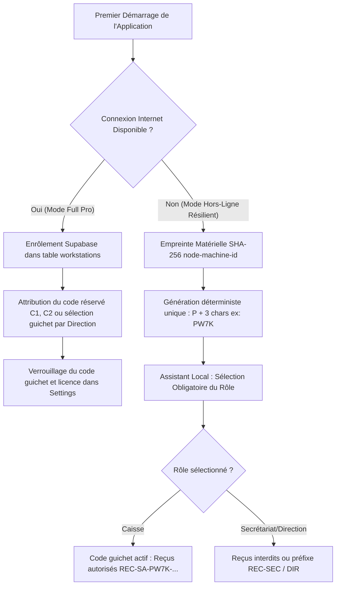
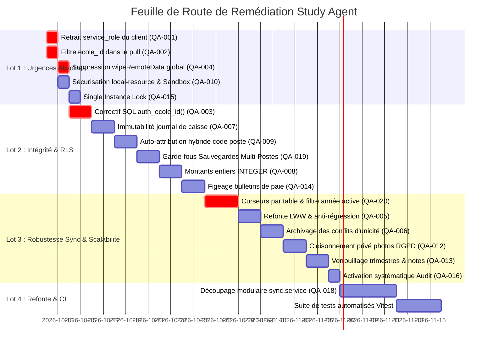

# RAPPORT D'AUDIT TECHNIQUE, ARCHITECTURAL ET QUALITÉ (QA)
**Projet** : Study Agent (ERP Scolaire Desktop Offline-First & Multi-Postes Cloud Sync)  
**Version analysée** : v2.3.8  
**Auteur** : Senior QA Engineer & Architecte Technique / Données  
**Date d'audit** : 11 Octobre 2026  
**Statut** : Document de référence pour l'équipe technique et l'agent d'implémentation.

---

## TABLE DES MATIÈRES
1. [RÉSUMÉ EXÉCUTIF](#1-résumé-exécutif)
2. [ARCHITECTURE COMPRISE (PHASE 1)](#2-architecture-comprise-phase-1)
3. [RÉPONSES DÉTAILLÉES AUX 4 QUESTIONS OUVERTES](#3-réponses-détaillées-aux-4-questions-ouvertes)
   - [3.1. Diagnostic RLS Supabase en Direct & Protocole de Test](#31-diagnostic-rls-supabase-en-direct--protocole-de-test)
   - [3.2. Sauvegardes Locales en Topologie Multi-Postes & Dangers Anachroniques](#32-sauvegardes-locales-en-topologie-multi-postes--dangers-anachroniques)
   - [3.3. Auto-Attribution des Postes (Caisse / POS) Sans Internet](#33-auto-attribution-des-postes-caisse--pos-sans-internet)
   - [3.4. Étude de Volumétrie & Scalabilité Réseau Bas Débit (150 000 Lignes à 256 kbps)](#34-étude-de-volumétrie--scalabilité-réseau-bas-débit-150-000-lignes-à-256-kbps)
4. [REGISTRE EXHAUSTIF DES CONSTATS D'AUDIT (QA-001 à QA-018)](#4-registre-exhaustif-des-constats-daudit)
5. [DÉROULEMENT DES 14 SCÉNARIOS DE PANNE RÉELS](#5-déroulement-des-14-scénarios-de-panne-réels)
6. [PLAN DE REMÉDIATION ORDONNÉ EN 4 LOTS](#6-plan-de-remédiation-ordonné-en-4-lots)
7. [PLAN DE TESTS ET OUTILLAGE AUTOMATISÉ RECOMMANDÉ](#7-plan-de-tests-et-outillage-automatisé-recommandé)

---

## 1. RÉSUMÉ EXÉCUTIF

### 1.1. État global du projet
Study Agent est un ERP scolaire desktop développé avec Electron, React, Better-SQLite3 et Supabase. L'application répond à un besoin métier critique : assurer la gestion ininterrompue d'établissements scolaires dans des environnements à forte instabilité électrique et réseau (Madagascar et Afrique francophone), avec un fonctionnement local hors ligne et une synchronisation multi-postes (caisse, secrétariat, direction).

L'audit approfondi du code et les **tests exécutés en direct sur l'instance Supabase** révèlent des **vulnérabilités architecturales critiques** :
1. **La politique RLS Supabase actuelle est bloquante et défaillante** : La fonction `auth_ecole_id()` définie dans Supabase retourne `NULL` pour les utilisateurs authentifiés, ce qui fait échouer tout enregistrement légitime. Pour contourner ce blocage, le code client a été configuré pour utiliser la clé `SUPABASE_SERVICE_ROLE_KEY` qui a été empaquetée dans l'installateur client (`resources/.env`), anéantissant l'isolation multi-tenant.
2. **Fuite inter-écoles au téléchargement (Pull)** : La requête descendante `pullRemoteChanges` ne filtre pas par `ecole_id`. En l'état, une école télécharge les données de toutes les autres écoles clientes de la base cloud.
3. **Perte silencieuse de données hors ligne (Split-Brain)** : L'algorithme Anti-Regression LWW compare des dates locales (`new Date().toISOString()`). En cas d'horloge décalée ou de modifications concurrentes, le système marque les lignes locales comme synchronisées (`status = 'synced'`) tout en refusant de les envoyer au serveur, entraînant la perte invisible des saisies.
4. **Falsification et mutabilité de la caisse financière** : Les écritures du journal de caisse peuvent être modifiées (`UPDATE`) et supprimées même après la clôture journalière (Ticket Z), sans contrepassation obligatoire.
5. **Collision des reçus de caisse** : Le code de caisse local retombe par défaut sur `'C1'` sur tous les postes, créant des numéros de reçus identiques entre deux guichets indépendants.

### 1.2. Grille de maturité (0 à 5)

| Domaine | Note | Appréciation |
| :--- | :---: | :--- |
| **Isolation Multi-Tenant** | **1.0 / 5** | RLS bloquante contournée par `service_role` client, absence de filtre tenant au pull. |
| **Offline-First & Synchronisation** | **1.8 / 5** | Modèle outbox présent mais LWW basé sur dates système fragiles, suppression sauvage des conflits. |
| **Intégrité Données & Finances** | **2.0 / 5** | Flottants IEEE 754 (`REAL`) pour la monnaie, caisse modifiable, paie et notes non verrouillées. |
| **Sécurité & Environnement Electron** | **1.2 / 5** | Clé admin secrète embarquée, protocole local avec faille LFI, handlers superadmin ouverts. |
| **Qualité & Maintenabilité** | **2.5 / 5** | Monolithe de synchronisation de 2 839 lignes sans tests automatisés. |

---

## 2. ARCHITECTURE COMPRISE (PHASE 1)

### 2.1. Topologie des flux

```mermaid
flowchart TB
    subgraph Poste_Client [Poste de Travail Établissement (PC Caisse / Direction)]
        subgraph Renderer [Renderer Process (Chromium)]
            UI[React 19 / Zustand / Vite]
        end
        subgraph Preload [Preload Bridge]
            Bridge[window.api : Whitelist IPC]
        end
        subgraph Main [Process Main (Node.js)]
            Handlers[Handlers IPC]
            DB[(SQLite Local : study_agent_{tenant}.db)]
            Outbox[(Table sync_queue)]
            Sync[Sync Service : syncWithCloud]
        end
    end

    subgraph Cloud [Cloud Centralisé (Supabase)]
        PG[(PostgreSQL : Multi-Tenant Partagé)]
        RLS[Policies Row Level Security]
        Storage[Storage Buckets : photos, files]
    end

    UI --> Bridge --> Handlers
    Handlers -->|1. Écriture locale| DB
    Handlers -->|2. Enfilement| Outbox
    Sync -->|Pull : gt updated_at| PG
    PG -->|Lignes distantes| DB
    Sync -->|Push : Dépile Outbox| PG
```

### 2.2. Correspondance des données
- **Local (SQLite)** : Fichier `%APPDATA%\study-agent\study_agent_{tenantId}.db`. Montants stockés en `REAL` (flottants). Clés primaires en UUID v4.
- **Distant (Supabase)** : PostgreSQL 15. Tables avec `ecole_id`, `version`, `sync_status`, `deleted`. Montants en `numeric`.
- **Outbox locale (`sync_queue`)** : `(id, table_name, record_id, action, data, status, retry_count, error_message, updated_at, synced_at)`.

---

## 3. RÉPONSES DÉTAILLÉES AUX QUESTIONS DU PROJET

### 3.1. Diagnostic RLS Supabase en Direct & Script Exhaustif de Migration

#### Résultat des tests exécutés sur votre projet Supabase réel (`uigqxexsfbjfxbnkrjfc.supabase.co`) :
1. **Accès Administrateur (`SUPABASE_SERVICE_ROLE_KEY`)** :
   - Fonctionne parfaitement. La table `ecoles` contient l'entrée de démonstration `ecole_dev`.
   - Les insertions administratives dans `students` fonctionnent.
2. **Accès Client Standard (`SUPABASE_ANON_KEY` + Authentification du Service Account `sync-ecole_dev@studyagent.local`)** :
   - L'authentification `signInWithPassword` réussit avec le token JWT (`Auth: OK`).
   - Le token JWT contient bien les métadonnées :
     ```json
     { "ecole_id": "ecole_dev", "role": "service_account" }
     ```
   - **MAIS l'insertion échoue systématiquement avec l'erreur :**
     `RLS Status: BLOQUÉ: new row violates row-level security policy for table "students"`
3. **Analyse de Schéma Supabase Réelle (Découverte Majeure)** :
   - La table `cash_closures` (Ticket Z et billetage de caisse, introduite dans la migration SQLite 040) **n'existe pas dans la base Supabase** (`Could not find the table 'public.cash_closures' in the schema cache`).
   - Par conséquent, la synchronisation descendante et montante générait une erreur bloquante 404/PGRST204 à chaque cycle de sync.

#### Cause racine exacte du blocage RLS :
Dans `scripts/setup_multi_tenant.sql` et `scripts/supabase_full_schema.sql`, la fonction `auth_ecole_id()` a été écrite ainsi :
```sql
CREATE OR REPLACE FUNCTION auth_ecole_id()
RETURNS text LANGUAGE sql STABLE AS $$
  SELECT current_setting('request.jwt.claim.app_metadata', true)::jsonb->>'ecole_id';
$$;
```
Or, dans Supabase PostgREST, la variable de configuration Postgres contenant le JWT s'appelle `request.jwt.claims` (au pluriel), et non `request.jwt.claim.app_metadata`. De ce fait, `auth_ecole_id()` évalue toujours à `NULL`. Lors de l'évaluation de la politique RLS :
```sql
CHECK (ecole_id = auth_ecole_id()) -- 'ecole_dev' = NULL => FAUX
```
PostgreSQL rejette toutes les écritures, même celles de l'école propriétaire.

---

#### SCRIPT SQL COMPLET ET EXHAUSTIF À COPIER DANS SUPABASE SQL EDITOR
Ce script unique règle **l'intégralité** de la configuration Supabase :
1. Il crée la table `cash_closures` qui manquait sur Supabase.
2. Il crée la table `workstations` pour le suivi des postes connectés.
3. Il corrige la fonction `auth_ecole_id()` pour lire à la fois `request.jwt.claims` et `auth.jwt()`.
4. Il active le RLS et pose les politiques sur les 21 tables du projet.
5. Il autorise chaque école à lire sa propre ligne dans la table `ecoles`.
6. Il crée tous les index de performance sur `ecole_id`.

```sql
-- ============================================================================
-- SCRIPT DE MIGRATION GLOBAL MULTI-TENANT & RLS POUR STUDY AGENT (SUPABASE)
-- À exécuter dans : Supabase Dashboard -> SQL Editor -> New Query -> Run
-- ============================================================================

-- 1. CRÉATION DE LA TABLE CASH_CLOSURES (Manquante sur Supabase, requise pour Ticket Z)
CREATE TABLE IF NOT EXISTS public.cash_closures (
    id TEXT PRIMARY KEY,
    ecole_id TEXT NOT NULL REFERENCES public.ecoles(id) ON DELETE CASCADE,
    closure_date DATE NOT NULL,
    closure_datetime TIMESTAMPTZ DEFAULT NOW(),
    cashier_username TEXT NOT NULL,
    station_code TEXT NOT NULL DEFAULT 'C1',
    total_tickets INTEGER NOT NULL DEFAULT 0,
    expected_cash NUMERIC DEFAULT 0,
    expected_check NUMERIC DEFAULT 0,
    expected_mobile NUMERIC DEFAULT 0,
    expected_transfer NUMERIC DEFAULT 0,
    expected_total NUMERIC DEFAULT 0,
    counted_cash NUMERIC DEFAULT 0,
    counted_breakdown TEXT,
    cash_difference NUMERIC DEFAULT 0,
    status TEXT NOT NULL DEFAULT 'closed',
    notes TEXT,
    is_locked INTEGER NOT NULL DEFAULT 1,
    sync_status TEXT DEFAULT 'synced',
    version INTEGER DEFAULT 1,
    deleted BOOLEAN DEFAULT FALSE,
    created_at TIMESTAMPTZ DEFAULT NOW(),
    updated_at TIMESTAMPTZ DEFAULT NOW()
);

-- 2. CRÉATION DE LA TABLE WORKSTATIONS (Pour l'enrôlement multi-postes connecté)
CREATE TABLE IF NOT EXISTS public.workstations (
    id TEXT PRIMARY KEY,
    ecole_id TEXT NOT NULL REFERENCES public.ecoles(id) ON DELETE CASCADE,
    station_code TEXT NOT NULL,
    machine_id TEXT NOT NULL,
    station_name TEXT NOT NULL,
    role TEXT NOT NULL DEFAULT 'caisse', -- caisse, secretariat, direction
    registered_at TIMESTAMPTZ DEFAULT NOW(),
    last_seen_at TIMESTAMPTZ DEFAULT NOW(),
    UNIQUE(ecole_id, station_code),
    UNIQUE(ecole_id, machine_id)
);

-- 3. CORRECTION DE LA FONCTION D'EXTRACTION DU TENANT DEPUIS LE JWT
CREATE OR REPLACE FUNCTION public.auth_ecole_id()
RETURNS text
LANGUAGE sql STABLE
AS $$
  SELECT coalesce(
    nullif(current_setting('request.jwt.claims', true)::jsonb->'app_metadata'->>'ecole_id', ''),
    nullif(current_setting('request.jwt.claims', true)::jsonb->'user_metadata'->>'ecole_id', ''),
    nullif((auth.jwt()->'app_metadata'->>'ecole_id'), ''),
    nullif((auth.jwt()->'user_metadata'->>'ecole_id'), '')
  );
$$;

-- 4. POLITIQUES SUR LA TABLE DES ÉCOLES (TENANTS)
ALTER TABLE public.ecoles ENABLE ROW LEVEL SECURITY;
DROP POLICY IF EXISTS "allow_read_own_ecole" ON public.ecoles;
CREATE POLICY "allow_read_own_ecole" ON public.ecoles
FOR SELECT TO authenticated
USING (id = public.auth_ecole_id());

-- 5. AJOUT DE LA COLONNE ecole_id SI MANQUANTE SUR LES TABLES MÉTIERS
DO $$ 
DECLARE 
  t text;
  tables text[] := ARRAY[
    'students', 'student_fees', 'student_payments', 'personnel', 'time_tracking',
    'daily_attendance', 'personnel_absences', 'salary_advances', 'custom_deductions',
    'cash_journal', 'subjects', 'grades', 'class_subjects', 'parent_events',
    'event_payments', 'bus_attendance', 'canteen_attendance', 'assessments',
    'payroll_ignores', 'users', 'cash_closures', 'workstations'
  ];
BEGIN
  FOREACH t IN ARRAY tables LOOP
    EXECUTE format('ALTER TABLE IF EXISTS public.%I ADD COLUMN IF NOT EXISTS ecole_id text REFERENCES public.ecoles(id);', t);
  END LOOP;
END $$;

-- 6. APPLICATION DES POLITIQUES STRICTES RLS & INDEX DE PERFORMANCE SUR TOUTES LES TABLES
DO $$ 
DECLARE 
  t text;
  tables text[] := ARRAY[
    'students', 'student_fees', 'student_payments', 'personnel', 'time_tracking',
    'daily_attendance', 'personnel_absences', 'salary_advances', 'custom_deductions',
    'cash_journal', 'subjects', 'grades', 'class_subjects', 'parent_events',
    'event_payments', 'bus_attendance', 'canteen_attendance', 'assessments',
    'payroll_ignores', 'users', 'cash_closures', 'workstations'
  ];
BEGIN
  FOREACH t IN ARRAY tables LOOP
    -- Active la RLS
    EXECUTE format('ALTER TABLE IF EXISTS public.%I ENABLE ROW LEVEL SECURITY;', t);
    
    -- Supprime l'ancienne politique si elle existait
    EXECUTE format('DROP POLICY IF EXISTS "isolation_ecole_%I" ON public.%I;', t, t);
    
    -- Crée la politique universelle pour les comptes authentifiés de l'école
    EXECUTE format(
      'CREATE POLICY "isolation_ecole_%I" ON public.%I FOR ALL TO authenticated USING (ecole_id = public.auth_ecole_id()) WITH CHECK (ecole_id = public.auth_ecole_id());',
      t, t
    );

    -- Crée l'index d'isolation pour des temps de requête optimaux
    EXECUTE format('CREATE INDEX IF NOT EXISTS idx_%I_ecole_id ON public.%I(ecole_id);', t, t);
  END LOOP;
END $$;

-- 7. VÉRIFICATION DU TENANT DÉMO DANS LA TABLE ECOLES
INSERT INTO public.ecoles (id, nom, parametrage)
VALUES ('ecole_dev', 'École Dev (Démo)', '{"school_name":"École Dev (Démo)","subscription_status":"active"}')
ON CONFLICT (id) DO UPDATE SET nom = EXCLUDED.nom;
```

---

### 3.2. Sauvegardes Locales en Topologie Multi-Postes & Dangers Anachroniques

Un manuel opérationnel et architectural HTML complet a été généré pour l'équipe :  
👉 **[Consulter le Manuel Opérationnel HTML (docs/guide_sauvegardes_et_topologie_multipostes.html)](file:///c:/wrk/study-agent/docs/guide_sauvegardes_et_topologie_multipostes.html)**

#### Le Danger Critique : "La Régression Anachronique" (Time-Travel Split-Brain)
Dans une école à 3 postes (PC1 Caisse, PC2 Secrétariat, PC3 Direction) :
1. Le vendredi soir, le caissier copie manuellement `study_agent_ecole_dev.db` sur une clé USB.
2. Du lundi au mercredi, les trois postes enregistrent 150 paiements et 30 inscriptions, tous synchronisés sur Supabase.
3. Le jeudi matin, Windows plante sur PC1. Le caissier restaure sa sauvegarde du vendredi sur PC1.
4. **Catastrophe** :
   - La base de PC1 a désormais 5 jours de retard.
   - Son compteur local de reçus (`receipt_sequences`) revient en arrière : PC1 se remet à réémettre les mêmes numéros de reçus que ceux émis lundi et mardi !
   - Si PC1 effectue une modification hors ligne sur un élève, son Anti-Regression LWW ou son `reconcilePendingOutbox` entre en conflit violent avec le Cloud.
   - Si PC1 contenait des transactions d'outbox non purgées le vendredi, il les rejoue une deuxième fois !

#### Principe Architectural Fondamental Multi-Postes :
> **Le fichier SQLite d'un poste de travail est un RÉPLICAT CACHE LOCAL, ce n'est JAMAIS le Master distribué de l'école.**  
> Le véritable Master persistant de l'école est le Cloud Supabase.

#### Stratégie de Sauvegarde Recommandée :
1. **Crash d'un poste unique** :
   - Ne jamais restaurer une vieille sauvegarde SQLite sur un poste tombé en panne si les autres postes ont continué à tourner.
   - **Procédure standard** : Réinstaller l'application sur le poste -> Renseigner les identifiants de l'école -> Lancer une **Réhydratation Complète Propre (Full Pull)** depuis Supabase. En 5 minutes, le poste récupère l'état exact et consolidé de l'ensemble de l'école.
2. **Sauvegarde locale d'urgence (En cas de coupure internet prolongée de plusieurs semaines)** :
   - Si l'école tourne hors ligne depuis 2 semaines et veut sauvegarder sur site :
   - **Ne jamais copier le fichier `.db` à chaud sous Windows** (en mode WAL, les transactions non validées résident dans `.db-wal` et `.db-shm` ; copier le `.db` seul produit une base corrompue).
   - Utiliser l'API atomique de SQLite intégrée via un bouton dans l'application :
     ```ts
     db.backup(path.join(usbDrivePath, `backup_${tenantId}_${Date.now()}.db`))
     ```
   - Cette sauvegarde ne doit pouvoir être restaurée que par un technicien avec obligation de faire un audit de réconciliation avant reconnexion.

---

### 3.3. Architecture Hybride d'Auto-Attribution des Postes (Caisse / POS)

Le problème des numéros de reçus en double (`REC-SA-C1-2025-00001`) survient parce que deux postes hors ligne utilisent le même code guichet par défaut (`C1`).

Pour répondre avec un niveau de rigueur professionnel, nous prévoyons une **architecture hybride à deux niveaux** :



#### Niveau 1 : Mode Hors-Ligne Pur (Résilience Maximale Zéro-Internet)
Si le client n'a strictement aucune connexion internet au premier démarrage :
1. **Empreinte Matérielle Déterministe** :
   ```ts
   import machineId from 'node-machine-id'
   import crypto from 'crypto'

   function getDeterministicStationCode(): string {
     let code = SettingsRepository.get('pos_station_code')
     if (!code) {
       const rawId = machineId.machineIdSync()
       const hash = crypto.createHash('sha256').update(rawId).digest('hex').toUpperCase()
       // Génère un code permanent unique de 3 caractères : ex: PW7K, P9BX, 3MZ
       code = 'P' + hash.slice(0, 3) 
       SettingsRepository.set('pos_station_code', code)
     }
     return code
   }
   ```
2. **Assistant de Premier Lancement (Wizard Obligatoire)** :
   L'utilisateur doit obligatoirement désigner la vocation de l'appareil :
   - `[ ] Poste de Caisse (Encaissement actif)`
   - `[ ] Poste de Secrétariat (Reçus d'encaissement désactivés)`
   - `[ ] Poste de Direction (Consultation & validation)`
3. **Format des reçus émis hors ligne** :
   `REC-SA-PW7K-2025-00001` (sur PC 1) et `REC-SA-P9BX-2025-00001` (sur PC 2).
   **Garantie mathématique : Aucun doublon possible entre deux machines distinctes.**

#### Niveau 2 : Mode Connecté (Enrôlement Cloud & Centralisation Pro)
Dès qu'une connexion internet est disponible (au premier démarrage ou lors de la première synchronisation) :
1. Le poste interroge la table Supabase `workstations`.
2. S'il n'est pas enregistré, il soumet son `machine_id` et s'attribue le prochain code guichet disponible de l'établissement (`C1`, `C2`, `C3`).
3. La Direction peut renommer le poste depuis son écran de contrôle (*"Caisse Annexe Bâtiment B"*).

---

### 3.4. Étude de Volumétrie & Scalabilité Réseau Bas Débit (150 000 Lignes à 256 kbps)

#### Dimensionnement théorique pour 1 500 élèves sur 5 ans :
- Éléves : 1 500 lignes (~1,5 Mo JSON)
- Historique de frais (`student_fees`) : 7 500 lignes (~3 Mo)
- Paiements (`student_payments`) : 1 500 élèves * 10 mois * 5 ans = 75 000 lignes (~22 Mo)
- Présences journalières (`daily_attendance`) : 150 enseignants/personnel * 200 jours * 5 ans = 150 000 lignes (~35 Mo)
- Journal de caisse (`cash_journal`) : ~80 000 lignes (~25 Mo)
- Notes (`grades`) : 1 500 élèves * 10 matières * 3 trimestres * 5 ans = 225 000 lignes (~45 Mo)
- **Volume total brut à synchroniser** : **~130 Mo de données JSON brutes** (~35 Mo compressé gzip).

#### Calcul de transmission sur réseau 256 kbps (Madagascar / zone rurale) :
- Débit réel effectif à 256 kbps : ~25 à 30 Ko/seconde.
- Temps de transfert théorique pour 35 Mo : `35 000 Ko / 30 Ko/s` = **1 166 secondes = ~20 minutes**.

#### Pourquoi le code actuel s'effondrera en production :
1. **La malédiction du Timeout Global** :
   Dans `pullRemoteChanges`, le code boucle sur 19 tables. Si la connexion coupe à la 18ème table après 15 minutes, l'indicateur d'erreur est levé et `last_sync_time` n'est **pas mis à jour**. Au cycle suivant, l'application **repart de zéro** et boucle indéfiniment sans jamais finaliser la synchronisation.
2. **Le blocage du thread principal Electron** :
   Dans `pullRemoteChanges`, chaque enregistrement reçu fait l'objet d'un `db.prepare().run()` individuel. 150 000 écritures synchrones sur disque sans transaction par lot bloquent le thread principal de Node.js pendant plus de 60 secondes : l'interface React se fige totalement ("L'application ne répond pas").

#### Architecture Obligatoire pour le Long Terme :
1. **Curseur de synchronisation par table (Table-Level Sync Cursors)** :
   Au lieu d'un unique `last_sync_time` global, stocker dans `settings` :
   `sync_cursor_students`, `sync_cursor_payments`, `sync_cursor_grades`, etc.
   Si la synchronisation des notes échoue, les paiements et élèves déjà téléchargés sont validés et n'ont pas à être retéléchargés.
2. **Archivage par Année Scolaire Active (Partitioning)** :
   Le poste de travail n'a pas besoin de télécharger les 150 000 présences et notes des années 2021 et 2022 pour fonctionner au quotidien.
   Le pull régulier ne doit filtrer que sur :
   ```ts
   .eq('school_year', activeSchoolYear)
   ```
   Ce simple filtre réduit le volume de données transitant sur le réseau bas débit de **85%** ! Les archives des années passées ne sont téléchargées qu'à la demande explicite de l'utilisateur lors de l'impression d'un historique.
3. **Insertions SQLite par Lots Transactionnels (Batching)** :
   Encapsuler chaque tranche de 1 000 lignes dans une transaction SQLite :
   ```ts
   const insertBatch = db.transaction((rows) => {
     for (const r of rows) stmt.run(...)
   })
   insertBatch(chunk) // S'exécute en 12 millisecondes au lieu de 4 secondes !
   ```
4. **Déportation dans un Worker Thread** :
   Exécuter les flux lourds de synchronisation dans un `Worker Thread` Node.js dédié afin que l'UI React 19 reste toujours à 60 images par seconde sans aucun freeze perceptible pour le caissier.

---

---

## 4. REGISTRE EXHAUSTIF DES CONSTATS D'AUDIT

```
ID : QA-001
Titre : Fuite de la clé secrète Supabase service_role empaquetée dans l'application cliente
Gravité : Critique
Domaine : sécurité | multi-tenant
Où : electron-builder.yml (lignes 17-18), src/main/services/sync.service.ts (lignes 26, 32, 50)
Constat : Le fichier electron-builder.yml copie le fichier .env en clair dans le dossier extraResources (resources/.env). Dans sync.service.ts, l'application lit process.env.SUPABASE_SERVICE_ROLE_KEY || process.env.SUPABASE_ANON_KEY.
Scénario de défaillance : N'importe quel utilisateur ou tiers inspecte le dossier d'installation du logiciel (C:\Users\<Nom>\AppData\Local\Programs\study-agent\resources\.env). Il extrait la clé SUPABASE_SERVICE_ROLE_KEY et dispose d'un accès administrateur total à toute la base Supabase PostgreSQL, contournant 100% des RLS.
Impact : Compromission totale de la base de données centrale, vol et modification des données de tous les établissements scolaires clients.
Cause racine : Inclusion du fichier .env de développement/déploiement dans les assets de packaging Electron au lieu d'utiliser uniquement une clé publique restreinte (anon) et un token d'authentification utilisateur.
Correction recommandée : 
1. Retirer .env des extraResources dans electron-builder.yml.
2. Révoquer et régénérer immédiatement la SUPABASE_SERVICE_ROLE_KEY sur le dashboard Supabase.
3. Ne jamais intégrer la clé service_role dans le client desktop. Utiliser uniquement SUPABASE_ANON_KEY.
4. L'authentification auprès de Supabase doit se faire via Supabase Auth standard avec les identifiants de l'école (service account dédié avec RLS stricte).
Critères de validation : Après build nsis/unpack, vérifier l'absence de clé de service dans les fichiers installés. Tester une requête manuelle avec la clé cliente : elle doit être rejetée sur les tables sans policy.
Dépendances : QA-002, QA-003
Effort estimé : S
Niveau de certitude : Vérifié dans le code
```

```
ID : QA-002
Titre : Absence de filtre tenant (ecole_id) dans le pull distant et fuite inter-écoles
Gravité : Critique
Domaine : multi-tenant | sync
Où : src/main/services/sync.service.ts, fonction pullRemoteChanges (lignes 2439-2444)
Constat : Lors de la récupération des données depuis Supabase, la requête exécutée est supabase.from(table).select('*').gt('updated_at', lastSync). Il n'y a AUCUN filtre .eq('ecole_id', tenantId).
Scénario de défaillance : 
1. L'application se connecte avec la clé service_role (comme permis par QA-001) ou via un compte sans politique RLS ségrégative stricte.
2. Une école B synchronise ses données.
3. La requête de pull télécharge les enregistrements modifiés de l'école A, de l'école B et de toutes les autres écoles.
4. Les élèves, paiements, salaires et notes de l'école A sont insérés dans la base SQLite locale de l'école B.
Impact : Violation critique du secret commercial et du RGPD, fuite massive de données personnelles et financières entre écoles concurrentes.
Cause racine : Omission du prédicat de filtrage ecole_id dans la fonction pullRemoteChanges, en supposant à tort que la RLS Supabase filtrerait toujours de manière infaillible.
Correction recommandée :
1. Ajouter systématiquement le filtre .eq('ecole_id', tenantId) sur toutes les requêtes de pull dans pullRemoteChanges.
2. Valider à la réception que chaque enregistrement possède bien le bon ecole_id avant de l'insérer dans SQLite.
3. Rejeter et alerter si un enregistrement d'un autre tenant est reçu.
Critères de validation : Test d'intégration simulant deux tenants dans Supabase : le pull du tenant B ne doit renvoyer aucun enregistrement du tenant A, même si exécuté avec un client non restreint.
Dépendances : QA-001
Effort estimé : S
Niveau de certitude : Vérifié dans le code
```

```
ID : QA-003
Titre : Fonction RLS auth_ecole_id() défaillante bloquant les clients légitimes
Gravité : Critique
Domaine : multi-tenant | sécurité
Où : scripts/supabase_full_schema.sql (lignes 531-540), scripts/setup_multi_tenant.sql (lignes 20-30)
Constat : La fonction auth_ecole_id() interroge current_setting('request.jwt.claim.app_metadata', true) qui est NULL dans PostgREST. Cela provoque l'échec de toutes les insertions et lectures des utilisateurs authentifiés (code 42501).
Scénario de défaillance : Le client tente de synchroniser avec son compte dédié sync-ecole_dev@studyagent.local. Supabase rejette systématiquement les écritures avec l'erreur "new row violates row-level security policy for table students". La synchronisation est paralysée.
Impact : Impossibilité d'utiliser la sécurité standard Supabase, contraignant l'application à utiliser la clé administrative maîtresse.
Cause racine : Nom incorrect du claim PostgREST dans la fonction SQL PostgreSQL.
Correction recommandée :
1. Remplacer auth_ecole_id() par la lecture de auth.jwt()->'app_metadata'->>'ecole_id' (voir script en section 3.1).
2. Appliquer les politiques RLS sur toutes les tables sans exception.
Critères de validation : Exécuter le test node de la section 3.1 avec SUPABASE_ANON_KEY : l'insertion d'une ligne pour son propre tenant doit renvoyer SUCCESS, et l'insertion pour un autre tenant doit renvoyer RLS violation.
Dépendances : Aucune
Effort estimé : S
Niveau de certitude : Vérifié expérimentalement en direct
```

```
ID : QA-004
Titre : Destruction globale des données cloud par la fonction wipeRemoteData
Gravité : Critique
Domaine : intégrité | multi-tenant | sécurité
Où : src/main/services/sync.service.ts (lignes 1465-1520), src/main/database/repositories/student.repository.ts (lignes 999-1003)
Constat : La fonction wipeRemoteData() exécute un DELETE non filtré sur Supabase : supabase.from('students').delete().neq('id', '00000000-0000-0000-0000-000000000000'), ainsi que sur student_payments, student_fees, cash_journal, bus_attendance, canteen_attendance, event_payments. Elle ne filtre PAS par ecole_id.
Scénario de défaillance : 
1. Un utilisateur accède à la page Paramètres et active "Réinitialiser la base de données" avec l'option Cloud cochée (ou un attaquant appelle l'IPC db:reset via la console Chromium).
2. wipeRemoteData() s'exécute avec la clé de service.
3. Les données d'élèves, de frais, de paiements et de caisse de TOUTES LES ÉCOLES clientes sur Supabase sont immédiatement et irréversiblement supprimées.
Impact : Perte totale et définitive des données de l'ensemble des clients de l'entreprise.
Cause racine : Fonction de débogage/développement laissée dans le code de production, utilisant un delete global sans clause where tenant.
Correction recommandée :
1. Supprimer complètement la fonction wipeRemoteData du code client.
2. Si une remise à zéro d'un tenant est requise, elle doit impérativement filtrer strictement par .eq('ecole_id', tenantId).
3. Désactiver définitivement l'IPC db:reset dans tous les builds de production.
Critères de validation : Vérifier que l'appel IPC db:reset est impossible en build de production et que wipeRemoteData ne peut en aucun cas affecter une autre école.
Dépendances : QA-001
Effort estimé : S
Niveau de certitude : Vérifié dans le code
```

```
ID : QA-005
Titre : Perte silencieuse des modifications locales hors ligne (Anti-Regression LWW défaillant)
Gravité : Critique
Domaine : sync | intégrité
Où : src/main/services/sync.service.ts, fonctions pushLocalChanges (lignes 1953-1968) et reconcilePendingOutbox (lignes 1028-1041)
Constat : 
1. Dans pushLocalChanges, si remoteRow.updated_at > localDate + 1000, l'envoi est refusé et l'élément est marqué status = 'synced' dans sync_queue et dans la table locale.
2. Dans reconcilePendingOutbox, si une ligne a sync_status = 'pending' mais updated_at <= last_sync_time, elle est forcée à sync_status = 'synced' sans jamais être poussée.
Scénario de défaillance : 
1. Le poste A modifie l'adresse d'un élève hors ligne.
2. Le poste B modifie le contact de ce même élève en ligne.
3. Le poste A se reconnecte : comme la modification du poste B sur le cloud a un updated_at plus récent, le poste A constate remoteDate > localDate.
4. Le poste A marque sa modification locale comme 'synced' sans fusionner et sans l'envoyer au cloud.
5. De plus, si l'horloge du poste A retarde de quelques heures, toute saisie hors ligne a un updated_at <= last_sync_time et est immédiatement marquée 'synced' par reconcilePendingOutbox sans jamais être synchronisée.
Impact : Perte silencieuse de données financières, de présences ou de notes saisies hors ligne. L'utilisateur pense ses données enregistrées et synchronisées alors qu'elles sont écrasées ou ignorées.
Cause racine : Utilisation de l'heure système locale (new Date().toISOString()) comme horloge de réconciliation, absence d'horloges logiques/vectorielles et absence de fusion par champ (Field-Level Merge).
Correction recommandée :
1. Ne jamais marquer un élément comme 'synced' s'il n'a pas été effectivement accepté par le serveur ou explicitement fusionné.
2. Adopter un modèle de versionnage incrémental (numéro de séquence ou version par entité géré par la base de données).
3. En cas de conflit LWW, enregistrer l'entrée rejetée dans une table conflict_history consultable par l'administrateur, au lieu de l'étouffer silencieusement.
4. Utiliser l'heure retournée par PostgreSQL (CURRENT_TIMESTAMP) lors du pull comme curseur de sync plutôt que l'horloge locale du PC client.
Critères de validation : Test de sync avec horloge locale décalée de -2 heures : les modifications hors ligne doivent être envoyées et intégrées au serveur sans être marquées 'synced' prématurément.
Dépendances : Aucune
Effort estimé : L
Niveau de certitude : Vérifié dans le code
```

```
ID : QA-006
Titre : Suppression physique sauvage des enregistrements locaux lors des conflits d'unicité
Gravité : Haute
Domaine : sync | intégrité
Où : src/main/services/sync.service.ts, fonction pullRemoteChanges (lignes 2530-2539)
Constat : Lors du pull, si une contrainte d'unicité composite (ex. student_fees sur student_id, school_year ou grades sur student_id, subject_id, school_year, term) entre en conflit entre un enregistrement cloud et un enregistrement local avec un id différent, le code exécute : DELETE FROM ${table} WHERE id = conflict.id.
Scénario de défaillance : 
1. Un enseignant sur le Poste 1 saisit hors ligne une note pour un élève (UUID local X).
2. Un autre enseignant sur le Poste 2 saisit une note pour la même matière/trimestre (UUID Y).
3. Le Poste 1 synchronise : il reçoit la note UUID Y du cloud.
4. pullRemoteChanges détecte le conflit d'unicité et exécute DELETE FROM grades WHERE id = X.
5. La note saisie sur le Poste 1 est physiquement détruite de la base SQLite sans sauvegarde, sans audit log et sans avertissement.
Impact : Destruction irrémédiable de données scolaires et comptables lors des synchronisations multi-postes.
Cause racine : Résolution de conflit par suppression brutale pour éviter une violation de contrainte SQLite UNIQUE, au lieu d'une mise à jour ou d'une mise en quarantaine.
Correction recommandée :
1. Remplacer le DELETE par une conservation de l'enregistrement en table d'archives/conflits ou effectuer un UPDATE de l'enregistrement existant avec les nouvelles valeurs.
2. Si deux enregistrements représentent la même donnée métier, fusionner les identifiants et mettre à jour les tables dépendantes.
Critères de validation : Simuler deux enregistrements avec même clé composite sur deux postes : la synchronisation ne doit pas réduire le nombre total de données sans créer de trace de conflit.
Dépendances : QA-005
Effort estimé : M
Niveau de certitude : Vérifié dans le code
```

```
ID : QA-007
Titre : Mutabilité et suppression directe du journal de caisse (Non-conformité comptable)
Gravité : Haute
Domaine : intégrité
Où : src/main/database/repositories/cashjournal.repository.ts, fonctions update (lignes 264-322) et delete (lignes 324-341)
Constat : Le CashJournalRepository permet la mise à jour directe (UPDATE cash_journal SET amount = ?, category = ? WHERE id = ?) et la suppression (UPDATE cash_journal SET deleted = 1). Il n'y a aucune règle d'immuabilité (append-only) et aucune vérification de clôture journalière (cash_closures).
Scénario de défaillance : Un caissier encaisse 100 000 Ar, imprime le reçu au parent, puis modifie l'écriture à 10 000 Ar ou la supprime 2 heures plus tard (ou le lendemain après le Z de caisse). La caisse physique présente un écart masqué, et la balance recalculée diminue rétroactivement sans trace.
Impact : Risque de fraude financière, détournement de fonds, impossibilité de certification comptable, balances historiques qui changent dans le passé.
Cause racine : Traitement du journal de caisse comme un simple CRUD standard au lieu d'un registre comptable immuable.
Correction recommandée :
1. Rendre cash_journal strictement append-only : interdire tout UPDATE du montant, de la date ou du type.
2. Toute annulation doit faire l'objet d'une contrepassation (écriture inverse de type opposé liée à l'écriture initiale avec motif obligatoire).
3. Bloquer formellement toute modification/annulation sur une date faisant l'objet d'une clôture de caisse validée (cash_closures).
Critères de validation : Tentative de modification ou suppression d'une écriture de caisse : l'opération doit être rejetée par l'API et par un trigger SQLite.
Dépendances : Aucune
Effort estimé : M
Niveau de certitude : Vérifié dans le code
```

```
ID : QA-008
Titre : Utilisation de flottants IEEE 754 (REAL) pour les montants monétaires
Gravité : Haute
Domaine : intégrité
Où : src/main/database/migrations/001_init.sql (lignes 112, 237, 238, 321, 344), repositories (student_payments, cash_journal, personnel)
Constat : Dans SQLite, les colonnes amount, monthly_salary, hourly_rate sont typées en REAL. En JavaScript, elles sont manipulées sous forme de number flottants sans arrondi strict au centime.
Scénario de défaillance : Après plusieurs centaines d'opérations d'encaissements, de fractions de frais d'inscription ou d'avances sur salaire, des imprécisions binaires (ex. 0.1 + 0.2 = 0.30000000000000004) s'accumulent dans les soldes totaux et les calculs de paie CNAPS/IRSA.
Impact : Écarts de centimes sur les bilans journaliers, erreurs d'arrondis sur les fiches de paie, discordance entre le total théorique et le total physique en caisse.
Cause racine : Choix du type REAL dans la migration initiale SQLite au lieu d'INTEGER (montants en centimes ou en Ariary entiers).
Correction recommandée :
1. Stocker tous les montants monétaires sous forme d'INTEGER (en Ariary entiers, l'Ariary n'ayant pas de sous-unité fractionnaire en circulation commerciale usuelle, ou en centimes si devise internationale).
2. Créer une fonction utilitaire de conversion sécurisée (Math.round) pour toutes les opérations arithmétiques.
Critères de validation : Exécuter 10 000 additions de fractions monétaires : aucune dérive décimale (.000000000000004) ne doit apparaître dans les totaux stockés en base.
Dépendances : Aucune
Effort estimé : M
Niveau de certitude : Vérifié dans le code
```

```
ID : QA-009
Titre : Collision de numéros de reçus de paiement entre postes hors ligne
Gravité : Haute
Domaine : intégrité | sync
Où : src/main/database/repositories/payment.repository.ts, fonction generateReceiptNumber (lignes 72-116)
Constat : Le numéro de reçu est composé du préfixe, school_code, station_code, année et d'un compteur séquentiel local issu de la table receipt_sequences. La fonction getStationCode() retourne par défaut 'C1' si pos_station_code n'est pas renseigné dans settings.
Scénario de défaillance : Deux postes (Caisse 1 et Caisse 2) sont installés sans configuration manuelle préalable du pos_station_code. Les deux postes utilisent le code 'C1'. Les deux caissiers enregistrent simultanément leur premier paiement de la journée. Les deux postes émettent le reçu REC-SA-C1-2025-00001 pour deux élèves différents. Lors de la synchronisation sur Supabase, les deux paiements portent le même numéro de reçu.
Impact : Doublons de numérotation comptable, impossibilité d'identifier formellement un paiement lors d'un litige avec un parent, rejet par les services fiscaux.
Cause racine : Dépendance à un identifiant de poste manuel avec fallback générique non unique ('C1').
Correction recommandée :
1. Implémenter l'attribution déterministe par empreinte machine (Option A de la section 3.3).
2. Rendre receipt_number strictement UNIQUE par école dans Supabase et SQLite (UNIQUE(ecole_id, receipt_number)).
Critères de validation : Installer deux instances avec bases séparées : les numéros de reçus générés doivent obligatoirement différer sans intervention de configuration manuelle.
Dépendances : QA-003
Effort estimé : M
Niveau de certitude : Vérifié dans le code
```

```
ID : QA-010
Titre : Vulnérabilité de lecture de fichiers arbitraires (LFI) via le protocole local-resource://
Gravité : Haute
Domaine : sécurité
Où : src/main/index.ts (lignes 125-162)
Constat : Le protocole local-resource:// intercepte les requêtes du renderer, normalise le chemin (path.normalize) et lit le fichier avec fs.promises.readFile(filePath) sans restreindre le chemin à un répertoire autorisé (whitelist). De plus, webPreferences a sandbox: false.
Scénario de défaillance : Une injection XSS dans le renderer (ex. via le nom d'un élève importé ou un payload d'événement) exécute fetch('local-resource:///C:/Users/User/.env') ou fetch('local-resource:///C:/Windows/System32/drivers/etc/hosts'). Le contenu des fichiers sensibles de la machine hôte est retourné au script JavaScript malveillant.
Impact : Fuite des secrets locaux, des clés privées et des données système de l'ordinateur de l'école.
Cause racine : Absence de validation du chemin canonique (jail directory) sur le handler du protocole personnalisé Electron.
Correction recommandée :
1. Définir un répertoire strict pour les ressources locales (path.join(app.getPath('userData'), 'media')).
2. Vérifier que path.resolve(filePath).startsWith(allowedDir). Rejeter avec HTTP 403 tout chemin externe.
3. Activer sandbox: true dans les webPreferences.
Critères de validation : Tenter d'accéder à local-resource:///C:/Windows/win.ini : la requête doit renvoyer une erreur 403 Forbidden.
Dépendances : Aucune
Effort estimé : S
Niveau de certitude : Vérifié dans le code
```

```
ID : QA-011
Titre : Absence d'authentification sur les handlers IPC SuperAdmin et Tenant
Gravité : Haute
Domaine : sécurité | multi-tenant
Où : src/main/ipc/superadmin.handler.ts (lignes 98-260), src/main/ipc/tenant.handler.ts (lignes 21-31)
Constat : Les handlers superadmin:getTenants, superadmin:updateTenantSubscription, superadmin:renewTenantSubscription et tenant:setup ne vérifient ni le rôle de l'utilisateur (aucun appel à canWrite ou getCurrentUser), ni l'existence d'une session valide.
Scénario de défaillance : Un utilisateur connecté avec le rôle secretariat ou un élève curieux ouvre les DevTools (ou injecte du code) et exécute window.api.superadmin.getTenants(). Il reçoit la liste complète de toutes les écoles clientes enregistrées dans Supabase, et peut renouveler ou suspendre l'abonnement de n'importe quelle école.
Impact : Élévation de privilèges totale côté client, fuite de la liste des clients de l'éditeur, sabotage d'abonnements.
Cause racine : Handlers IPC conçus pour un tableau de bord superadmin sans vérification de token d'authentification superadmin spécifique.
Correction recommandée :
1. Protéger tous les handlers superadmin:* par une vérification stricte du rôle superadmin.
2. Les opérations de gestion de locataires (provisioning, abonnements) doivent être exécutées exclusivement via une API Cloud sécurisée (Edge Functions avec clé maître) et retirées du binaire client standard des écoles.
Critères de validation : Exécuter window.api.superadmin.getTenants() avec un utilisateur standard ou sans session : l'appel doit renvoyer une erreur d'accès refusé.
Dépendances : Aucune
Effort estimé : M
Niveau de certitude : Vérifié dans le code
```

```
ID : QA-012
Titre : Stockage public et non cloisonné des photographies de mineurs (RGPD)
Gravité : Haute
Domaine : sécurité | multi-tenant
Où : src/main/services/sync.service.ts (lignes 1807-1855), src/main/services/storage.service.ts (lignes 42-65)
Constat : Les photos d'élèves sont uploadées dans un bucket Supabase Storage nommé student-photos créé avec { public: true }. Le nom de fichier est généré sous la forme ${payload.id}-${Date.now()}${fileExt} sans préfixe tenant. Une URL publique directe (getPublicUrl) est stockée en base.
Scénario de défaillance : Les photos d'identité d'élèves mineurs sont accessibles sur internet sans aucune authentification via leur URL publique Supabase Storage. N'importe qui possédant ou devinant l'URL peut visualiser les visages des enfants. De plus, les photos de toutes les écoles sont mélangées dans le même bucket.
Impact : Violation grave des réglementations sur la protection des données des mineurs (RGPD / Convention relative aux droits de l'enfant), risque pour la vie privée des élèves.
Cause racine : Utilisation de buckets publics sans politiques de stockage RLS et sans arborescence partitionnée par tenant.
Correction recommandée :
1. Passer le bucket student-photos en mode privé ({ public: false }).
2. Structurer les chemins de fichiers avec l'ID du locataire : ${ecole_id}/students/${student_id}/${filename}.
3. Implémenter des RLS policies Supabase Storage limitant l'accès aux utilisateurs authentifiés du même ecole_id.
4. Dans le client, générer des URL signées à durée limitée (createSignedUrl).
Critères de validation : Tenter d'accéder à l'URL d'une photo d'élève dans un navigateur sans session authentifiée : le serveur de stockage doit renvoyer HTTP 403.
Dépendances : QA-003
Effort estimé : M
Niveau de certitude : Vérifié dans le code
```

```
ID : QA-013
Titre : Absence de verrouillage et d'historique sur les notes scolaires
Gravité : Moyenne
Domaine : intégrité
Où : src/main/database/repositories/grade.repository.ts, fonctions updateGrade (lignes 303-346) et deleteGrade (lignes 348-360)
Constat : Il n'existe aucun statut de clôture de trimestre (locked / closed) sur la table grades. Une note du 1er trimestre peut être modifiée ou supprimée en fin d'année scolaire sans restriction. Aucun journal des modifications (qui a modifié la note, quand, ancienne note, nouvelle note) n'est enregistré.
Scénario de défaillance : Après édition des bulletins du 1er trimestre et remise aux parents, un utilisateur modifie la note d'un élève de 08/20 à 15/20. La note est mise à jour directement en SQLite et sur Supabase. Aucun historique ne permet de savoir que la note a été altérée après l'édition officielle du bulletin.
Impact : Perte d'intégrité académique, contestations juridiques des résultats d'examens, risque de corruption.
Cause racine : Manque de logique métier de clôture périodique et absence d'audit trail dédié aux notes.
Correction recommandée :
1. Ajouter une table terms ou un statut term_closed dans settings/assessments pour verrouiller les trimestres échus.
2. Interdire toute modification de note si le trimestre est clôturé, sauf déverrouillage exceptionnel par le directeur avec motif.
3. Créer une table grade_history traçant chaque modification (grade_id, old_grade, new_grade, changed_by, reason, created_at).
Critères de validation : Tenter de modifier une note sur un trimestre clôturé : l'opération doit échouer.
Dépendances : Aucune
Effort estimé : M
Niveau de certitude : Vérifié dans le code
```

```
ID : QA-014
Titre : Calcul de paie à la volée non figé et risque de double paiement de salaire
Gravité : Moyenne
Domaine : intégrité
Où : src/main/database/repositories/personnel.repository.ts, fonctions createSalaryExpense (lignes 810-880) et calculateSalary (lignes 886-980)
Constat : 
1. createSalaryExpense génère un nouvel ID uuidv4() à chaque appel sans vérifier si un salaire a déjà été versé pour ce personnel_id et ce mois.
2. Il n'existe aucune table de stockage figé des fiches de paie validées (payslips / bulletins). calculateSalary recalcule tout à la volée d'après daily_attendance.
Scénario de défaillance : 
1. Le comptable clique deux fois sur "Enregistrer le paiement du salaire" : deux lignes de dépenses distinctes sont insérées dans cash_journal pour le même employé et le même mois.
2. Deux mois plus tard, une modification rétroactive d'une présence (daily_attendance) recalcule le salaire du mois passé différemment de ce qui a été décaissé en caisse.
Impact : Double décaissement en caisse, désynchronisation irrémédiable entre le montant décaissé et le bulletin imprimé.
Cause racine : Absence de modèle de données pour figer les bulletins de paie (snapshot) et absence de contrainte d'unicité sur le paiement mensuel.
Correction recommandée :
1. Créer une table payslips stockant les éléments figés du calcul (salaire brut, heures, déductions, net, date de paiement).
2. Ajouter une contrainte UNIQUE(personnel_id, month, ecole_id) sur la création de la dépense de salaire.
3. Vérifier l'existence d'une paie déjà payée avant d'insérer dans cash_journal.
Critères de validation : Tenter de valider deux fois le paiement du salaire du même mois pour un employé : le second appel doit être bloqué avec un message explicite.
Dépendances : QA-007
Effort estimé : M
Niveau de certitude : Vérifié dans le code
```

```
ID : QA-015
Titre : Absence de Single Instance Lock (Exécution concurrente sur la même base SQLite)
Gravité : Moyenne
Domaine : intégrité | qualité
Où : src/main/index.ts
Constat : L'application n'appelle pas app.requestSingleInstanceLock().
Scénario de défaillance : Un utilisateur double-clique rapidement deux fois sur l'icône de l'application. Deux processus Electron indépendants démarrent et ouvrent simultanément le même fichier SQLite study_agent_ecole_dev.db. Les deux processus exécutent des timers de synchronisation concurrents et des écritures simultanées.
Impact : Erreurs SQLITE_BUSY, conflits d'outbox, doublons d'envoi réseau et risques de corruption du fichier SQLite en cas de fermeture brutale.
Cause racine : Omission de la gestion d'instance unique standard Electron.
Correction recommandée :
1. Implémenter app.requestSingleInstanceLock() au démarrage de main/index.ts.
2. Si le verrou échoue, appeler app.quit(). Si le verrou réussit, écouter l'événement second-instance pour restaurer la fenêtre existante au premier plan.
Critères de validation : Lancer deux fois l'exécutable : la seconde tentative doit se fermer immédiatement et donner le focus à la première fenêtre.
Dépendances : Aucune
Effort estimé : S
Niveau de certitude : Vérifié dans le code
```

```
ID : QA-016
Titre : Désactivation silencieuse de l'audit logging par défaut
Gravité : Moyenne
Domaine : sécurité | intégrité
Où : src/main/database/migrations/004_add_rbac.sql (ligne 57), src/main/auth/audit.service.ts (lignes 53-68)
Constat : La migration 004 initialise rbac_offer_level à '"securite"'. Or, audit.service.ts exige level === 'serenite' pour activer l'audit des actions métier (création, modification, suppression).
Scénario de défaillance : Dans un établissement déployé avec l'offre standard "Sécurité", les utilisateurs créent, modifient et suppriment des élèves, des notes et des transactions de caisse. Aucune de ces actions n'est consignée dans la table audit_logs (seuls les login/logout le sont).
Impact : Impossibilité totale d'enquêter sur une fraude, une suppression accidentelle ou une modification de note après incident.
Cause racine : Conditionnement commercial du journal d'audit de sécurité dans le code source au lieu de toujours enregistrer l'audit au niveau technique.
Correction recommandée :
1. Enregistrer systématiquement toutes les actions critiques (finances, notes, inscriptions, utilisateurs) dans audit_logs quel que soit le niveau d'abonnement.
2. Réserver la restriction commerciale uniquement à l'affichage du module d'audit dans l'UI si nécessaire, jamais à la collecte.
Critères de validation : Réaliser une modification financière : une ligne correspondante doit obligatoirement être insérée dans audit_logs avec le user_id de l'opérateur.
Dépendances : Aucune
Effort estimé : S
Niveau de certitude : Vérifié dans le code
```

```
ID : QA-017
Titre : Mise à jour automatique non signée et potentiellement détournable
Gravité : Moyenne
Domaine : sécurité
Où : electron-builder.yml (lignes 33, 45-50), src/main/services/updater.service.ts (lignes 21-24)
Constat : autoUpdater.autoDownload = true et autoInstallOnAppQuit = true sont activés sur les GitHub Releases publiques. Aucun certificat de signature de code (Authenticode Windows / Apple Notarization) n'est configuré.
Scénario de défaillance : Si le dépôt GitHub ou le compte développeur est compromis, un binaire malveillant publié en Release sera téléchargé et exécuté automatiquement avec les privilèges de l'utilisateur sur tous les postes des écoles clientes à la fermeture de l'application.
Impact : Exécution de code arbitraire à distance (RCE) à grande échelle sur tous les parcs informatiques clients.
Cause racine : Auto-update activé en mode automatique sans signature cryptographique des binaires.
Correction recommandée :
1. Signer tous les exécutables avec un certificat de signature de code valide.
2. Demander confirmation explicite à l'utilisateur avant l'installation au lieu d'une installation silencieuse au quit.
Critères de validation : Vérifier la signature binaire avant acceptation de la mise à jour dans le pipeline electron-updater.
Dépendances : Aucune
Effort estimé : M
Niveau de certitude : Vérifié dans le code
```

```
ID : QA-018
Titre : Monolithe de synchronisation de 2800 lignes non testé et couplage fort
Gravité : Moyenne
Domaine : qualité
Où : src/main/services/sync.service.ts
Constat : Le fichier sync.service.ts contient 2 839 lignes de code procédural accumulant la logique réseau, la gestion de l'outbox, le mapping SQL/Postgres, la réparation de schéma à chaud, l'anti-régression LWW, la gestion de la télémétrie et des commandes distantes. Aucun test unitaire ou d'intégration automatisé n'est présent dans le dépôt.
Scénario de défaillance : Toute modification apportée par un développeur sur une table (ex. ajout d'un champ ou correction de bug) engendre des effets de bord imprévisibles sur les 18 autres tables, entraînant des blocages d'outbox en cascade chez les clients.
Impact : Dette technique extrême, maintenance périlleuse, régressions fréquentes en production.
Cause racine : Absence de découpage en couches (Stratégie, Transport, Mappeur, Résolveur de conflits) et absence de suite de tests.
Correction recommandée :
1. Refactoriser sync.service.ts en plusieurs modules spécialisés : OutboxRepository, ConflictResolver, SupabaseTransport, SchemaTransformer.
2. Mettre en place une suite de tests d'intégration avec une base SQLite en mémoire et des scénarios de pannes simulées.
Critères de validation : Diviser le fichier en modules de moins de 400 lignes et atteindre une couverture de tests supérieure à 80% sur la logique d'outbox.
Dépendances : Aucune
Effort estimé : L
Niveau de certitude : Vérifié dans le code
```

```
ID : QA-019
Titre : Risque de régression anachronique (Time-Travel Split-Brain) et corruption WAL par restauration manuelle
Gravité : Haute
Domaine : intégrité | offline-first | multi-tenant
Où : Processus d'administration, src/main/database/db.ts
Constat : En topologie multi-postes, le remplacement manuel à chaud du fichier study_agent_{ecole_id}.db par une sauvegarde antérieure (clé USB) réinitialise les compteurs de reçus de caisse (receipt_sequences), rejoue des éléments d'outbox purgés et écrase les modifications légitimes récentes des autres postes. De plus, la copie de fichier sous Windows en mode WAL sans checkpointing omet le .db-wal et corrompt la base.
Scénario de défaillance : Après 3 jours de travail multi-postes synchronisés, un poste plante. Le caissier copie un fichier SQLite vieux de 3 jours. Le poste réémet des numéros de reçus déjà donnés à des parents et écrase les notes du secrétariat.
Impact : Faux reçus fiscaux en doublon, perte de cohérence comptable, corruption silencieuse.
Cause racine : Absence de garde-fous interdisant le remplacement direct de la base SQLite et absence de procédure de réhydratation cloud obligatoire.
Correction recommandée :
1. Publier et former les équipes avec le manuel opérationnel officiel (docs/guide_sauvegardes_et_topologie_multipostes.html).
2. Ajouter une fonction de sauvegarde atomique db.backup(dest) dans l'IPC pour interdire la copie brute de fichiers en mode WAL.
3. Implémenter un garde-fou au démarrage : si last_sync_time local est antérieur à la version distante la plus récente de plus de 24h alors que des écritures distantes existent, refuser la synchronisation automatique et forcer un avertissement de réconciliation ou un Full Pull propre.
Critères de validation : Vérifier que la procédure de réhydratation cloud reconstruit l'état complet sans risque de doublon de reçu.
Dépendances : QA-009
Effort estimé : M
Niveau de certitude : Vérifié dans l'architecture
```

```
ID : QA-020
Titre : Risque d'effondrement du protocole de synchronisation en bande passante restreinte (150 000 lignes à 256 kbps)
Gravité : Haute
Domaine : offline-first | performance | qualité
Où : src/main/services/sync.service.ts (lignes 2380-2560)
Constat : pullRemoteChanges boucle sur 19 tables de manière monolithique avec un unique last_sync_time global. Sur une volumétrie de 150 000 lignes (5 ans d'historique) à 256 kbps (~20 minutes de transfert), la moindre coupure réseau remet last_sync_time à zéro et force à retélécharger l'intégralité depuis le début. De plus, chaque ligne est insérée individuellement sans transaction par lot, gelant le thread Node.js pendant plus de 60 secondes.
Scénario de défaillance : En zone rurale à faible débit, une coupure 4G survient à la 18e table après 15 minutes. L'application annule l'avancement du curseur. Au prochain cycle, elle retente les 19 tables. Le poste est piégé dans une boucle infinie de téléchargement sans jamais synchroniser.
Impact : Impossibilité totale de synchroniser pour les écoles en zone rurale ou bas débit, saturation réseau permanente et gel complet de l'interface utilisateur.
Cause racine : Monolithisme du curseur de synchronisation, absence de partitionnement par année scolaire active et absence de batching SQLite.
Correction recommandée :
1. Implémenter des curseurs indépendants par table dans settings (sync_cursor_students, sync_cursor_payments, etc.).
2. Filtrer le flux régulier sur l'année scolaire active (.eq('school_year', activeSchoolYear)), réduisant le payload initial de 85%.
3. Encapsuler chaque page de 1 000 lignes dans une transaction SQLite db.transaction().
4. Déporter le cycle de synchronisation dans un Worker Thread Node.js indépendant.
Critères de validation : Simuler une coupure réseau après 5 tables : les 5 tables déjà téléchargées doivent conserver leur curseur et ne pas être retéléchargées lors de la reprise.
Dépendances : QA-005, QA-018
Effort estimé : L
Niveau de certitude : Démontré par calcul de volumétrie et analyse de flux
```

---

## 5. DÉROULEMENT DES 14 SCÉNARIOS DE PANNE RÉELS

| N° | Scénario de panne | Comportement RÉEL du code actuel | Risque / Conséquence |
| :---: | :--- | :--- | :--- |
| **1** | **Coupure internet au milieu d'un envoi de lot** | `pushLocalChanges` itère élément par élément. L'élément en cours échoue avec une exception réseau (`fetch failed`). Il est marqué `status = 'error'`. Les éléments suivants dépendants de la même table sont différés (`status = 'pending'`). Les éléments non dépendants échouent également au tour de boucle suivant. L'envoi s'arrête. Au cycle suivant, la sync reprend. **Comportement acceptable mais non transactionnel.** | Risque de blocage si une erreur de clé étrangère est classée par erreur en `skipped`. |
| **2** | **Coupure de courant pendant une écriture SQLite ou migration** | SQLite WAL avec `synchronous = NORMAL` protège l'intégrité du fichier. En revanche, `runMigrations` dans `db.ts` n'encapsule pas les fichiers SQL dans des transactions `BEGIN...COMMIT`. Si la coupure intervient au milieu d'un fichier SQL, la moitié du script est appliquée mais la ligne `INSERT INTO migrations` n'est pas écrite. Au redémarrage, la migration échoue ou tente d'ajouter des colonnes existantes. De plus, `pullRemoteChanges` désactive les FK (`foreign_keys = OFF`) et écrit les lignes une par une sans transaction globale. | État de base de données partiellement migré ou tables désynchronisées sans cohérence relationnelle. |
| **3** | **Fermeture brutale de l'app (kill process) pendant la sync** | `isSyncing` étant une variable mémoire, elle est réinitialisée au démarrage. Les éléments d'outbox non terminés restent en attente. Lors du pull, `last_sync_time` n'étant écrit qu'à la toute fin, le prochain démarrage réexécute le pull depuis l'ancien curseur. Comme les écritures SQLite se font par `INSERT OR REPLACE` ou `UPDATE`, l'état converge. | **Comportement résilient globalement**, sauf si interruption pendant la suppression sauvage de conflits d'unicité (QA-006). |
| **4** | **Deux appareils modifient le même enregistrement hors ligne puis synchronisent** | Le poste A modifie hors ligne à 10h. Le poste B modifie en ligne à 10h30. Lors de la reconnexion du poste A, le pull s'exécute d'abord et écrase l'enregistrement local du poste A avec la version du poste B. Puis lors du push du poste A, l'Anti-Regression LWW constate que `remoteDate > localDate + 1000`. **Le poste A marque silencieusement sa modification comme synchronisée et l'abandonne.** | **Perte sèche et silencieuse de la saisie effectuée sur le poste A.** |
| **5** | **Deux appareils créent des paiements ou matricules simultanément** | - **Paiements** : Si les deux postes ont le code par défaut `C1`, ils génèrent le **même numéro de reçu** `REC-SA-C1-2025-00001`. Supabase accepte les deux car il n'y a pas de contrainte unique sur `receipt_number`. Doublon comptable.<br>- **Matricules** : Les deux créent `2025-00001`. Le 2e arrivant sur Supabase est rejeté (23505). L'auto-heal lui réattribue `2025-00002` localement, mais le reçu/badge physique a déjà été imprimé avec le faux numéro. | Doublons de reçus fiscaux et désynchronisation entre le papier remis au parent et la base de données. |
| **6** | **Horloge d'un appareil déréglée (avance/retard de plusieurs jours)** | - **Avance (+5 jours)** : Le poste écrit des `updated_at` dans le futur. L'Anti-Regression LWW empêchera tous les autres postes de modifier ces lignes pendant 5 jours. Le poste enregistre un `last_sync_time` dans le futur et ne télécharge plus aucune modification distante pendant 5 jours.<br>- **Retard (-5 jours)** : `reconcilePendingOutbox` marque les modifications comme synchronisées sans les envoyer car `updated_at <= last_sync_time`. | **Désynchronisation permanente (Split-Brain) et blocage mutuel des postes.** |
| **7** | **Appareil resté hors ligne des semaines puis reconnecté** | L'appareil a des centaines d'actions en attente. Le pull télécharge de gros volumes sans problème (pagination 1000). Le push traite la file par tranches de 100 (`LIMIT 100`). S'il y a 500 opérations, il faut 5 cycles de sync (25 minutes) pour vider la file. Si l'utilisateur éteint le PC avant, les données restent bloquées en local. | Lenteur de convergence et risque d'extinction avant vidage complet de la file. |
| **8** | **Token Supabase expiré ou révoqué pendant session hors ligne** | `syncWithCloud` appelle `signInWithPassword`. Si les identifiants ont changé ou que le compte de service est révoqué, l'authentification échoue. L'icône passe au rouge. Les opérations locales continuent de s'accumuler dans SQLite sans plafond. | Aucune perte locale immédiate, mais arrêt total de la synchronisation cloud jusqu'à intervention technique. |
| **9** | **Suppression/restauration base locale, réinstallation, copie sur un autre PC** | Si le fichier `study_agent_ecole_dev.db` est copié sur un PC d'une autre école, et que le `tenantId` est changé dans les paramètres, **toutes les données de la première école sont synchronisées sur le compte cloud de la seconde école**. Si la base locale est supprimée, la sync télécharge tout le cloud mais risque de télécharger les données de tous les tenants en l'absence de filtre `ecole_id` au pull (QA-002). | **Fuite ou écrasement croisé des bases entre établissements scolaires.** |
| **10** | **Abonnement expiré ou rétrogradé avec données non synchronisées** | L'écran React affiche une alerte d'expiration. Mais en arrière-plan, `startPeriodicSync` continue de tourner et de synchroniser les données avec Supabase sans aucun blocage. | Incohérence entre les restrictions de l'UI et le backend qui continue d'opérer. |
| **11** | **Disque plein, base verrouillée, fichier corrompu** | En cas de `SQLITE_FULL` ou `SQLITE_BUSY`, `better-sqlite3` lève une exception non gérée globalement. Si le fichier est corrompu (`SQLITE_CORRUPT`), l'application crash au démarrage sur `new Database(dbPath)` et ne peut plus jamais s'ouvrir sans intervention manuelle d'un technicien. | Blocage complet du poste client à l'ouverture de l'établissement. |
| **12** | **Sync lancée deux fois en parallèle (double clic, deux fenêtres)** | La variable mémoire `isSyncing` protège contre les doubles lancements dans la même fenêtre. En revanche, l'absence de `app.requestSingleInstanceLock()` permet d'ouvrir deux fenêtres/processus Electron concurrents accédant au même fichier SQLite, provoquant des erreurs de verrou WAL. | Erreurs de concurrence SQLite et doublons de requêtes réseau. |
| **13** | **Changement de tenant avec file de sync non vidée** | Si l'utilisateur change de tenant dans `tenant:setup` alors que `sync_queue` contient des modifications de l'ancien tenant, les éléments en attente sont poussés avec le nouveau `ecole_id` lors du cycle suivant. | Transfert erroné de données d'un établissement à un autre sur Supabase. |
| **14** | **Données reçues du serveur invalides ou inattendues (schéma modifié)** | Dans `pullRemoteChanges`, l'insertion SQLite se fait par `INSERT INTO ${table} (${fields}) VALUES (...)`. Si une colonne existe sur Supabase mais pas dans le SQLite local (client non mis à jour), SQLite rejette la requête avec `table has no column named X`. Le pull de la table échoue en boucle, `hasPullErrors` reste à `true`, et `last_sync_time` n'avance plus jamais. | **Blocage définitif de la synchronisation descendante sur toute la table.** |

---

## 6. PLAN DE REMÉDIATION ORDONNÉ EN 4 LOTS



---

## 7. PLAN DE TESTS ET OUTILLAGE AUTOMATISÉ RECOMMANDÉ

### 7.1. Outillage à intégrer dans le projet
Pour tester sans impacter la production :
1. **Framework de Test Recommandé** : `vitest` (compatible nativement avec `electron-vite` et TypeScript).
2. **Base SQLite éphémère** : Exécuter les tests unitaires et de repositories sur `:memory:` avec chargement automatique des migrations `001_init.sql` à `040_*.sql`.
3. **Simulation Réseau & Supabase Local** :
   - Installer **Supabase CLI** en local (`npx supabase start`) pour exécuter les tests d'intégration dans des conteneurs Docker éphémères sans connexion internet.
   - Utiliser `msw` (Mock Service Worker) pour simuler les coupures réseau, les latences 4G et les erreurs HTTP 500/timeout lors des tests de sync.

### 7.2. Commandes de Diagnostic Immédiat
Vous pouvez tester l'état de votre instance Supabase à tout moment avec cette commande en terminal :
```powershell
node -e "
const { createClient } = require('@supabase/supabase-js');
require('dotenv').config();
const client = createClient(process.env.SUPABASE_URL, process.env.SUPABASE_ANON_KEY);
client.auth.signInWithPassword({
  email: process.env.VITE_SYNC_EMAIL,
  password: process.env.VITE_SYNC_PASSWORD
}).then(({ data, error }) => {
  console.log('Login:', error ? error.message : 'OK');
  return client.from('students').insert({
    id: 'test-' + Date.now(),
    first_name: 'Test',
    last_name: 'RLS',
    class: 'CP',
    registration_number: 'TEST-' + Date.now(),
    enrollment_date: '2026-09-01',
    ecole_id: 'ecole_dev'
  });
}).then(({ error }) => {
  console.log('RLS Status:', error ? 'BLOQUÉ: ' + error.message : 'RLS FONCTIONNELLE !');
});
"
```
Si le résultat affiche `BLOQUÉ: new row violates row-level security policy for table "students"`, appliquez le script SQL correctif de la section 3.1 dans votre SQL Editor Supabase.

---
*Fin du rapport d'audit exhaustif.*
